# Self Massage · 教材动作素材

这份文档把七批素材拆解合并为 **135 项动作**，保留教材原图、来源编号、中文步骤和英文译稿。可以直接取用这里的素材，制作自己的网页、卡片或其他呈现，不必使用本项目的插画版网站。

## 阅读与复用

- **编号：** `SM-001`—`SM-135` 是整理后的动作编号；“教材原编号”用于回查原图。教材原有 132 项，部分组合拆成独立动作，因此两套编号不完全相同。按每项列出的对应关系查找，不要按差值推算。
- **原图：** 每项保留动作裁图，并附整页原图链接；多阶段动作保留阶段图，必要时附补充参考图。图中的教材文字和手写标记保留原貌。
- **步骤：** 中文按已完成核对的动作拆解整理；原图只提供姿态与位置参考，完整的动作顺序、接触、回位、次数和时长以文字步骤为准。英文沿用既有译稿，尚未完成独立校对；这些素材也不等于专业教学审核结论。
- **精简：** 删除重复的概述、问答往返、已被更正的旧判断、待办和制作分镜；保留实际操作所需的手型、左右配合、移动方向、接触与回位方式、计数单位及明确的呼吸要求。共用规则集中如下。
- **文件：** 所有图片使用仓库相对路径，位于 `materials/textbook/`。复用时请把本文件与该图片目录一起保存；无需运行网站或安装依赖。
- **许可：** 本文和随附原图、补充图按 [CC BY 4.0](CONTENT-LICENSE.md) 开放。转载时保留来源与图片内已有署名，标明修改。

## 共用规则

1. **力度：** 全部动作以自己感觉舒服为准，没有统一固定数值。
2. **睁闭眼与呼吸：** 从 `SM-045` 起，没有在单项中特别说明时均无规定。任何单项明确的闭眼、吸气、呼气和时长要求都保留；这条默认不覆盖前 44 项。
3. **转按方向与取点：** 从 `SM-074` 起，未特别说明的转按方向、点位顺序与点位数量不作固定规定。此规则不适用于推拉路径、关节绕圈、组合阶段顺序、左右换侧次序或动作次数。
4. **逐点转按：** 从 `SM-084` 起，适用这一手法且无其他明确说明时，每点转按 3–5 圈；用拇指时，完成该点后抬起拇指再换点。这不适用于沿路径连续环绕、普通按压、保持或其他手型的回位。

**Common rules (English)**

1. Use pressure that feels comfortable; no fixed pressure is prescribed.
2. From `SM-045` onward, eye position and breathing are not prescribed unless specified in the individual exercise. Preserve all explicit eye, breathing and timing instructions. This default does not replace instructions for the first 44 exercises.
3. From `SM-074` onward, circular-pressing direction, point order and point count are not fixed unless specified. This does not change stroke paths, joint rotations, stage order, side changes or repetition counts.
4. From `SM-084` onward, applicable point-by-point circular pressing defaults to 3–5 circles per point. When using a thumb, lift it after completing the point before moving to the next. Specific instructions override this default; it does not apply to continuous circular gliding, ordinary presses, holds or other hand configurations.

## 目录

- [第 1 章 · 眼部](#chapter-1)：SM-001—SM-006，6 项
- [第 2 章 · 头面部](#chapter-2)：SM-007—SM-028，22 项
- [第 3 章 · 颈部、头皮与肩部](#chapter-3)：SM-029—SM-045，17 项
- [第 4 章 · 手臂、手部、手指与手腕](#chapter-4)：SM-046—SM-065，20 项
- [第 5 章 · 坐姿过渡与下肢](#chapter-5)：SM-066—SM-096，31 项
- [第 6 章 · 卧姿活动与伸展](#chapter-6)：SM-097—SM-128，32 项
- [第 7 章 · 肩、背、胸与腹](#chapter-7)：SM-129—SM-135，7 项

---

## 第 1 章 · 眼部

整理自《第一批眼部素材拆解》。

| 动作编号 | 动作名称 | 教材原编号 |
| --- | --- | --- |
| [SM-001](#sm-001) | 温掌覆眼与上眼眶刮拭 | 1 |
| [SM-002](#sm-002) | 拇指固定与眼眶横扫转压 | 2 |
| [SM-003](#sm-003) | 左右上下定向注视 | 3 |
| [SM-004](#sm-004) | 眼球转动 | 4 |
| [SM-005](#sm-005) | 睁大双眼与快速眨眼 | 5 |
| [SM-006](#sm-006) | 温掌敷眼与面部轻拍 | 6 |

### SM-001 · 温掌覆眼与上眼眶刮拭

Warmed palms and upper eye-socket strokes

**部位：** 眼部　｜　**教材原编号：** 1　｜　**页码：** 1　｜　[整页原图](materials/textbook/source-pages/page-01.jpg) · [动作原图](materials/textbook/source-actions/source-001.jpg)

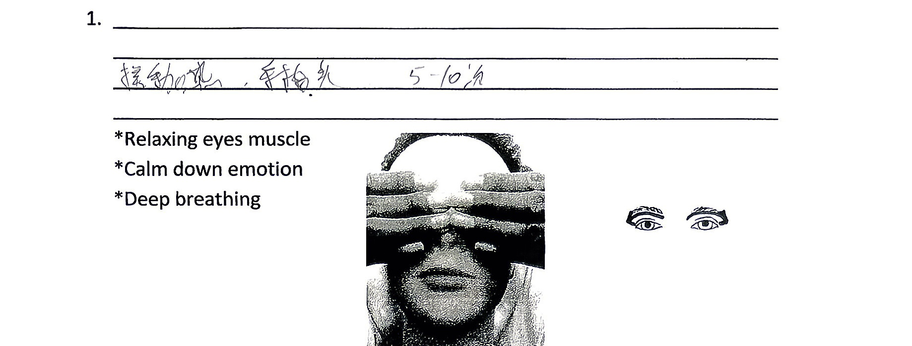

**中文步骤**

1. 双手相互搓动，使手掌温热。
2. 闭上双眼，将双手覆盖在双眼上，中指与无名指指尖对齐；后续刮拭全程保持闭眼。
3. 用中指和无名指的指肚，沿上眼眶从内侧向外侧刮拭。
4. 刮到外侧后，抬起手指回到内侧。
5. 重复由内向外刮拭、抬指回位的过程，共刮拭5–10次。

**补充说明：** 刮拭速度无规定。

**English instructions**

1. Rub your palms together until they feel warm.
2. Close your eyes and place your hands over them with the tips of your middle and ring fingers aligned. Keep your eyes closed throughout the strokes.
3. Using the pads of your middle and ring fingers, stroke along the upper rim of each eye socket from the inner side outward.
4. After reaching the outer side, lift your fingers away and return them to the inner starting position.
5. Repeat the outward stroke and lifted return, for a total of 5–10 outward strokes.

**Note:** No stroke speed is prescribed.

---

### SM-002 · 拇指固定与眼眶横扫转压

Thumb-supported eye-socket sweeps and circular presses

**部位：** 眼部　｜　**教材原编号：** 2　｜　**页码：** 1　｜　[整页原图](materials/textbook/source-pages/page-01.jpg) · [动作原图](materials/textbook/source-actions/source-002.jpg)

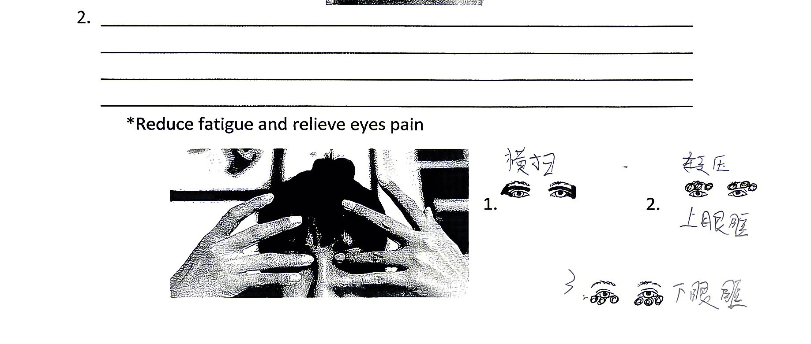

**中文步骤**

1. 全程闭眼，双手同时操作：两侧大拇指分别按住太阳穴，其余四指分开。
2. 只用无名指沿上眼眶从内向外横扫；到达外侧后抬起无名指回到内侧，再重复，共横扫5–10次。
3. 用无名指按内侧→中间→外侧的顺序，转压上眼眶三个点，每点旋转5–10圈。
4. 再按内侧→中间→外侧的顺序，转压下眼眶三个点，每点旋转5–10圈。

**补充说明：** 转压没有规定旋转方向。

**English instructions**

1. Close your eyes and keep them closed throughout the exercise. Use both hands simultaneously, holding each thumb against the temple on the same side and spreading the other four fingers apart.
2. Using only your ring fingers, sweep along the upper rims of both eye sockets from the inner sides outward at the same time. Lift the fingers away and return them to the inner starting positions after each stroke. Repeat for a total of 5–10 outward strokes.
3. Use your ring fingers to press with a circular motion at the inner, middle and outer points along the upper rims of both eye sockets, in that order, working on both sides simultaneously. Make 5–10 circles at each point.
4. Then repeat along the lower rims on both sides simultaneously, working from the inner points to the middle points, then the outer points. Make 5–10 circles at each point.

**Note:** No rotation direction is prescribed.

---

### SM-003 · 左右上下定向注视

Looking left, right, up and down

**部位：** 眼部　｜　**教材原编号：** 3　｜　**页码：** 1　｜　[整页原图](materials/textbook/source-pages/page-01.jpg) · [动作原图](materials/textbook/source-actions/source-003.jpg)

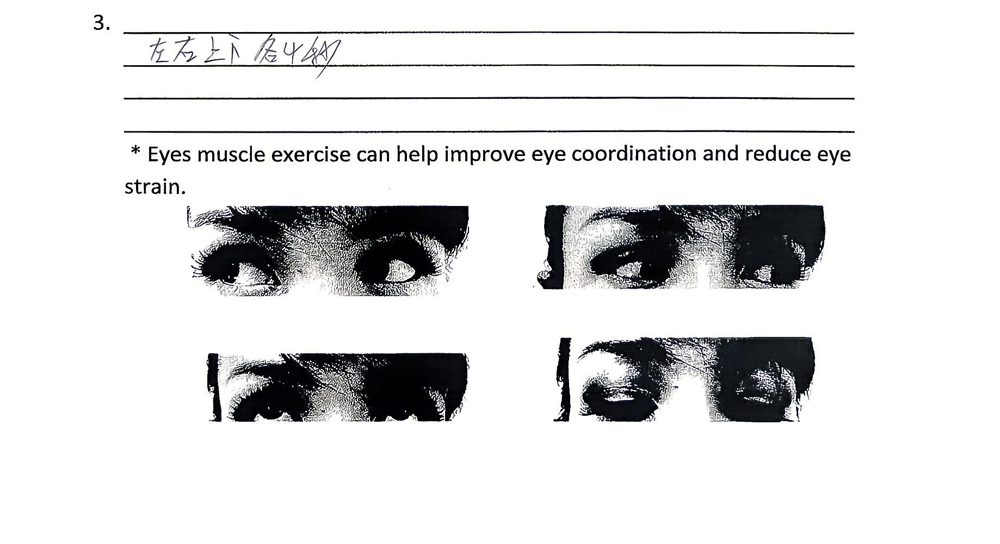

**中文步骤**

1. 头部保持不动，向左看，保持4–6秒。
2. 直接转为向右看，保持4–6秒。
3. 直接转为向上看，保持4–6秒。
4. 直接转为向下看，保持4–6秒，完成一轮。

**English instructions**

1. Keep your head still, look left and hold for 4–6 seconds.
2. Move your gaze directly to the right and hold for 4–6 seconds.
3. Move your gaze directly upward and hold for 4–6 seconds.
4. Move your gaze directly downward and hold for 4–6 seconds to complete the sequence.

---

### SM-004 · 眼球转动

Eye circles

**部位：** 眼部　｜　**教材原编号：** 4　｜　**页码：** 2　｜　[整页原图](materials/textbook/source-pages/page-02.jpg) · [动作原图](materials/textbook/source-actions/source-004.jpg)

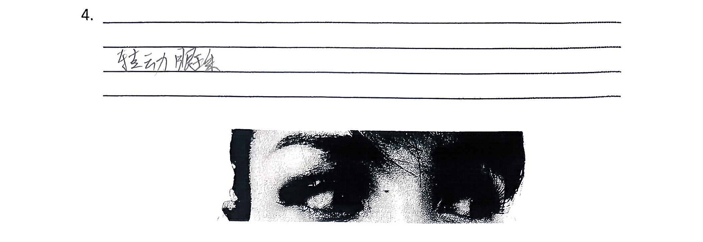

**中文步骤**

1. 头部保持不动，双眼睁开。
2. 双眼同步，尽可能大幅度地向一个方向转动5–10圈。
3. 直接反转，向相反方向再转5–10圈。

**补充说明：** 两个阶段方向相反即可，不限定先顺时针还是先逆时针；转动速度无规定。

**English instructions**

1. Keep your head still and both eyes open.
2. Move both eyes together through as wide a range as possible, making 5–10 circles in one direction.
3. Reverse directly and make another 5–10 circles in the opposite direction.

**Note:** Use opposite directions for the two stages; either direction may come first. No rotation speed is prescribed.

---

### SM-005 · 睁大双眼与快速眨眼

Wide-eye hold and rapid blinking

**部位：** 眼部　｜　**教材原编号：** 5　｜　**页码：** 2　｜　[整页原图](materials/textbook/source-pages/page-02.jpg) · [动作原图](materials/textbook/source-actions/source-005.jpg)

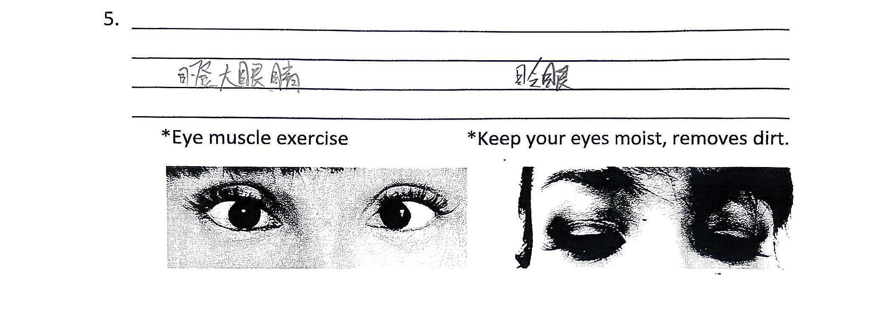

**中文步骤**

1. 头部保持不动，双眼同时尽可能大幅度地睁大。
2. 保持5–10秒。
3. 然后快速眨眼5–10次，完成一轮。
4. 重复“睁大并保持→快速眨眼”的组合，共做三轮。

**English instructions**

1. Keep your head still and open both eyes as wide as possible together.
2. Hold for 5–10 seconds.
3. Then blink rapidly 5–10 times to complete one round.
4. Repeat the combined wide-eye hold and rapid blinking sequence for a total of three rounds.

---

### SM-006 · 温掌敷眼与面部轻拍

Warmed palms, eye covering and gentle face tapping

**部位：** 眼部　｜　**教材原编号：** 6　｜　**页码：** 2　｜　[整页原图](materials/textbook/source-pages/page-02.jpg) · [动作原图](materials/textbook/source-actions/source-006.jpg)

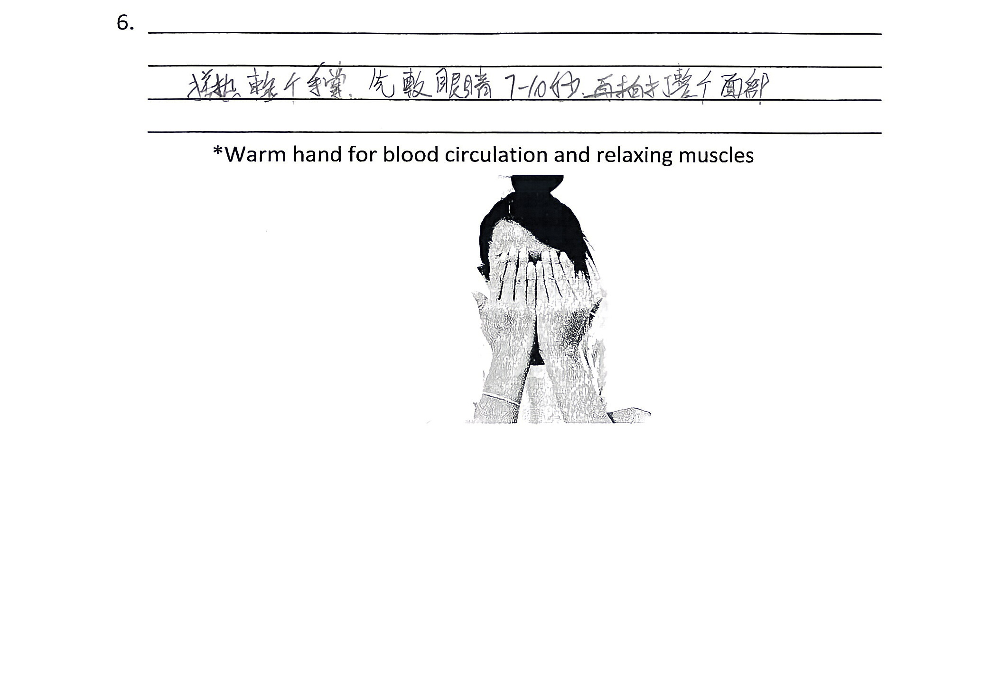

**中文步骤**

1. 全程保持闭眼，双手相互搓动，使整个手掌温热。
2. 用温热的双手敷眼睛，保持7–10秒。
3. 继续闭眼，用掌面、双手同时轻轻拍打整个面部各处。
4. 拍打没有固定顺序、次数或时长；完成上述整套动作一遍。

**English instructions**

1. Keep your eyes closed throughout and rub your hands together to warm the whole surface of both palms.
2. Cover your eyes with your warmed hands for 7–10 seconds.
3. Keeping your eyes closed, gently tap all areas of your face with the surfaces of both palms, using both hands simultaneously.
4. No fixed tapping order, number of taps or duration is prescribed. Complete the whole sequence once.

---

## 第 2 章 · 头面部

整理自《第二批头面部素材拆解》。

| 动作编号 | 动作名称 | 教材原编号 |
| --- | --- | --- |
| [SM-007](#sm-007) | 太阳穴旋转按揉与按压 | 7 |
| [SM-008](#sm-008) | 食指关节上提外眼角 | 8 |
| [SM-009](#sm-009) | 外眼角按压与转压 | 9 |
| [SM-010](#sm-010) | 食指关节沿眉刮拭 | 10 |
| [SM-011](#sm-011) | 眉部三点按压 | 11 |
| [SM-012](#sm-012) | 眉毛三点捏按 | 12 |
| [SM-013](#sm-013) | 上眼眶向头顶推抚 | 13 |
| [SM-014](#sm-014) | 眉上双指向外推拉 | 14 |
| [SM-015](#sm-015) | 额头多点转压与上推 | 15 |
| [SM-016](#sm-016) | 眉心、鼻部与下巴按压及呼吸组合 | 16 |
| [SM-017](#sm-017) | 下眼眶三点按压 | 17 |
| [SM-018](#sm-018) | 面部双弧线提拉 | 18 |
| [SM-019](#sm-019) | 下巴至太阳穴双线上提 | 19 |
| [SM-020](#sm-020) | 面部三组点位转压 | 20 |
| [SM-021](#sm-021) | 嘴唇周围逐点转压 | 21 |
| [SM-022](#sm-022) | 吸气屏息与嘴角外拉 | 22 |
| [SM-023](#sm-023) | 下颌线分点顶压 | 23（左图） |
| [SM-024](#sm-024) | 下颌线五点夹拉 | 23（右图） |
| [SM-025](#sm-025) | 双指指腹全脸拍打 | 24 |
| [SM-026](#sm-026) | 耳廓拇指转压 | 25（左图） |
| [SM-027](#sm-027) | 耳廓逐点外拉 | 25（中图） |
| [SM-028](#sm-028) | 温掌捂耳 | 25（右图） |

### SM-007 · 太阳穴旋转按揉与按压

Temple circles and pressing

**部位：** 面部　｜　**教材原编号：** 7　｜　**页码：** 3　｜　[整页原图](materials/textbook/source-pages/page-03.jpg) · [动作原图](materials/textbook/source-actions/source-007.jpg)

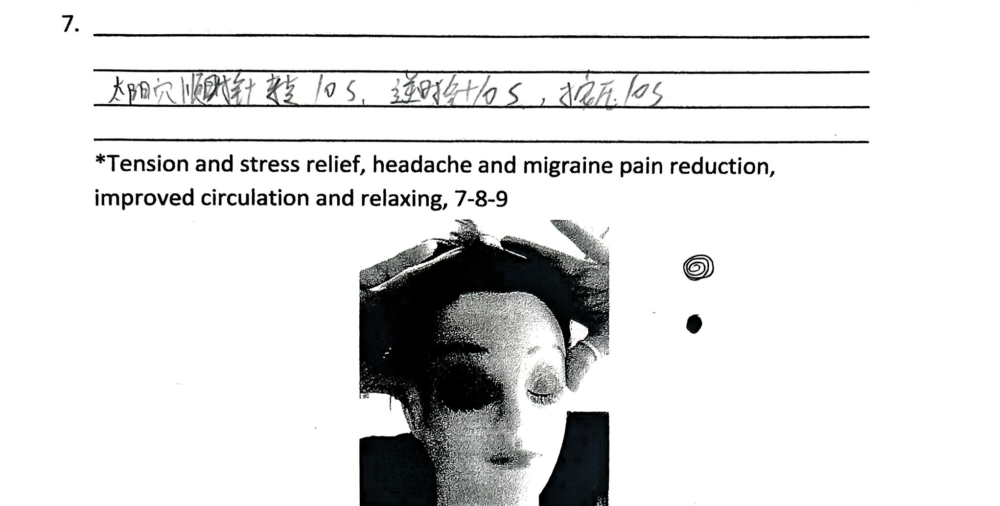

**中文步骤**

1. 全程闭眼，将两侧拇指指腹放在太阳穴，其余四指放在头顶，仅作支撑。
2. 两侧拇指同时、同向顺时针旋转按揉10秒。
3. 再同时、同向逆时针旋转按揉10秒。
4. 停止转揉，持续按住太阳穴10秒，完成一遍。

**English instructions**

1. Keep your eyes closed throughout. Place the pads of your thumbs against your temples, with the other four fingers of each hand resting on top of your head for support only.
2. Move both thumbs clockwise together, in the same direction, for 10 seconds.
3. Then move both thumbs counterclockwise together, in the same direction, for 10 seconds.
4. Stop the circular movement and hold a continuous press at the temples for 10 seconds to complete one sequence.

---

### SM-008 · 食指关节上提外眼角

Outer eye-corner lifts with the index-finger knuckle

**部位：** 面部　｜　**教材原编号：** 8　｜　**页码：** 3　｜　[整页原图](materials/textbook/source-pages/page-03.jpg) · [动作原图](materials/textbook/source-actions/source-008.jpg)

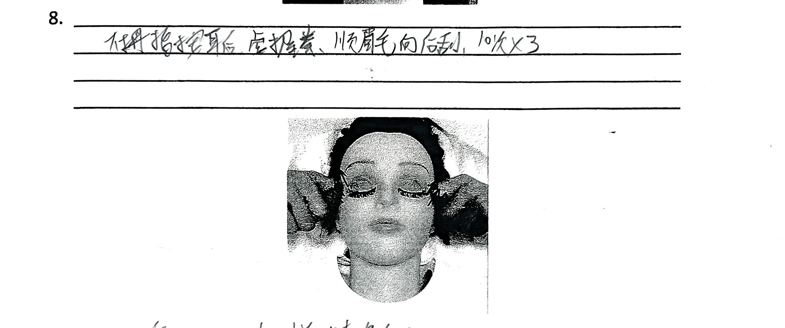

**中文步骤**

1. 全程闭眼，大拇指放在耳后，其余四指虚握，以食指第二关节背面接触外眼角。
2. 左右两侧同时上提外眼角，每次上提后放松回位。
3. 做10次，共1组；上提后停留时间没有规定。

**English instructions**

1. Keep your eyes closed throughout. Place your thumbs behind your ears, loosely curl the other four fingers, and place the backs of the second joints of your index fingers at the outer eye corners.
2. Lift both outer eye corners upward simultaneously. Relax and return to the starting position after each lift.
3. Complete 10 lifts for one set. No fixed hold time is prescribed.

---

### SM-009 · 外眼角按压与转压

Outer eye-corner presses and circles

**部位：** 面部　｜　**教材原编号：** 9　｜　**页码：** 3　｜　[整页原图](materials/textbook/source-pages/page-03.jpg) · [动作原图](materials/textbook/source-actions/source-009.jpg)

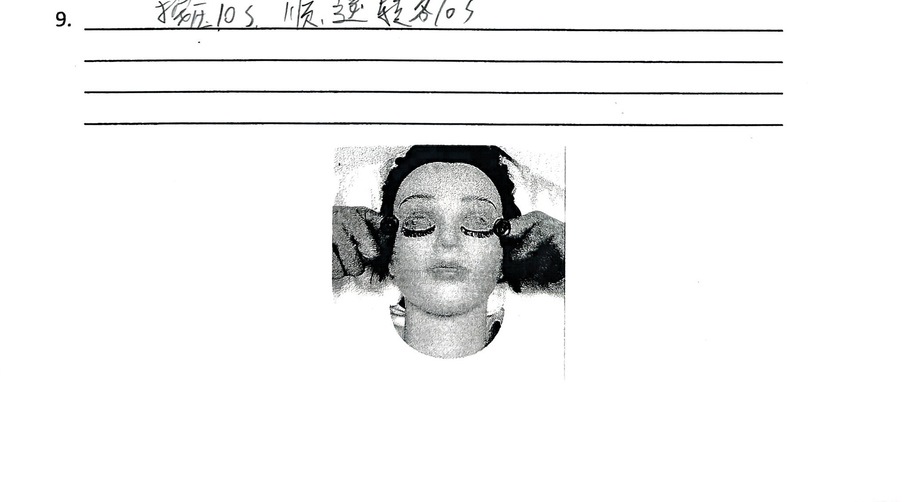

**中文步骤**

1. 全程闭眼，大拇指放在耳后，其余四指虚握，以食指第二关节背面接触外眼角旁。
2. 左右同时在原位持续按压10秒。
3. 两侧同时、同向顺时针转压10秒，再同向逆时针转压10秒，整套一遍；不保持上提。

**English instructions**

1. Keep your eyes closed throughout. Place your thumbs behind your ears, loosely curl the other four fingers, and place the backs of the second joints of your index fingers beside the outer eye corners.
2. Hold a continuous press in place on both sides simultaneously for 10 seconds.
3. Make clockwise circular presses on both sides simultaneously and in the same direction for 10 seconds, then counterclockwise circular presses for 10 seconds. Complete the sequence once, without holding the eye corners lifted.

---

### SM-010 · 食指关节沿眉刮拭

Eyebrow sweeps with the index-finger knuckle

**部位：** 面部　｜　**教材原编号：** 10　｜　**页码：** 4　｜　[整页原图](materials/textbook/source-pages/page-04.jpg) · [动作原图](materials/textbook/source-actions/source-010.jpg)

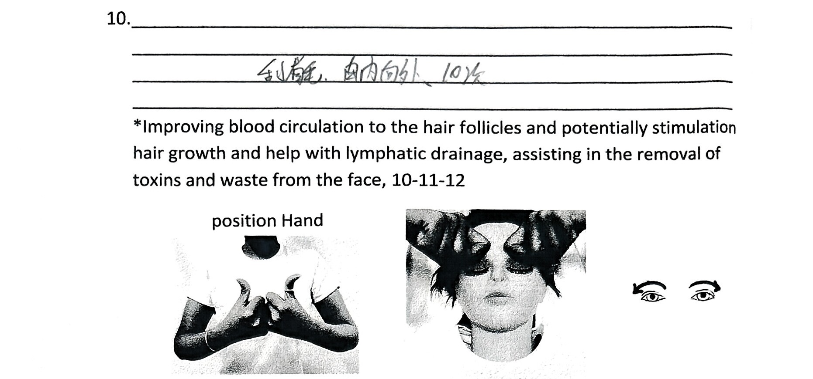

**中文步骤**

1. 全程闭眼，大拇指按在太阳穴，其余四指虚握拳。
2. 左右同时用食指中间关节背面沿眉毛从内向外刮拭。
3. 刮到外侧后，抬起食指回到内侧，再开始下一次。
4. 每组10次，共3组，组间休息没有规定。

**English instructions**

1. Keep your eyes closed throughout. Place your thumbs against your temples and loosely curl the other four fingers into fists.
2. Use the backs of the middle joints of your index fingers to sweep along both eyebrows simultaneously, from the inner ends outward.
3. After reaching the outer ends, lift your fingers away and return them to the inner starting positions before the next sweep.
4. Complete 10 sweeps per set for three sets. No fixed rest interval between sets is prescribed.

---

### SM-011 · 眉部三点按压

Three-point eyebrow presses

**部位：** 面部　｜　**教材原编号：** 11　｜　**页码：** 4　｜　[整页原图](materials/textbook/source-pages/page-04.jpg) · [动作原图](materials/textbook/source-actions/source-011.jpg)

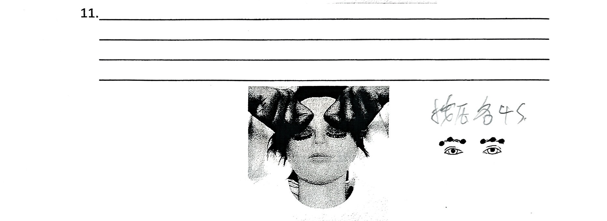

**中文步骤**

1. 全程闭眼，拇指按在太阳穴，其余四指虚握拳，用食指中间关节背面接触眉部。
2. 双手同时，依次在眉毛内侧、中间、外侧三个点持续按压，每点按住4–6秒。
3. 内侧→中间→外侧做完算一遍，整套共做2–3遍。

**English instructions**

1. Keep your eyes closed throughout. Place your thumbs against your temples, loosely curl the other four fingers into fists, and use the backs of the middle joints of your index fingers to contact the eyebrows.
2. Work both sides simultaneously. Hold a continuous press at the inner, middle and outer points of each eyebrow, in that order, for 4–6 seconds per point.
3. Pressing all three points completes one sequence. Complete a total of 2–3 sequences.

---

### SM-012 · 眉毛三点捏按

Three-point eyebrow pinches

**部位：** 面部　｜　**教材原编号：** 12　｜　**页码：** 4　｜　[整页原图](materials/textbook/source-pages/page-04.jpg) · [动作原图](materials/textbook/source-actions/source-012.jpg)

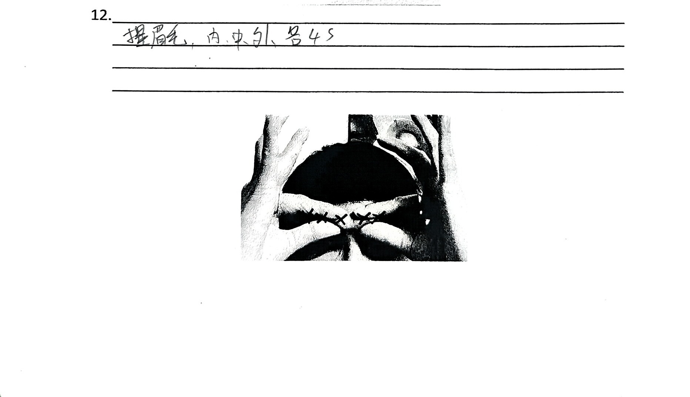

**中文步骤**

1. 全程闭眼，双手同时操作。拇指放在眉毛下方，食指放在上方，用两指指腹夹捏眉毛处的组织。
2. 按内侧→中间→外侧顺序，依次持续捏住三个点，每点4–6秒。
3. 三个点全部完成算一遍，整套只做一遍。

**English instructions**

1. Keep your eyes closed throughout and work both sides simultaneously. Place each thumb below the eyebrow and the index finger above it, using the finger pads to pinch the tissue at the eyebrow.
2. Move from the inner point to the middle and then the outer point, holding each pinch continuously for 4–6 seconds.
3. Pinching all three points completes one sequence. Complete the sequence once.

---

### SM-013 · 上眼眶向头顶推抚

Upward strokes from the upper orbital rims to the crown

**部位：** 面部　｜　**教材原编号：** 13　｜　**页码：** 5　｜　[整页原图](materials/textbook/source-pages/page-05.jpg) · [动作原图](materials/textbook/source-actions/source-013.jpg)

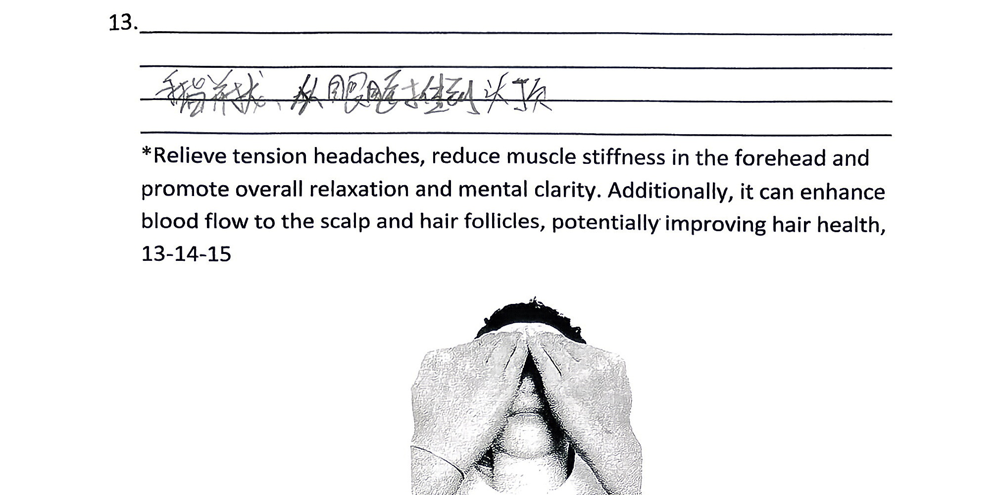

**中文步骤**

1. 全程闭眼，双手除拇指外的四指并拢，用指腹按住上眼眶。
2. 双手同时从上眼眶沿额头向上推，越过发际线，推到头顶。
3. 到头顶后抬手，回到上眼眶，再开始下一次向上推；头顶停留时间没有规定。
4. 向上推8–10次，共1组。

**English instructions**

1. Keep your eyes closed throughout. Bring the four fingers of each hand together, excluding the thumb, and place the finger pads against the upper orbital rims.
2. Move both hands simultaneously upward along the forehead, past the hairline, to the crown of the head.
3. Lift your hands away at the crown and return them to the upper orbital rims before the next upward stroke. No fixed hold time at the crown is prescribed.
4. Complete 8–10 upward strokes for one set.

---

### SM-014 · 眉上双指向外推拉

Outward strokes above the eyebrows with two fingers

**部位：** 面部　｜　**教材原编号：** 14　｜　**页码：** 5　｜　[整页原图](materials/textbook/source-pages/page-05.jpg) · [动作原图](materials/textbook/source-actions/source-014.jpg)

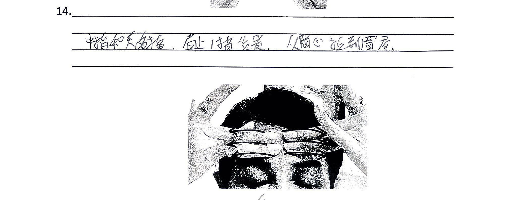

**中文步骤**

1. 全程闭眼，中指和无名指并拢，用两指指腹按在眉毛上方一指宽处。
2. 左右两侧同时，从眉心一侧向外拉到眉尖一侧。
3. 向外拉完后抬手，回到眉心一侧，再开始下一次；回位时不沿皮肤向内拉。
4. 每组8–10次，共2–3组，组间休息没有规定。

**English instructions**

1. Keep your eyes closed throughout. Bring your middle and ring fingers together and place their pads one finger-width above your eyebrows.
2. Work both sides simultaneously, pulling outward from the inner brow area toward the outer ends of the eyebrows.
3. After each outward stroke, lift your fingers away and return them to the inner starting positions before the next stroke, without pulling inward along the skin.
4. Complete 8–10 strokes per set for 2–3 sets. No fixed rest interval between sets is prescribed.

---

### SM-015 · 额头多点转压与上推

Forehead circular presses and upward strokes

**部位：** 面部　｜　**教材原编号：** 15　｜　**页码：** 5　｜　[整页原图](materials/textbook/source-pages/page-05.jpg) · [动作原图](materials/textbook/source-actions/source-015.jpg)

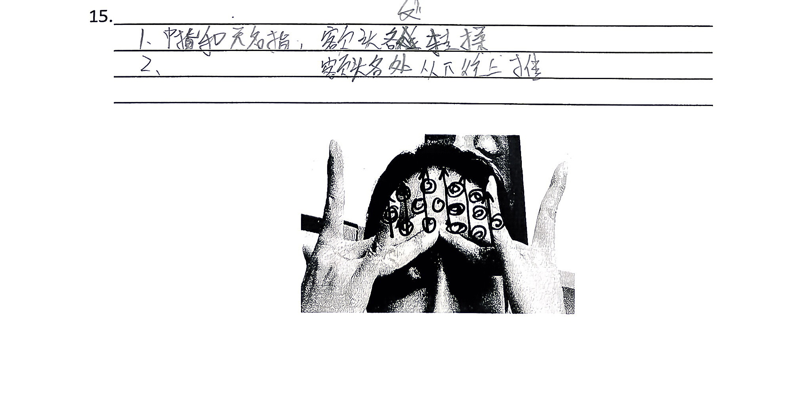

**中文步骤**

1. 全程闭眼，左右同时操作。中指和无名指并拢，用两指指腹在额头各处转压，每点4–6圈。点位、顺序、旋转方向及两侧旋转方向配合均无固定要求。
2. 整个额头转压完成后，再进行上推；仍用并拢的中指和无名指指腹，从眼眶处向上推到发际线附近。
3. 在额头不同位置分别上推，每个位置4–6次，覆盖整个额头。每次推完后抬手回到起始位置，再开始下一次。
4. 上推的时间及停留时间没有固定规定，转压与上推整套共做一遍。

**English instructions**

1. Keep your eyes closed and work both sides simultaneously. Bring your middle and ring fingers together and use their pads to apply circular pressure across the forehead, making 4–6 circles at each point. No fixed point locations, point sequence, rotation direction or directional relationship between sides is prescribed.
2. Finish circular pressing across the whole forehead before beginning the upward strokes. Keep the same finger position and contact surface, moving upward from the orbital rim area to approximately the hairline.
3. Apply 4–6 upward strokes at each position, working across the entire forehead. After each stroke, lift your fingers away and return them to the starting position.
4. No fixed stroke duration or hold time is prescribed. Complete the entire circular-pressing and upward-stroking routine once.

---

### SM-016 · 眉心、鼻部与下巴按压及呼吸组合

Brow, nose and chin presses with breathing

**部位：** 面部　｜　**教材原编号：** 16　｜　**页码：** 6　｜　[整页原图](materials/textbook/source-pages/page-06.jpg) · [动作原图](materials/textbook/source-actions/source-016.jpg)

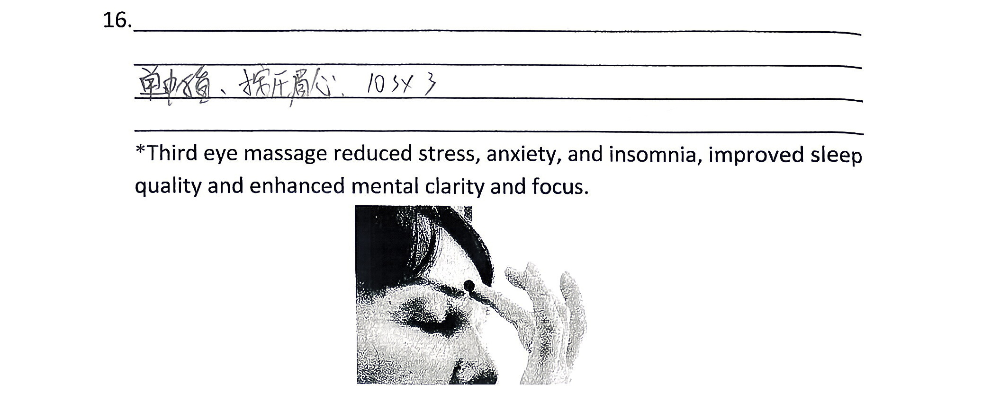

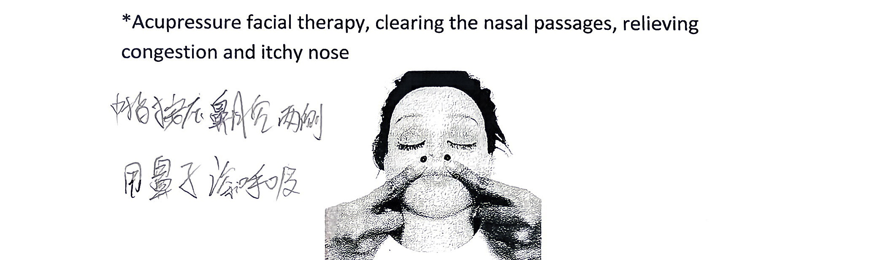

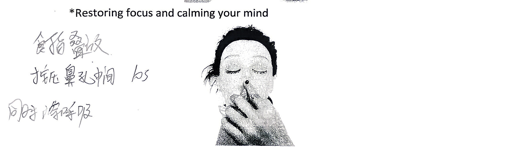

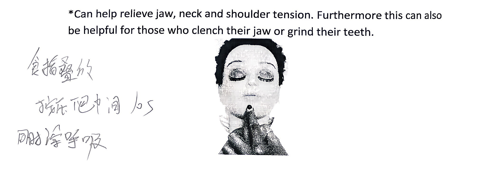

**中文步骤**

1. 全程闭眼，用单手中指指腹按压眉心，每次10秒，做3次。
2. 双手中指指腹同时按住鼻翼两侧，同时用鼻子深呼吸；每次10秒，做3次。
3. 两手食指叠放，用下面食指的指腹按压两个鼻孔之间、鼻子底部中间的小柱状部位，同时用鼻子深呼吸；每次10秒，做3次。
4. 两手食指叠放，用下面食指的指腹按压下唇正下方的凹陷，同时用嘴深呼吸；每次10秒，做3次。

**English instructions**

1. Keep your eyes closed throughout. Press between the eyebrows with the pad of one middle finger for 10 seconds, repeating three times.
2. Use the pads of both middle fingers to press beside the nasal wings simultaneously while breathing deeply through the nose. Press for 10 seconds each time, repeating three times.
3. Stack your index fingers and use the pad of the lower index finger to press the small column between the nostrils at the base of the nose while breathing deeply through the nose. Press for 10 seconds each time, repeating three times.
4. Stack your index fingers and use the pad of the lower index finger to press the hollow directly below the lower lip while breathing deeply through the mouth. Press for 10 seconds each time, repeating three times.

---

### SM-017 · 下眼眶三点按压

Three-point presses along the lower orbital rim

**部位：** 面部　｜　**教材原编号：** 17　｜　**页码：** 7　｜　[整页原图](materials/textbook/source-pages/page-07.jpg) · [动作原图](materials/textbook/source-actions/source-017.jpg)

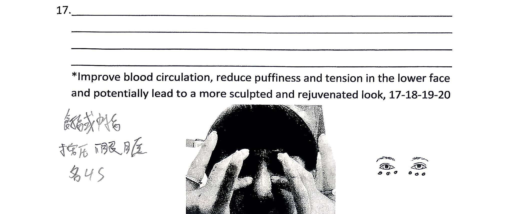

**中文步骤**

1. 全程闭眼，五指张开，选择食指或中指，用所选手指的指腹接触下眼眶。
2. 左右两侧同时，按内侧→中间→外侧顺序按压下眼眶三个点，每点持续按住4–6秒。
3. 三个点完成算一遍，整套共做2–3遍。

**English instructions**

1. Keep your eyes closed throughout and spread all five fingers. Choose either the index finger or the middle finger, using its pad to contact the lower orbital rim.
2. Work both sides simultaneously. Press the inner, middle and outer points along each lower orbital rim in that order, holding each point continuously for 4–6 seconds.
3. Pressing all three points completes one sequence. Complete a total of 2–3 sequences.

---

### SM-018 · 面部双弧线提拉

Two-arc facial lifts

**部位：** 面部　｜　**教材原编号：** 18　｜　**页码：** 7　｜　[整页原图](materials/textbook/source-pages/page-07.jpg) · [动作原图](materials/textbook/source-actions/source-018.jpg)

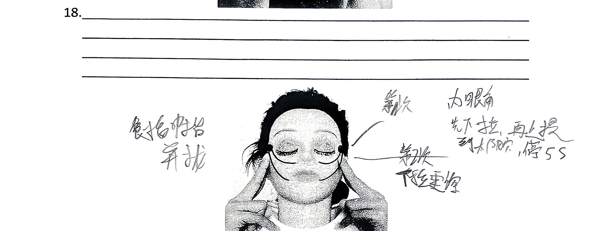

**中文步骤**

1. 全程闭眼，食指和中指并拢，以两指指腹接触，左右两侧同时操作。
2. 先从内眼角处下拉，弧线最低大致到鼻尖高度，再沿弧线上提到太阳穴，保持接触停留5秒。
3. 抬手移到嘴角处，向下拉到大致下巴高度，再沿更大的弧线上提到太阳穴，保持接触停留5秒。
4. 两条弧线依次各完成一次算一轮，共做2–3轮；每条弧线结束后抬手移到下一起点。

**English instructions**

1. Keep your eyes closed throughout. Bring your index and middle fingers together and use their pads, working both sides simultaneously.
2. Start at the inner eye corners and pull downward to approximately nose-tip height, then follow an upward arc to the temples. Maintain contact there for 5 seconds.
3. Lift your fingers away and move to the mouth corners. Pull downward to approximately chin height, then follow a larger upward arc to the temples. Maintain contact there for 5 seconds.
4. Completing each arc once, in order, makes one round. Complete 2–3 rounds, lifting your fingers away after each arc to move to the next starting point.

---

### SM-019 · 下巴至太阳穴双线上提

Chin-to-temple lifts along two paths

**部位：** 面部　｜　**教材原编号：** 19　｜　**页码：** 7　｜　[整页原图](materials/textbook/source-pages/page-07.jpg) · [动作原图](materials/textbook/source-actions/source-019.jpg)

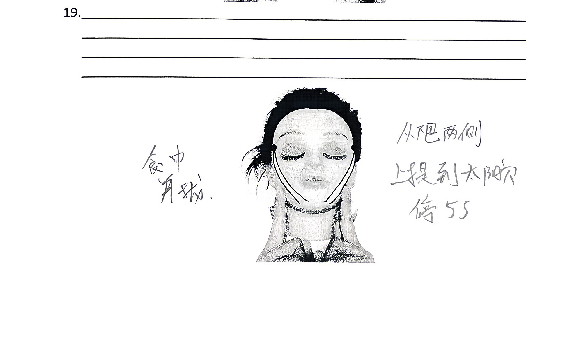

**中文步骤**

1. 全程闭眼，食指和中指并拢，用两指指腹按住下巴两侧，左右同时操作。
2. 先沿原图中较靠脸中央的内线上提至太阳穴，保持接触停留5秒，再抬手回到下巴。
3. 再沿较靠脸外侧的外线上提至太阳穴，保持接触停留5秒，再抬手回到下巴。
4. 内线、外线依次各完成一次算一组，共做2–3组。

**English instructions**

1. Keep your eyes closed throughout. Bring your index and middle fingers together and place their pads on both sides of the chin, working both sides simultaneously.
2. First follow the inner path, closer to the center of the face as shown in the source image, upward to the temples. Maintain contact for 5 seconds, then lift your fingers away and return to the chin.
3. Next follow the outer path, closer to the sides of the face, upward to the temples. Maintain contact for 5 seconds, then lift your fingers away and return to the chin.
4. Completing the inner path once and then the outer path once makes one set. Complete 2–3 sets.

---

### SM-020 · 面部三组点位转压

Circular presses at three pairs of facial points

**部位：** 面部　｜　**教材原编号：** 20　｜　**页码：** 8　｜　[整页原图](materials/textbook/source-pages/page-08.jpg) · [动作原图](materials/textbook/source-actions/source-020.jpg)

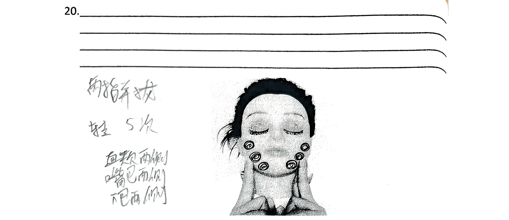

**中文步骤**

1. 全程闭眼，食指和中指并拢，用两指指腹接触，左右两侧同时操作。
2. 从上到下依次转压面颊两侧、嘴巴两侧、下巴两侧三组点位，每点转5圈。旋转方向及两侧同向或镜像配合没有规定。
3. 三组点位全部完成后结束，整套一遍，不重复。

**English instructions**

1. Keep your eyes closed throughout. Bring your index and middle fingers together and use their pads, working both sides simultaneously.
2. Apply circular pressure from top to bottom at three pairs of points: the sides of the cheeks, the sides of the mouth, and the sides of the chin. Make 5 circles at each point. No rotation direction or directional relationship between sides is prescribed.
3. Complete all three pairs of points once, without repeating the sequence.

---

### SM-021 · 嘴唇周围逐点转压

Circular presses around the lips

**部位：** 面部　｜　**教材原编号：** 21　｜　**页码：** 8　｜　[整页原图](materials/textbook/source-pages/page-08.jpg) · [动作原图](materials/textbook/source-actions/source-021.jpg)

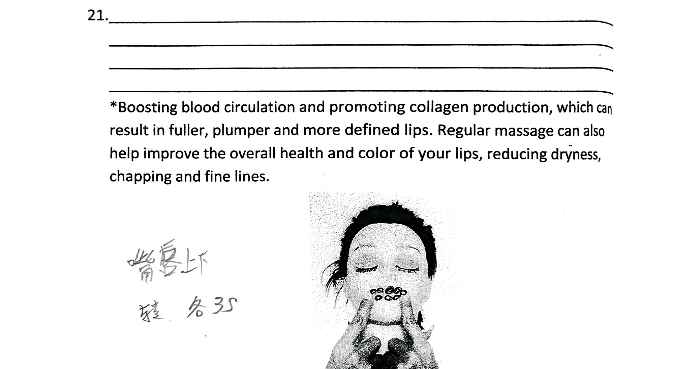

**中文步骤**

1. 全程闭眼，用双手食指指腹，同时沿嘴唇外缘逐点转压。
2. 每点转压3秒，旋转方向无要求。点位数量、起点和先后顺序没有固定规定，覆盖嘴唇外缘一圈即可。
3. 覆盖一圈算一遍，整套共做2–3遍。

**English instructions**

1. Keep your eyes closed throughout. Use the pads of both index fingers to apply circular pressure at points along the outer border of the lips, working both hands simultaneously.
2. Spend 3 seconds at each point. No rotation direction, fixed point count, starting point or point sequence is prescribed; cover the entire outer border of the lips.
3. Covering the outer border once completes one sequence. Complete 2–3 sequences.

---

### SM-022 · 吸气屏息与嘴角外拉

Mouth-corner pulls with a held breath

**部位：** 面部　｜　**教材原编号：** 22　｜　**页码：** 8　｜　[整页原图](materials/textbook/source-pages/page-08.jpg) · [动作原图](materials/textbook/source-actions/source-022.jpg)

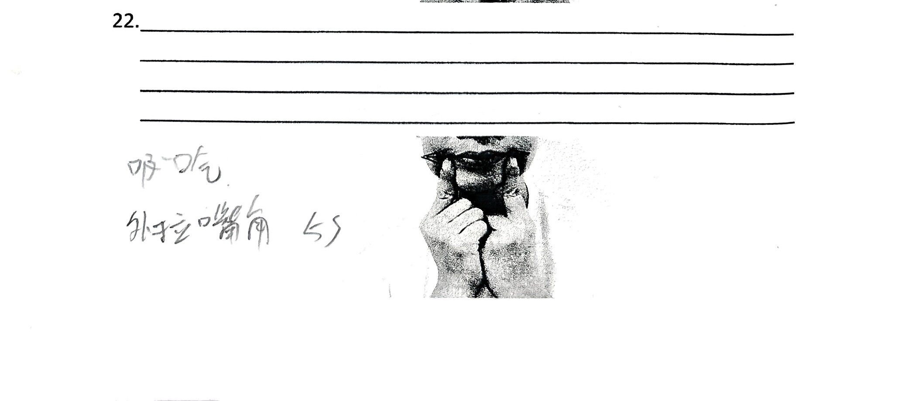

**中文步骤**

1. 全程闭眼，用鼻子或嘴吸一口气，随后闭嘴憋住，无须鼓起腮帮。
2. 将双手食指指腹按在嘴角外侧，手指留在口外，左右同时向外拉，保持5秒。
3. 松手、呼气，再重新吸气开始下一次，共做4–6次。

**English instructions**

1. Keep your eyes closed throughout. Take a breath through either the nose or the mouth, then close your mouth and hold the breath. Puffing the cheeks is not required.
2. Place the pads of both index fingers against the outside of the mouth corners, keeping the fingers outside the mouth. Pull both sides outward simultaneously and hold for 5 seconds.
3. Release the fingers and exhale, then take a new breath for the next repetition. Complete 4–6 repetitions.

---

### SM-023 · 下颌线分点顶压

Point-by-point jawline presses

**部位：** 面部　｜　**教材原编号：** 23（左图）　｜　**页码：** 9　｜　[整页原图](materials/textbook/source-pages/page-09.jpg) · [动作原图](materials/textbook/source-actions/source-023.jpg)

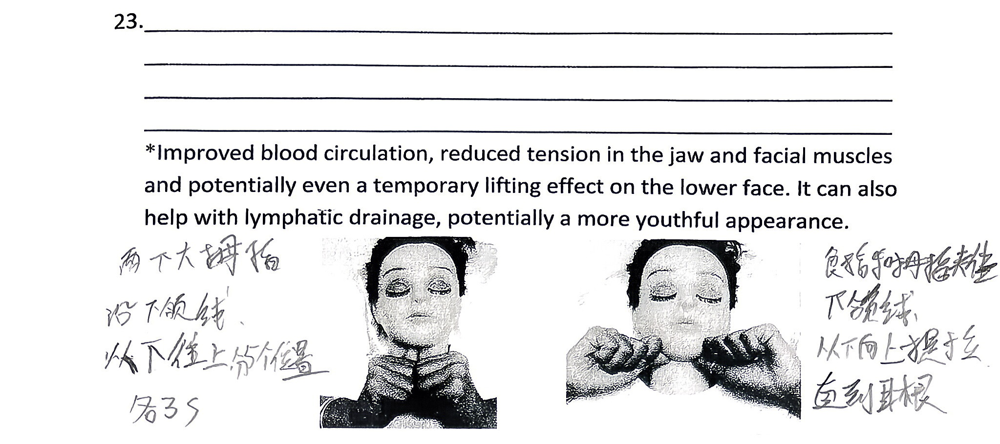

**中文步骤**

1. 全程闭眼，左右同时。将双拇指指腹放在下颌线下方，从下往上顶压。
2. 从下巴中央两侧沿下颌线向耳根方向，由内向外各分五个点，每点保持3秒。
3. 五点完成算一组，共做2–3组。

**English instructions**

1. Keep your eyes closed and work both sides simultaneously. Place the pads of both thumbs below the jawline and press upward.
2. Work outward from either side of the center of the chin toward the ears, pressing five points on each side. Hold each point for 3 seconds.
3. Completing the five points makes one set. Complete 2–3 sets.

---

### SM-024 · 下颌线五点夹拉

Five-point jawline pinch lifts

**部位：** 面部　｜　**教材原编号：** 23（右图）　｜　**页码：** 9　｜　[整页原图](materials/textbook/source-pages/page-09.jpg) · [动作原图](materials/textbook/source-actions/source-023.jpg)

**中文步骤**

1. 全程闭眼，左右同时。拇指放在下颌线下方，食指在上方，用弯曲后的食指关节与拇指夹住下颌线。
2. 从下巴到耳根，左右各分五个点。每点向远离脸部的方向拉起，保持3秒。
3. 松开后换到下一个点；五点全部完成算一组，共做2–3组。

**English instructions**

1. Keep your eyes closed and work both sides simultaneously. Place each thumb below the jawline and the bent index-finger knuckle above it to pinch the jawline.
2. Work at five points on each side, moving from the chin toward the ears. At each point, lift outward away from the face and hold for 3 seconds.
3. Release before moving to the next point. Completing all five points makes one set. Complete 2–3 sets.

---

### SM-025 · 双指指腹全脸拍打

Whole-face tapping with two finger pads

**部位：** 面部　｜　**教材原编号：** 24　｜　**页码：** 9　｜　[整页原图](materials/textbook/source-pages/page-09.jpg) · [动作原图](materials/textbook/source-actions/source-024.jpg)

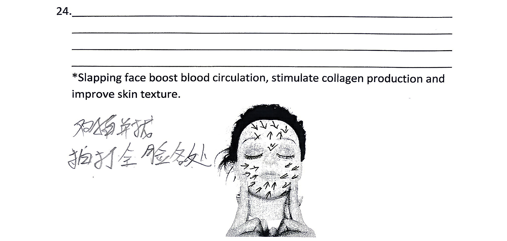

**中文步骤**

1. 全程闭眼，双手食指和中指并拢，用两指指腹同时拍打全脸各处。
2. 拍打没有固定顺序，覆盖全脸即可；次数和时长没有规定。
3. 整套做一遍。

**English instructions**

1. Keep your eyes closed throughout. Bring the index and middle fingers of each hand together and use their pads to tap across the whole face with both hands simultaneously.
2. No fixed tapping order, number of taps or duration is prescribed; cover the whole face.
3. Complete the routine once.

---

### SM-026 · 耳廓拇指转压

Thumb circular presses along the outer ear

**部位：** 耳部　｜　**教材原编号：** 25（左图）　｜　**页码：** 9　｜　[整页原图](materials/textbook/source-pages/page-09.jpg) · [动作原图](materials/textbook/source-actions/source-025.jpg)

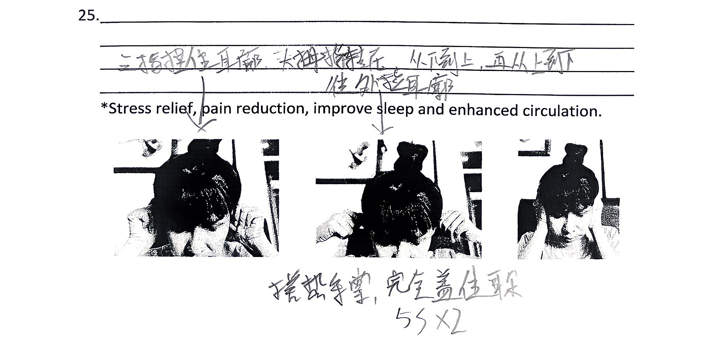

**中文步骤**

1. 全程闭眼，左右同时操作。拇指在耳廓后，食指和中指在前，用三指指腹捏住耳廓。
2. 从耳垂开始向上逐点用拇指转压，每点3秒；到耳廓最上端后，再从上向下逐点转压至耳垂。旋转方向无要求。
3. 从下到上再从上到下为一轮，共做2–3轮。

**English instructions**

1. Keep your eyes closed throughout and work both sides simultaneously. Place each thumb behind the outer ear, with the index and middle fingers in front, holding the outer ear between the finger pads.
2. Starting at the earlobe, make circular presses with the thumb at successive points, spending 3 seconds at each point. Work up to the top of the outer ear, then back down point by point to the earlobe. No rotation direction is prescribed.
3. The upward and downward passes together make one round. Complete 2–3 rounds.

---

### SM-027 · 耳廓逐点外拉

Point-by-point outward ear pulls

**部位：** 耳部　｜　**教材原编号：** 25（中图）　｜　**页码：** 9　｜　[整页原图](materials/textbook/source-pages/page-09.jpg) · [动作原图](materials/textbook/source-actions/source-025.jpg)

**中文步骤**

1. 全程闭眼，左右同时操作。拇指在耳廓后，食指和中指在前，用三指指腹捏住耳廓。
2. 从下到上逐点向外拉，每点保持3秒，松开后再换下一个点。点位数量无固定要求，覆盖整个耳廓即可。
3. 从下到上覆盖整个耳廓为一轮，共做2–3轮。

**English instructions**

1. Keep your eyes closed throughout and work both sides simultaneously. Place each thumb behind the outer ear, with the index and middle fingers in front, holding the outer ear between the finger pads.
2. Work upward point by point. Pull outward and hold for 3 seconds at each point, then release before moving to the next point. No fixed number of points is prescribed; cover the whole outer ear.
3. One upward pass covering the whole outer ear makes one round. Complete 2–3 rounds.

---

### SM-028 · 温掌捂耳

Covering the ears with warmed hands

**部位：** 耳部　｜　**教材原编号：** 25（右图）　｜　**页码：** 9　｜　[整页原图](materials/textbook/source-pages/page-09.jpg) · [动作原图](materials/textbook/source-actions/source-025.jpg)

**中文步骤**

1. 全程闭眼，双手搓热后完全捂住双耳，保持5秒。
2. 每轮都重新搓热双手，再捂住双耳5秒，共做2–3轮。

**English instructions**

1. Keep your eyes closed throughout. Rub your hands together to warm them, then cover both ears completely for 5 seconds.
2. Warm your hands again before each round, then cover both ears for 5 seconds. Complete 2–3 rounds.

---

## 第 3 章 · 颈部、头皮与肩部

整理自《第三批颈部头皮肩部素材拆解》。

| 动作编号 | 动作名称 | 教材原编号 |
| --- | --- | --- |
| [SM-029](#sm-029) | 后颈四点拇指转压 | 26 |
| [SM-030](#sm-030) | 单手四指颈部肌肉牵拉 | 27 |
| [SM-031](#sm-031) | 后颈双掌夹提 | 28 |
| [SM-032](#sm-032) | 扶额与头颈交界按压抬头 | 29 |
| [SM-033](#sm-033) | 拇指定点向上顶提头部 | 30 |
| [SM-034](#sm-034) | 扶头侧压与保持 | 31 |
| [SM-035](#sm-035) | 头颈双向绕圈 | 32 |
| [SM-036](#sm-036) | 双拇指顶下巴与头部后仰 | 33 |
| [SM-037](#sm-037) | 双手压头与低头保持 | 34 |
| [SM-038](#sm-038) | 耳上至太阳穴头皮转压 | 35 |
| [SM-039](#sm-039) | 耳后至颈部区域转压 | 36 |
| [SM-040](#sm-040) | 后脑区域拇指转压 | 37 |
| [SM-041](#sm-041) | 双手五指抓捏头皮 | 38 |
| [SM-042](#sm-042) | 指缝夹发上提 | 39 |
| [SM-043](#sm-043) | 对侧肩部两区域抓捏 | 40 |
| [SM-044](#sm-044) | 屈臂后压与转体保持 | 41 |
| [SM-045](#sm-045) | 大臂按压放松与肩部侧向拉伸 | 42 |

### SM-029 · 后颈四点拇指转压

Four-point thumb circular presses along the back of the neck

**部位：** 颈部　｜　**教材原编号：** 26　｜　**页码：** 10　｜　[整页原图](materials/textbook/source-pages/page-10.jpg) · [动作原图](materials/textbook/source-actions/source-026.jpg)

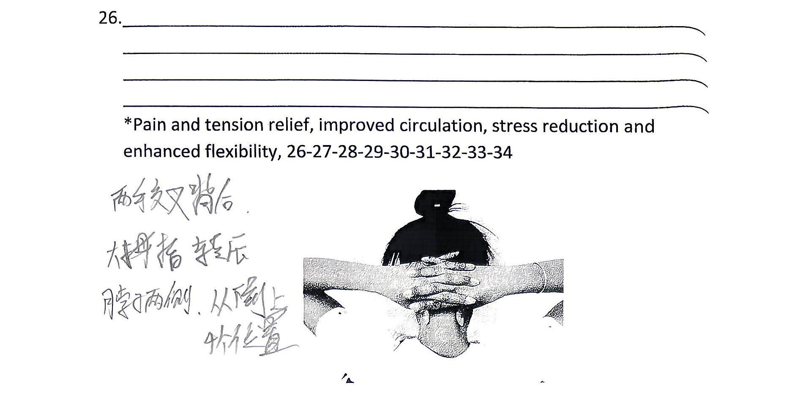

**中文步骤**

1. 全程闭眼，头部自然直立。双手交叉放在脑后，其余手指只作支撑，用两侧拇指指腹同时转压后颈。
2. 从后颈上端到脖子根部，由上到下依次做四个点位，每个点位转压8–10圈。旋转方向无要求。
3. 四个点位做完为一遍，整套只做一遍。呼吸无固定要求，力度以自己舒服为准。

**English instructions**

1. Keep your eyes closed throughout and your head naturally upright. Cross your hands behind your head, using the other fingers only for support. Use the pads of both thumbs to make circular presses on both sides of the back of the neck simultaneously.
2. Work downward through four points on each side, from the upper back of the neck to its base. Make 8–10 circles at each point. No rotation direction is prescribed.
3. Complete the four-point sequence once. No breathing pattern is prescribed. Adjust the pressure to what feels comfortable.

---

### SM-030 · 单手四指颈部肌肉牵拉

One-hand four-finger neck muscle pulls

**部位：** 颈部　｜　**教材原编号：** 27　｜　**页码：** 10　｜　[整页原图](materials/textbook/source-pages/page-10.jpg) · [动作原图](materials/textbook/source-actions/source-027.jpg)

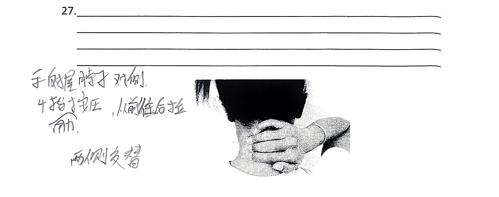

**中文步骤**

1. 头部自然直立，睁眼或闭眼均可。用一只手握住脖子，以食指、中指、无名指和小指的指腹按住对侧颈部肌肉，拇指只作支撑。
2. 以右手为例：四指指腹按住左侧颈部肌肉，弯曲四指，同时用手臂带动，将被按住的肌肉向右侧牵拉，保持3秒后松开。
3. 同侧始终在同一位置重复牵拉，不沿脖子上下换点。完成5–10次后换手：左手四指指腹按住右侧颈部肌肉，向左牵拉，每次保持3秒后松开，同样做5–10次。
4. 左右各完成5–10次为一轮，整套只做一轮。呼吸无固定要求，力度以自己感觉舒服为准。

**English instructions**

1. Keep your head naturally upright. Your eyes may be open or closed. Hold your neck with one hand, placing the pads of the index, middle, ring and little fingers against the neck muscles on the opposite side. Use the thumb only for support.
2. For example, with the right hand, place the four finger pads against the left-side neck muscles. Bend the fingers and use the arm to draw the contacted muscles toward the right. Hold for 3 seconds, then release.
3. Repeat at the same location without moving up or down the neck. After 5–10 pulls, switch hands. Use the left hand to contact the right-side neck muscles and draw them toward the left, holding for 3 seconds before releasing each time. Complete 5–10 pulls on this side as well.
4. Completing 5–10 pulls on each side makes one round. Complete one round only. No breathing pattern is prescribed. Adjust the pressure to what feels comfortable.

---

### SM-031 · 后颈双掌夹提

Back-of-neck squeeze and lift with both palms

**部位：** 颈部　｜　**教材原编号：** 28　｜　**页码：** 10　｜　[整页原图](materials/textbook/source-pages/page-10.jpg) · [动作原图](materials/textbook/source-actions/source-028.jpg)

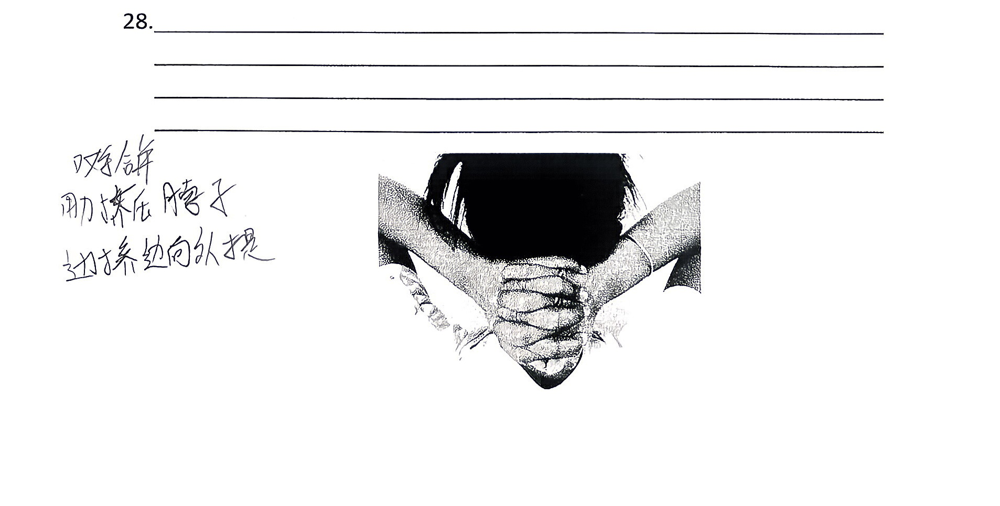

**中文步骤**

1. 头部自然直立，睁眼或闭眼均可。双手十指交叉放在后颈，用掌心挤压后颈肌肉。
2. 一边挤压，一边将夹住的肌肉向后提起，方向为远离后颈；保持3–5秒后松开。
3. 在同一位置重新夹住并向后提，不沿脖子上下换点。共做5–10次，1组。
4. 呼吸无固定要求，力度以自己感觉舒服为准。

**English instructions**

1. Keep your head naturally upright. Your eyes may be open or closed. Interlace all ten fingers behind your neck and use your palms to squeeze the muscles at the back of the neck.
2. While squeezing, lift the held tissue backward, away from the back of the neck. Hold for 3–5 seconds, then release.
3. Grasp and lift again at the same location without moving up or down the neck. Complete one set of 5–10 repetitions.
4. No breathing pattern is prescribed. Adjust the pressure to what feels comfortable.

---

### SM-032 · 扶额与头颈交界按压抬头

Forehead-supported head raise with pressure at the head–neck junction

**部位：** 颈部　｜　**教材原编号：** 29　｜　**页码：** 11　｜　[整页原图](materials/textbook/source-pages/page-11.jpg) · [动作原图](materials/textbook/source-actions/source-029.jpg)

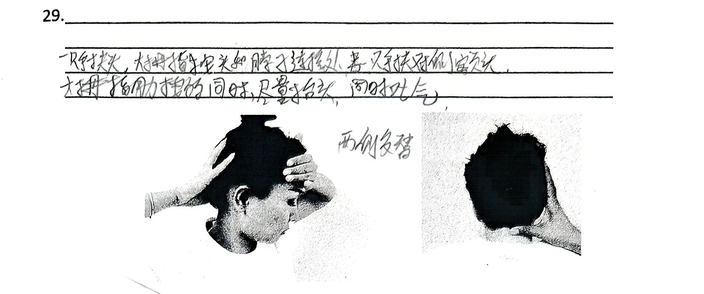

**中文步骤**

1. 头部自然直立，睁眼或闭眼均可。以右侧为例：左手扶住左侧额头，右手拇指指腹放在右侧脖子与头的交界处，右手其余四指扶住后脑。
2. 先吸一口气，再用拇指指腹持续按住同一个点，同时抬头；抬头及保持姿势期间持续吐气，保持5–10秒。拇指不转揉、不滑动。
3. 每次结束后松开拇指，头回到自然直立的起始位置，再开始下一次。
4. 同侧完成4–6次后换侧，双手作用对调：右手扶右侧额头，左拇指按左侧头颈交界处，其余四指扶住后脑。同样做4–6次，左右完成后结束，整套一轮。
5. 力度以自己感觉舒服为准，无统一固定要求。

**English instructions**

1. Start with your head naturally upright. Your eyes may be open or closed. For the right side, support the left side of your forehead with your left hand. Place the pad of your right thumb at the junction between the neck and head on the right, with the other four fingers of your right hand supporting the back of your head.
2. Take a breath in, then maintain a continuous press at the same point with the thumb pad while raising your head. Exhale continuously as you raise your head and throughout the 5–10-second hold. Do not make circles or slide the thumb.
3. At the end of each repetition, release the thumb and return your head to the naturally upright starting position before repeating.
4. Complete 4–6 repetitions on the same side, then switch sides and reverse the hand positions: the right hand supports the right side of the forehead, while the left thumb presses the left head–neck junction and the other four fingers support the back of the head. Complete 4–6 repetitions on this side as well. Working both sides completes one round; do one round only.
5. Adjust the pressure to what feels comfortable. No fixed pressure is prescribed.

---

### SM-033 · 拇指定点向上顶提头部

Upward head lift with fixed thumb contact

**部位：** 颈部　｜　**教材原编号：** 30　｜　**页码：** 11　｜　[整页原图](materials/textbook/source-pages/page-11.jpg) · [动作原图](materials/textbook/source-actions/source-030.jpg)

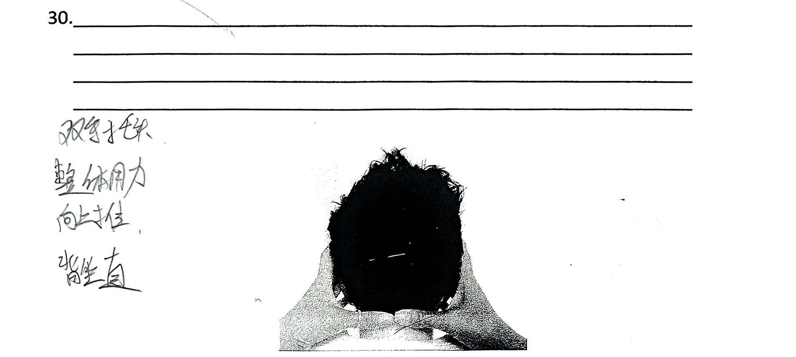

**中文步骤**

1. 背部挺直，头部自然直立，睁眼或闭眼均可。双手托住后颈，拇指指腹放在后颈，其余四指放在头侧，只作支撑。
2. 先吸一口气。两侧拇指保持原位，同时向上发力，将整个头向上顶提，像向上拔起；发力过程持续3–5秒，并持续吐气。
3. 拇指不沿后颈向上滑动，不额外停留。结束本次向上发力后，再重复。
4. 共做8–10次，1组。力度以自己感觉舒服为准，无统一固定要求。

**English instructions**

1. Keep your back straight and your head naturally upright. Your eyes may be open or closed. Support the back of your neck with both hands. Place the thumb pads against the back of the neck, with the other four fingers of each hand at the side of the head for support only.
2. Take a breath in. Keeping the thumbs in place, apply upward force with both thumbs simultaneously to lift the whole head upward, as if lifting it out. Continue applying this upward force for 3–5 seconds while exhaling continuously.
3. Do not slide the thumbs upward along the neck or add a hold afterward. End the upward effort before repeating.
4. Complete one set of 8–10 repetitions. Adjust the pressure to what feels comfortable. No fixed pressure is prescribed.

---

### SM-034 · 扶头侧压与保持

Hand-assisted head side bend and hold

**部位：** 颈部　｜　**教材原编号：** 31　｜　**页码：** 11　｜　[整页原图](materials/textbook/source-pages/page-11.jpg) · [动作原图](materials/textbook/source-actions/source-031.jpg)

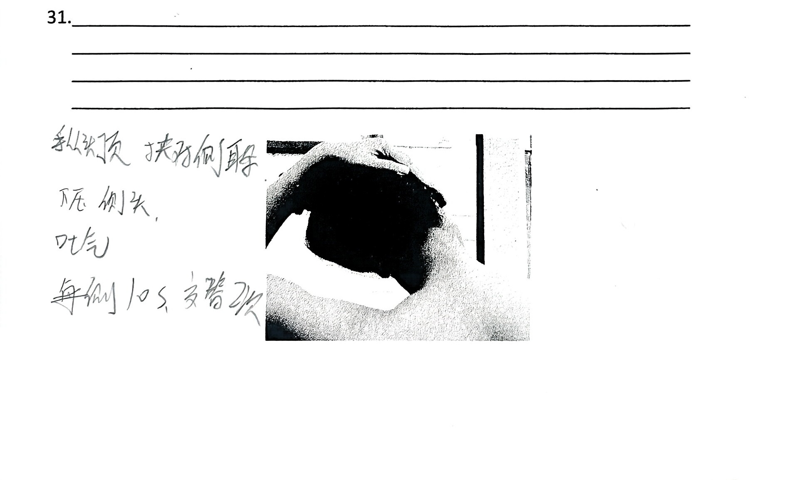

**中文步骤**

1. 背部挺直，双肩自然放松，头部自然直立，睁眼或闭眼均可。
2. 以向右侧倾为例：右手绕过头顶，用掌面扶住左侧头部；左手自然下垂。先吸一口气，再用手辅助将头向右侧下压，只做侧倾，不转头或低头。
3. 下压及保持10秒期间持续吐气。保持结束后松手，头回到自然直立，再换侧。
4. 换侧时左手绕过头顶，用掌面扶住右侧头部，辅助头向左侧下压；右手自然下垂。同样先吸气，下压和保持10秒时持续吐气，结束后松手回正。
5. 左右交替，每侧做2次。力度以自己感觉舒服为准，无统一固定要求。

**English instructions**

1. Keep your back straight, shoulders naturally relaxed and head naturally upright. Your eyes may be open or closed.
2. For a bend to the right, reach your right hand over the top of your head and place the palm against the left side of your head. Let the left arm hang naturally. Take a breath in, then use your hand to assist the head downward toward the right. Bend sideways only, without turning the head or bending it forward.
3. Exhale continuously as you lower the head and throughout the 10-second hold. Then release the hand and return your head to the naturally upright position before switching sides.
4. For the other side, reach the left hand over your head, placing the palm against the right side and assisting the head downward toward the left. Let the right arm hang naturally. Again, inhale first, then exhale continuously during the side bend and 10-second hold. Release and return upright afterward.
5. Alternate sides, completing two repetitions on each side. Adjust the pressure to what feels comfortable. No fixed pressure is prescribed.

---

### SM-035 · 头颈双向绕圈

Head and neck circles in both directions

**部位：** 颈部　｜　**教材原编号：** 32　｜　**页码：** 12　｜　[整页原图](materials/textbook/source-pages/page-12.jpg) · [动作原图](materials/textbook/source-actions/source-032.jpg)

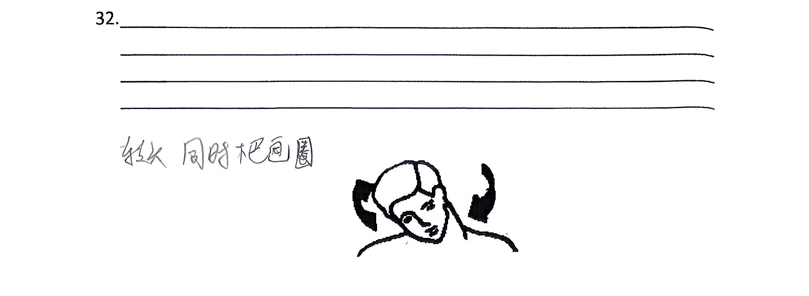

**中文步骤**

1. 背部挺直，双手自然下垂，头部自然直立。放松脖子，睁眼或闭眼均可。
2. 头部完整绕圈，经过低头、侧倾和仰头等位置，想象下巴在画圆。先顺时针转10圈。
3. 完成顺时针10圈后直接反向，再逆时针转10圈，不先回正停顿。呼吸无固定要求。

**English instructions**

1. Keep your back straight, let both arms hang naturally and start with your head naturally upright. Relax your neck. Your eyes may be open or closed.
2. Move your head through a full circle, including forward bending, side bending and backward tilting, imagining that your chin is drawing a circle. Complete 10 clockwise circles first.
3. After the 10 clockwise circles, reverse direction directly and complete 10 counterclockwise circles, without first returning upright for a pause. No breathing pattern is prescribed.

---

### SM-036 · 双拇指顶下巴与头部后仰

Two-thumb chin lift and backward head tilt

**部位：** 颈部　｜　**教材原编号：** 33　｜　**页码：** 12　｜　[整页原图](materials/textbook/source-pages/page-12.jpg) · [动作原图](materials/textbook/source-actions/source-033.jpg)

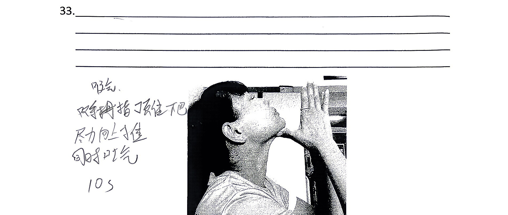

**中文步骤**

1. 背部挺直，头部自然直立，睁眼或闭眼均可。双手拇指指腹顶住下巴下方，其余四指并拢朝上。
2. 先吸一口气，再用两侧拇指向上顶起下巴，使头部后仰。后仰及保持10秒期间持续吐气。
3. 结束后停止上顶，头回到自然直立，再开始下一次。
4. 重复4–6次，整套只做1组。力度以自己感觉舒服为准，无统一固定要求。

**English instructions**

1. Keep your back straight and start with your head naturally upright. Your eyes may be open or closed. Place the pads of both thumbs against the underside of the chin, keeping the other four fingers of each hand together and pointing upward.
2. Take a breath in, then push the chin upward with both thumbs so that the head tilts backward. Exhale continuously during the backward tilt and throughout the 10-second hold.
3. Stop the upward push and return your head to the naturally upright position before starting the next repetition.
4. Complete one set of 4–6 repetitions. Adjust the pressure to what feels comfortable. No fixed pressure is prescribed.

---

### SM-037 · 双手压头与低头保持

Forward head bend with downward hand pressure

**部位：** 颈部　｜　**教材原编号：** 34　｜　**页码：** 12　｜　[整页原图](materials/textbook/source-pages/page-12.jpg) · [动作原图](materials/textbook/source-actions/source-034.jpg)

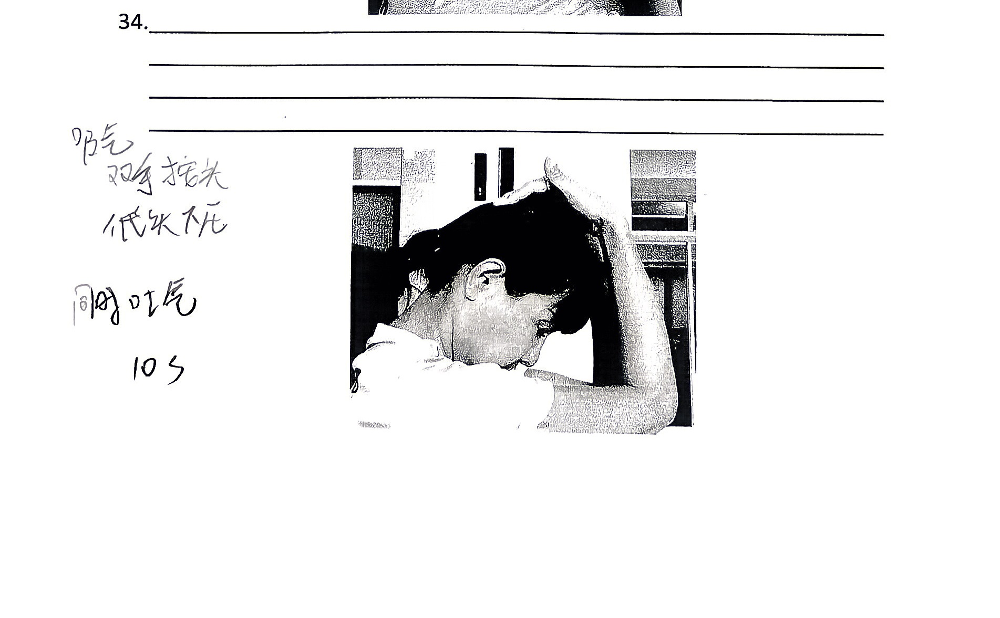

**中文步骤**

1. 背部挺直，头部自然直立，睁眼或闭眼均可。双手并排放在头顶，两肘向前收拢。
2. 先吸一口气，再低头并用双手向下压；低头和保持10秒期间持续吐气。
3. 结束后停止下压，头回到自然直立，再开始下一次。
4. 共做4–6次，1组。力度以自己感觉舒服为准，无统一固定要求。

**English instructions**

1. Keep your back straight and start with your head naturally upright. Your eyes may be open or closed. Place both hands side by side on top of your head, bringing the elbows inward toward the front.
2. Take a breath in, then bend your head forward while pressing downward with both hands. Exhale continuously during the forward bend and throughout the 10-second hold.
3. Stop pressing downward and return your head to the naturally upright position before starting the next repetition.
4. Complete one set of 4–6 repetitions. Adjust the pressure to what feels comfortable. No fixed pressure is prescribed.

---

### SM-038 · 耳上至太阳穴头皮转压

Scalp circular presses from above the ears to the temples

**部位：** 头皮　｜　**教材原编号：** 35　｜　**页码：** 13　｜　[整页原图](materials/textbook/source-pages/page-13.jpg) · [动作原图](materials/textbook/source-actions/source-035.jpg)

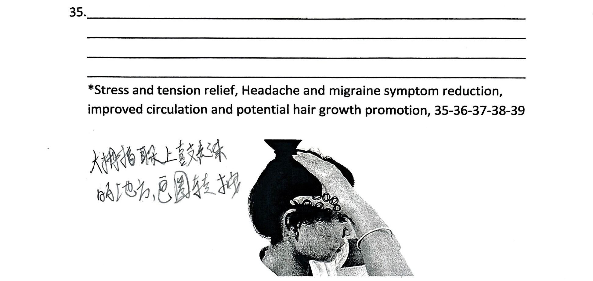

**中文步骤**

1. 头部自然直立，睁眼或闭眼均可。两侧同时操作，其余四指扶住头顶，用拇指指腹在耳朵正上方至太阳穴这片头皮区域逐点转压。
2. 每个点位转压3–5圈，没有时间要求；点位覆盖整个区域即可，完整覆盖一遍后结束。
3. 旋转方向、两侧是否同向和点位顺序均无规定。呼吸无固定要求，力度以自己感觉舒服为准。

**English instructions**

1. Keep your head naturally upright. Your eyes may be open or closed. Work both sides simultaneously, supporting the top of the head with the other four fingers of each hand. Use the thumb pads to make circular presses at points across the scalp region from directly above the ears to the temples.
2. Make 3–5 circles at each point. No duration is prescribed; choose points that cover the whole region, and finish after one complete pass.
3. No rotation direction, matching of directions between sides or point order is prescribed. No breathing pattern is prescribed. Adjust the pressure to what feels comfortable.

---

### SM-039 · 耳后至颈部区域转压

Circular presses behind the ears down to the neck

**部位：** 头皮　｜　**教材原编号：** 36　｜　**页码：** 13　｜　[整页原图](materials/textbook/source-pages/page-13.jpg) · [动作原图](materials/textbook/source-actions/source-036.jpg)

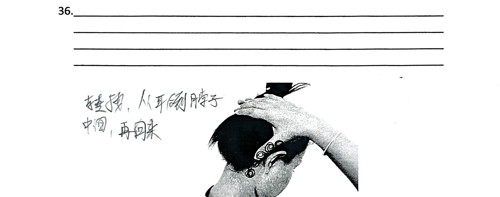

**中文步骤**

1. 头部自然直立，睁眼或闭眼均可。两侧同时操作，其余四指扶住头顶，用拇指指腹在耳朵后方逐点转压，覆盖耳朵正上方至脖子之间的这片区域。
2. 每个点位转压3–5圈，没有时间要求；点位覆盖整个区域即可，完整覆盖一遍后结束。
3. 旋转方向、两侧是否同向和点位顺序均无规定。呼吸无固定要求，力度以自己感觉舒服为准。

**English instructions**

1. Keep your head naturally upright. Your eyes may be open or closed. Work both sides simultaneously, supporting the top of the head with the other four fingers of each hand. Use the thumb pads to make circular presses at points behind the ears, covering the region from directly above the ears down to the neck.
2. Make 3–5 circles at each point. No duration is prescribed; choose points that cover the whole region, and finish after one complete pass.
3. No rotation direction, matching of directions between sides or point order is prescribed. No breathing pattern is prescribed. Adjust the pressure to what feels comfortable.

---

### SM-040 · 后脑区域拇指转压

Thumb circular presses across the back of the head

**部位：** 头皮　｜　**教材原编号：** 37　｜　**页码：** 13　｜　[整页原图](materials/textbook/source-pages/page-13.jpg) · [动作原图](materials/textbook/source-actions/source-037.jpg)

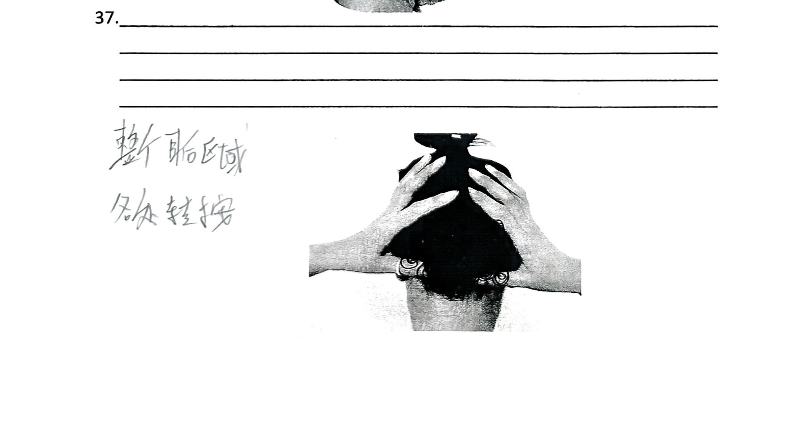

**中文步骤**

1. 头部自然直立，睁眼或闭眼均可。双手同时操作，其余四指扶住头顶，用拇指指腹在整个后脑、两耳之间的区域逐点转压。
2. 每个点位转压3–5圈，没有时间要求；点位覆盖整个区域即可，完整覆盖一遍后结束。
3. 旋转方向和点位顺序均无规定。呼吸无固定要求，力度以自己感觉舒服为准。

**English instructions**

1. Keep your head naturally upright. Your eyes may be open or closed. Work with both hands simultaneously, supporting the top of the head with the other four fingers of each hand. Use the thumb pads to make circular presses at points across the whole back of the head between the ears.
2. Make 3–5 circles at each point. No duration is prescribed; choose points that cover the whole region, and finish after one complete pass.
3. No rotation direction, point order or breathing pattern is prescribed. Adjust the pressure to what feels comfortable.

---

### SM-041 · 双手五指抓捏头皮

Two-hand five-finger scalp grasp and release

**部位：** 头皮　｜　**教材原编号：** 38　｜　**页码：** 14　｜　[整页原图](materials/textbook/source-pages/page-14.jpg) · [动作原图](materials/textbook/source-actions/source-038.jpg)

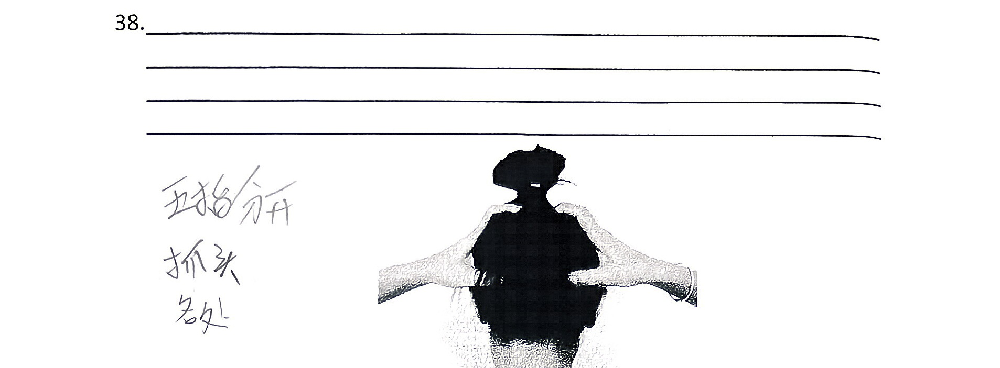

**中文步骤**

1. 头部自然直立，睁眼或闭眼均可。双手同时操作，五指张开成爪状，用五指指腹在头皮各处抓捏。
2. 每次抓完立即放开，继续覆盖其他位置，直到整个头皮完整覆盖一遍。
3. 抓捏顺序、次数和总时长均无规定。呼吸无固定要求，力度以自己感觉舒服为准。

**English instructions**

1. Keep your head naturally upright. Your eyes may be open or closed. Work with both hands simultaneously, spreading the five fingers of each hand into a claw-like shape. Use all five finger pads to grasp and squeeze at locations across the scalp.
2. Release immediately after each grasp, then continue at other locations until you have covered the whole scalp once.
3. No order, number of grasps or total duration is prescribed. No breathing pattern is prescribed. Adjust the pressure to what feels comfortable.

---

### SM-042 · 指缝夹发上提

Upward hair lifts with hair held between the fingers

**部位：** 头皮　｜　**教材原编号：** 39　｜　**页码：** 14　｜　[整页原图](materials/textbook/source-pages/page-14.jpg) · [动作原图](materials/textbook/source-actions/source-039.jpg)

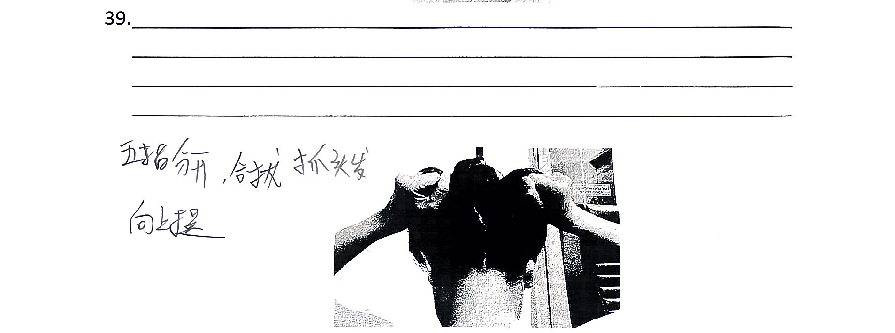

**中文步骤**

1. 头部自然直立，睁眼或闭眼均可。双手同时操作，五指张开，再合拢指缝，在靠近发根的位置夹住头发并向上提。
2. 提起后停留2–3秒，再松开头发、换到其他位置。
3. 位置顺序、提拉次数和总时长均无规定，覆盖整个头部一遍即可。呼吸无固定要求，力度以自己感觉舒服为准。

**English instructions**

1. Keep your head naturally upright. Your eyes may be open or closed. Work with both hands simultaneously: spread the five fingers, then bring the fingers together to hold hair between them close to the roots and lift upward.
2. Hold for 2–3 seconds after lifting, then release the hair before moving to another location.
3. No location order, number of lifts or total duration is prescribed. Cover the whole head once. No breathing pattern is prescribed. Adjust the pressure to what feels comfortable.

---

### SM-043 · 对侧肩部两区域抓捏

Two-region grasp and release on the opposite shoulder

**部位：** 肩部　｜　**教材原编号：** 40　｜　**页码：** 14　｜　[整页原图](materials/textbook/source-pages/page-14.jpg) · [动作原图](materials/textbook/source-actions/source-040.jpg)

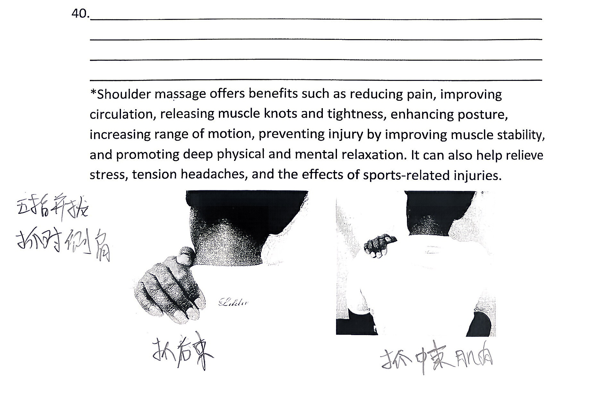

**中文步骤**

1. 背部挺直，头部自然直立，睁眼或闭眼均可。一只手抓捏对侧肩部，另一只手自然下垂。用指腹配合掌面，由拇指与其余四指相对夹住肌肉。
2. 先在靠近脖子和背部的肩后侧区域原位反复抓放5–10次。每次抓完立即松开，不停留。
3. 再移到稍远离脖子、肩膀正上方的区域，同样原位抓放5–10次，每次立即松开。
4. 同侧两个区域完成后再换手操作另一侧；另一侧也先后侧区域、再肩顶区域，各5–10次。左右都完成后结束，整套一轮。
5. 呼吸无固定要求，力度以自己感觉舒服为准。

**English instructions**

1. Keep your back straight and your head naturally upright. Your eyes may be open or closed. Use one hand to grasp the opposite shoulder while letting the other arm hang naturally. Use the finger pads together with the palm, holding the muscle between the thumb and the other four fingers.
2. First grasp and release at the same location in the rear shoulder region closer to the neck and back, for 5–10 repetitions. Release immediately after each grasp, without holding.
3. Then move to the region slightly farther from the neck and directly on top of the shoulder. Again, grasp and release at the same location for 5–10 repetitions, releasing immediately each time.
4. Finish both regions on one side before switching hands to work on the other side. Repeat the rear region first, then the top region, for 5–10 repetitions each. Complete both sides once to finish one round.
5. No breathing pattern is prescribed. Adjust the pressure to what feels comfortable.

---

### SM-044 · 屈臂后压与转体保持

Backward arm pressure with torso rotation and hold

**部位：** 肩部　｜　**教材原编号：** 41　｜　**页码：** 15　｜　[整页原图](materials/textbook/source-pages/page-15.jpg) · [动作原图](materials/textbook/source-actions/source-041.jpg)

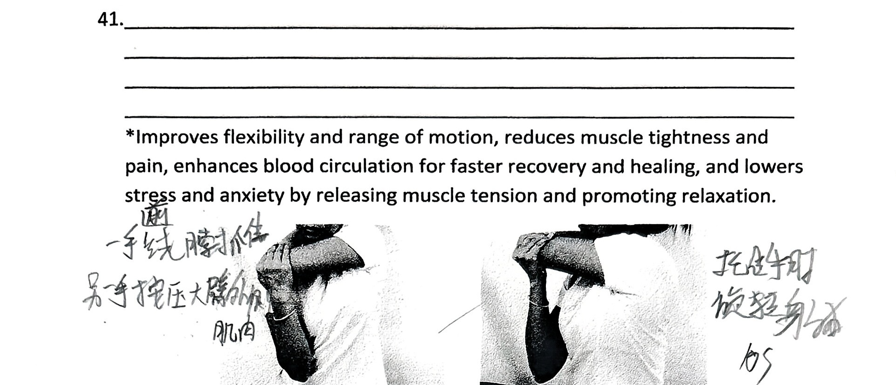

**中文步骤**

1. 站立，背部挺直，睁眼或闭眼均可。以右臂弯曲为例，右手放在后颈，右肘朝上。
2. 左手按住右大臂下侧、靠近肘关节的部位，向后发力。同时腿部保持不动，从腰部开始将身体向左转，头随身体一起转。
3. 转到左侧后保持5–10秒。结束后身体回正、松开辅助按压，再重复。
4. 同侧做5–10次后换侧，手位镜像对调：左手放后颈、左肘朝上，右手按住左大臂下侧靠近肘关节的位置向后发力，身体与头向右转，到位后保持5–10秒，再回正、松开。另一侧同样做5–10次。
5. 左右各完成后结束，整套一轮，不再重复。呼吸无固定要求，力度以自己感觉舒服为准。

**English instructions**

1. Stand with your back straight. Your eyes may be open or closed. For the bent right arm, place the right hand behind the neck with the right elbow pointing upward.
2. Place the left hand against the underside of the right upper arm near the elbow joint and apply backward pressure. Keep the legs still and rotate the torso to the left from the waist, letting the head turn with the torso.
3. Once turned to the left, hold the position for 5–10 seconds. Then return the torso to face forward, release the assisting pressure and repeat.
4. Complete 5–10 repetitions before switching sides. Reverse the hand positions: place the left hand behind the neck with the elbow upward, use the right hand to apply backward pressure to the underside of the left upper arm near the elbow, and rotate the torso and head to the right. Hold for 5–10 seconds, return forward and release. Complete 5–10 repetitions on this side as well.
5. Finish after working both sides once; do not repeat the full sequence. No breathing pattern is prescribed. Adjust the pressure to what feels comfortable.

---

### SM-045 · 大臂按压放松与肩部侧向拉伸

Upper-arm pressing followed by a sideways shoulder stretch

**部位：** 肩部　｜　**教材原编号：** 42　｜　**页码：** 15　｜　[整页原图](materials/textbook/source-pages/page-15.jpg) · [动作原图](materials/textbook/source-actions/source-042.jpg)

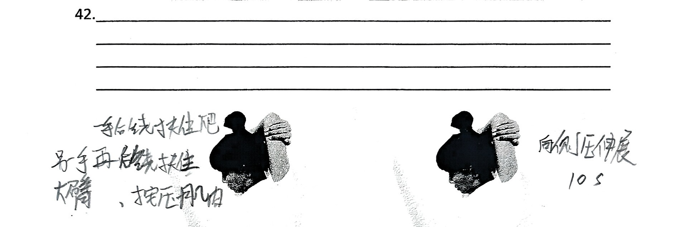

**中文步骤**

1. 站立，背部挺直，头部自然直立，身体保持朝前、不转动。以拉伸右肩为例，右手放在后颈、右肘朝上；左臂在头后弯曲，左手握住右大臂下侧靠近肘关节的位置。
2. 每侧开始时，先用辅助的手原位反复按压，放松被拉伸一侧的大臂肌肉。按压次数和时间无规定。
3. 随后用左手将右大臂连同手肘向左侧牵拉，拉伸右肩，保持10秒。保持结束后松开牵拉，手臂回到起始位置。
4. 同侧连续拉伸2–3次；每次之间不重新增加预备按压阶段。完成后换侧：左手放后颈、左肘朝上，右手在头后握左大臂下侧近肘部，先原位按压放松，再向右侧牵拉左肩，各次保持10秒并松开回位，同样拉伸2–3次。
5. 左右各完成后结束，整套一轮。睁闭眼和呼吸均无规定，力度以自己感觉舒服为准。

**English instructions**

1. Stand with your back straight, head naturally upright and torso facing forward without rotating. To stretch the right shoulder, place the right hand behind the neck with the elbow pointing upward. Bend the left arm behind the head and use the left hand to hold the underside of the right upper arm near the elbow joint.
2. At the start of each side, use the assisting hand to press repeatedly at the same location to relax the upper-arm muscles on the side being stretched. No number of presses or pressing duration is prescribed.
3. Then use the left hand to draw the right upper arm and elbow toward the left, stretching the right shoulder. Hold for 10 seconds, then release the pull and return the arm to its starting position.
4. Complete 2–3 stretches on the same side, without repeating the preparatory pressing phase between stretches. Then switch sides: place the left hand behind the neck with the elbow upward, and reach the right hand behind the head to hold the underside of the left upper arm near the elbow. Press in place first, then draw the left arm toward the right to stretch the left shoulder. Hold each stretch for 10 seconds, release and return, completing 2–3 stretches.
5. Finish after working both sides once. Eye position and breathing are not prescribed. Adjust the pressure to what feels comfortable.

---

## 第 4 章 · 手臂、手部、手指与手腕

整理自《第四批手臂手部手指手腕素材拆解》。

| 动作编号 | 动作名称 | 教材原编号 |
| --- | --- | --- |
| [SM-046](#sm-046) | 大臂外侧握压与小臂外侧拇指点压 | 43 |
| [SM-047](#sm-047) | 大臂与小臂内侧拇指按压 | 44 |
| [SM-048](#sm-048) | 肘部小臂下压与前推 | 45 |
| [SM-049](#sm-049) | 手掌上下分区四线拇指推压 | 46 |
| [SM-050](#sm-050) | 十指交叉拇指掌心逐点转压 | 47 |
| [SM-051](#sm-051) | 虎口对夹掌根至手腕拇指转压 | 48 |
| [SM-052](#sm-052) | 掌根至指尖转按与指尖保持 | 49 |
| [SM-053](#sm-053) | 指缝外拉与捏持 | 50 |
| [SM-054](#sm-054) | 掌背侧指缝外拉与捏持 | 52 |
| [SM-055](#sm-055) | 食指关节掌心画圈 | 51 |
| [SM-056](#sm-056) | 手指背侧转按与指尖保持 | 53 |
| [SM-057](#sm-057) | 食指中指关节夹拉手指 | 54 |
| [SM-058](#sm-058) | 握拳四指指腹按拉 | 55 |
| [SM-059](#sm-059) | 拇食指逐指从指根拉至指尖 | 56 |
| [SM-060](#sm-060) | 握拳与握指辅助手腕外翻 | 57 |
| [SM-061](#sm-061) | 十指交叉紧握与张手握拳 | 58 |
| [SM-062](#sm-062) | 拇指拨腕配合弯起放平 | 59 |
| [SM-063](#sm-063) | 腕掌侧关节及邻近区域逐点转压 | 60 |
| [SM-064](#sm-064) | 双指并拢拍打腕关节 | 61 |
| [SM-065](#sm-065) | 双腕掌心侧与小指侧掌缘互拍 | 62 |

### SM-046 · 大臂外侧握压与小臂外侧拇指点压

Outer upper-arm grip presses and outer forearm thumb presses

**部位：** 手臂　｜　**教材原编号：** 43　｜　**页码：** 15　｜　[整页原图](materials/textbook/source-pages/page-15.jpg) · [动作原图](materials/textbook/source-actions/source-043.jpg)

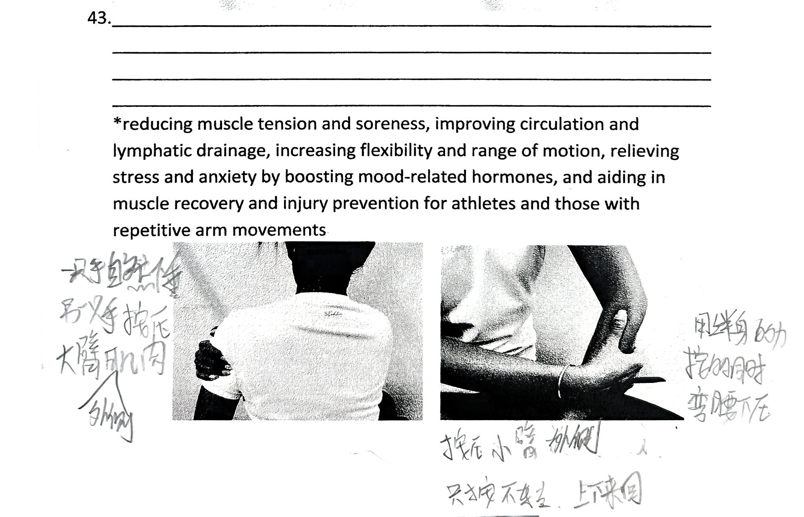

**中文步骤**

1. 两张图均操作手臂外侧。大臂：被操作的手臂自然下垂，另一只手用指腹配合掌面握住大臂外侧，每个点位按压3–5次，按完松开，再上下移动到其他点位，覆盖整个大臂外侧。点位没有固定顺序。
2. 小臂：站姿或坐姿均可，被操作的手臂下垂，手肘稍弯，方便另一只手抓握，不使用额外支撑。另一只手用拇指指腹按压小臂外侧，其余四指在下方支撑。
3. 按压小臂时，上半身弯腰下压，借助上半身的力量，通过当前拇指接触点发力。每个点位按压3–5次，按完松开，再上下换点，覆盖整个小臂外侧。点位没有固定顺序。
4. 同一侧的大臂和小臂全部完成后，再换手操作另一侧。左右两侧各覆盖完成后结束，整套做一遍。

**English instructions**

1. Both pictures work on the outer side of the arm. Upper arm: let the arm being worked on hang naturally. Use the finger pads and palm of the other hand to grip and press the outer upper arm. Press 3–5 times at each point, then release before moving up or down to another point. Cover the whole outer upper arm; no fixed point order is prescribed.
2. Forearm: either stand or sit. Let the arm being worked on hang with the elbow slightly bent so that the other hand can hold it comfortably. Use no additional support. Press the outer forearm with the pad of the other thumb, with the other four fingers underneath for support.
3. When pressing the forearm, bend the upper body forward and downward to apply force through the current thumb contact point. Press 3–5 times at each point, then release before moving up or down to another point. Cover the whole outer forearm; no fixed point order is prescribed.
4. Complete both the upper arm and forearm on the same side before switching hands to work on the other side. Finish after covering both sides once; perform the whole sequence once.

---

### SM-047 · 大臂与小臂内侧拇指按压

Thumb presses along the inner upper arm and forearm

**部位：** 手臂　｜　**教材原编号：** 44　｜　**页码：** 16　｜　[整页原图](materials/textbook/source-pages/page-16.jpg) · [动作原图](materials/textbook/source-actions/source-044.jpg)

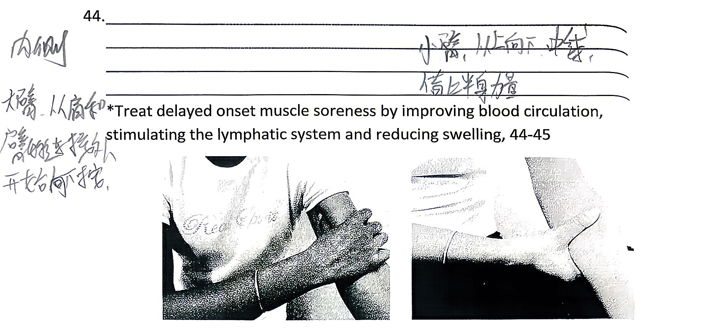

**中文步骤**

1. 站姿或坐姿均可。被操作的手臂前伸，手肘稍弯，掌心朝上，不使用额外支撑。两张图都操作手臂内侧。
2. 大臂：以左侧为例，右手抓住左大臂，右手拇指在内侧，其余四指在外侧。用右手拇指指腹按压大臂内侧，从肩膀与大臂的连接处开始，依次向下到手肘。每个点位按压3–5次，按完松开，再移动到下一个点。
3. 小臂：左小臂前伸，右手抓住左小臂，右拇指在上、其余四指在下。用右手拇指指腹按压小臂内侧，从肘关节开始，依次向下到手腕。每个点位按压3–5次，按完松开，再换下一个点。按压时配合上半身弯腰下压，借助上半身力量通过拇指接触点按压。
4. 同侧大臂和小臂全部按完后，换手操作另一侧，手型与路径镜像对调。左右两侧各覆盖完成后结束，整套一遍。

**English instructions**

1. Either stand or sit. Extend the arm being worked on forward, with the elbow slightly bent and the palm facing up. Use no additional support. Both pictures work on the inner side of the arm.
2. Upper arm: using the left side as an example, hold the left upper arm with the right hand. Place the right thumb on the inner side and the other four fingers on the outer side. Use the right thumb pad to press along the inner upper arm, starting at the shoulder–upper-arm junction and proceeding down to the elbow. Press 3–5 times at each point, then release before moving to the next point.
3. Forearm: extend the left forearm forward and hold it with the right hand, with the right thumb above and the other four fingers below. Use the right thumb pad to press the inner forearm, starting at the elbow joint and proceeding down to the wrist. Press 3–5 times at each point, then release before moving to the next point. Bend the upper body forward and downward while pressing, using the upper body to apply force through the thumb contact point.
4. Complete both the upper arm and forearm on the same side before switching hands to work on the other side, mirroring the hand positions and paths. Finish after covering both sides once; perform the whole sequence once.

---

### SM-048 · 肘部小臂下压与前推

Elbow presses and forward pushes along the forearm

**部位：** 手臂　｜　**教材原编号：** 45　｜　**页码：** 16　｜　[整页原图](materials/textbook/source-pages/page-16.jpg) · [动作原图](materials/textbook/source-actions/source-045.jpg)

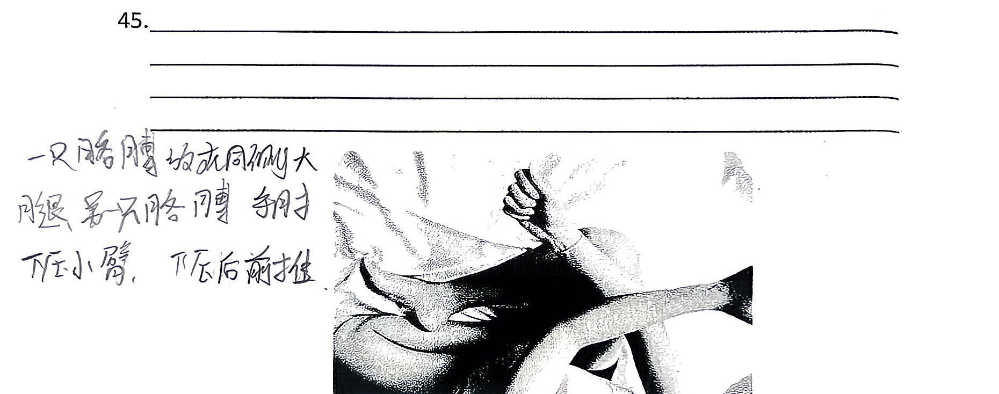

**中文步骤**

1. 坐姿，双腿交叉。以左侧为例，左小臂放在左大腿上支撑，手臂保持前伸，掌心朝上。
2. 用右肘肘尖按压左小臂内侧。每次先向下按压，再向前、朝手心方向推，构成一次“下压→前推”。
3. 每个点位做2–3次“下压→前推”后，抬起右肘，再移动到下一个点位。点位从小臂靠近肘部处开始，依次向手腕方向推进，覆盖整个小臂内侧。
4. 左侧覆盖一遍后换侧：右小臂由右大腿支撑，掌心朝上，用左肘肘尖按压右小臂内侧，按相同方式由肘端逐点至手腕，每点2–3次后抬肘换点。左右各覆盖一遍，整套一遍。

**English instructions**

1. Sit with the legs crossed. Using the left side as an example, rest the left forearm on the left thigh for support, keeping the arm extended forward with the palm facing up.
2. Use the tip of the right elbow to work on the inner left forearm. Press downward first, then push forward toward the palm. These two stages together form one press-and-push repetition.
3. Complete 2–3 press-and-push repetitions at each point, then lift the right elbow before moving to the next point. Start near the elbow end of the forearm and progress toward the wrist, covering the whole inner forearm.
4. After covering the left side once, switch sides. Support the right forearm on the right thigh with the palm facing up, and use the left elbow tip to work on the inner right forearm in the same way. Progress from the elbow end to the wrist, completing 2–3 press-and-push repetitions at each point before lifting the elbow and changing points. Cover each side once; perform the whole sequence once.

---

### SM-049 · 手掌上下分区四线拇指推压

Four-path thumb strokes across the upper and lower palm

**部位：** 手部　｜　**教材原编号：** 46　｜　**页码：** 16　｜　[整页原图](materials/textbook/source-pages/page-16.jpg) · [动作原图](materials/textbook/source-actions/source-046.jpg)

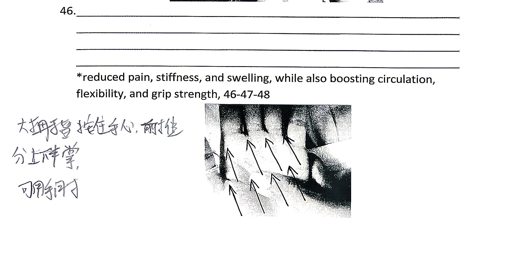

**中文步骤**

1. 以左手为例，右手抓住左手手掌，右手拇指指腹接触左掌，其余四指在左手手背侧支撑。
2. 将左掌分为上、下两个区域：上半掌从掌心到指根，下半掌从掌根到掌心。两区域都沿食指、中指、无名指和小指对应的四条路径操作，不包括拇指路径；四条路径没有固定先后顺序。
3. 先做上半掌：用右手拇指指腹从掌心推到指根，每条路径做2–3次。每次推到终点后抬起拇指，回到该路径起点，再做下一次。完成四条路径，覆盖整个上半掌。
4. 接着做下半掌：用拇指指腹从掌根推到掌心，每条路径做2–3次，每次推完抬指回到该路径起点。完成四条路径，覆盖整个下半掌。
5. 同一只手的上下半掌全部完成后换手，另一只手按相同方式操作。左右各完成后结束，整套一次。

**English instructions**

1. Using the left hand as an example, hold it with the right hand. Place the right thumb pad on the left palm, with the other four fingers supporting the back of the left hand.
2. Divide the palm into two regions: the upper half runs from the palm center to the finger bases; the lower half runs from the heel of the palm to its center. In each region, follow four paths aligned with the index, middle, ring and little fingers, excluding the thumb. No fixed order among the four paths is prescribed.
3. Work on the upper half first. Use the right thumb pad to push from the palm center to the finger bases, repeating each path 2–3 times. After each stroke, lift the thumb and return to the start of that path before repeating. Complete all four paths to cover the upper half.
4. Then work on the lower half. Use the thumb pad to push from the heel of the palm to the palm center, repeating each path 2–3 times. Lift the thumb and return to the start of that path after each stroke. Complete all four paths to cover the lower half.
5. Finish both regions of one palm before switching hands and repeating on the other hand. Finish after working both hands; perform the whole sequence once.

---

### SM-050 · 十指交叉拇指掌心逐点转压

Interlaced-hand thumb circles across the palm

**部位：** 手部　｜　**教材原编号：** 47　｜　**页码：** 17　｜　[整页原图](materials/textbook/source-pages/page-17.jpg) · [动作原图](materials/textbook/source-actions/source-047.jpg)

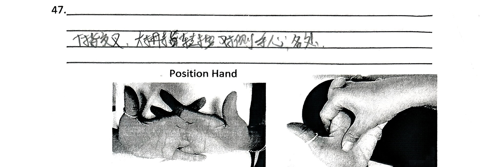

**中文步骤**

1. 十指交叉，用右手拇指指腹在左手掌心各处逐点转压。
2. 每个点位转压3–5圈，完成后抬起拇指，再换下一个点。旋转方向和点位先后顺序均无规定，覆盖整个左手掌心即可。
3. 左掌全部覆盖后换手，用左手拇指指腹同样转压右手掌心，各点3–5圈，完成后抬指换点。左右各覆盖一遍，整套只做一次。

**English instructions**

1. Interlace the fingers and use the pad of the right thumb to work point by point across the left palm with circular pressure.
2. Make 3–5 circles at each point, then lift the thumb before moving to the next point. Neither the rotation direction nor the order of the points is prescribed; cover the whole left palm.
3. After covering the left palm, switch hands and use the left thumb pad to work across the right palm in the same way. Make 3–5 circles at each point and lift the thumb before changing points. Cover each palm once; perform the whole sequence once.

---

### SM-051 · 虎口对夹掌根至手腕拇指转压

Thumb circles from the heel of the palm to the wrist with a web grip

**部位：** 手部　｜　**教材原编号：** 48　｜　**页码：** 17　｜　[整页原图](materials/textbook/source-pages/page-17.jpg) · [动作原图](materials/textbook/source-actions/source-048.jpg)

**中文步骤**

1. 以左手为例，左手掌心向上。右手虎口与左手虎口对夹，右手虎口位于左手掌根处，其余四指在左手手背侧支撑。
2. 用右手拇指指腹在左手掌根到手腕的区域各处逐点转压，每个点位3–5圈。每点完成后抬起拇指，再换下一个点。
3. 旋转方向和点位先后顺序均无规定，覆盖整个掌根到手腕区域即可。
4. 覆盖完成后换手，手型镜像对调，用左手拇指指腹操作右手掌根到手腕区域，各点3–5圈后抬指换点。左右各覆盖一遍，整套只做一遍。

**English instructions**

1. Using the left hand as an example, turn the left palm upward. Clasp the hands with the thumb–index webs against each other, positioning the right thumb–index web at the heel of the left palm. The other four fingers of the right hand support the back of the left hand.
2. Use the right thumb pad to apply circular pressure at points throughout the area from the heel of the left palm to the wrist. Make 3–5 circles at each point, then lift the thumb before moving to the next point.
3. Neither the rotation direction nor the order of the points is prescribed; cover the whole area from the heel of the palm to the wrist.
4. After covering the area, switch hands and mirror the grip. Use the left thumb pad to work on the area from the heel of the right palm to the wrist, making 3–5 circles at each point and lifting the thumb before changing points. Cover each side once; perform the whole sequence once.

---

### SM-052 · 掌根至指尖转按与指尖保持

Circular presses from palm heel to fingertips with fingertip holds

**部位：** 手部　｜　**教材原编号：** 49　｜　**页码：** 17　｜　[整页原图](materials/textbook/source-pages/page-17.jpg) · [动作原图](materials/textbook/source-actions/source-049.jpg)

**中文步骤**

1. 以左手为例，用右手握住左手，右手拇指指腹操作左手掌面，其余四指在左手手背侧支撑。
2. 按照拇指→食指→中指→无名指→小指的顺序，逐条完成五条路径。每条路径都从掌根开始，沿对应手指一直做到指尖，再开始下一根。
3. 用右手拇指指腹一边转按一边缓慢向上推进，速度尽可能慢，尽可能覆盖整个掌心到手指的全部点位。旋转方向无要求，每个点位的圈数没有规定。
4. 到每根手指的指尖后，用右手拇指指腹配合食指关节，捏住指尖指腹部位，原位保持5秒，再松开并开始下一根手指的路径。
5. 左手五条路径全部完成后换手，用左手操作右手，手型与路径镜像对调，仍依次从拇指做到小指。左右各完成后结束，整套只做一遍。

**English instructions**

1. Using the left hand as an example, hold it with the right hand. Use the right thumb pad on the palm side, while the other four fingers support the back of the left hand.
2. Complete five paths in order: thumb, index, middle, ring and little finger. Start each path at the heel of the palm and follow the corresponding finger all the way to its tip before starting the next finger.
3. Use the right thumb pad to apply circular pressure while slowly advancing toward the fingertip. Move as slowly as possible and cover as many points as possible across the whole palm and fingers. No rotation direction or number of circles at each point is prescribed.
4. At each fingertip, pinch the fingertip pad between the pad of the right thumb and the knuckle of the right index finger. Hold in place for 5 seconds, then release and begin the path for the next finger.
5. After completing all five paths on the left hand, switch hands and mirror the grip and paths on the right hand, again working from thumb to little finger. Finish after both hands; perform the whole sequence once.

---

### SM-053 · 指缝外拉与捏持

Finger-web pulls and pinch holds

**部位：** 手部　｜　**教材原编号：** 50　｜　**页码：** 18　｜　[整页原图](materials/textbook/source-pages/page-18.jpg) · [动作原图](materials/textbook/source-actions/source-050.jpg)

**中文步骤**

1. 以左手为例，右手拇指指腹接触指缝掌心侧，配合食指指腹，捏住相邻两个手指根部连接处的指缝组织。
2. 沿掌面朝指尖方向向外拉，每次拉完松开，重新捏住再拉，共10次。
3. 10次外拉完成后，重新捏住同一指缝，在原位保持5秒，不继续向外拉。
4. 四个指缝按拇指与食指之间→食指与中指之间→中指与无名指之间→无名指与小指之间的顺序操作。每个指缝都先外拉10次，再原位捏持5秒。
5. 左手四个指缝全部完成后换手，用左手拇指和食指指腹操作右手，顺序与方法镜像对调。左右各完成后结束，整套只做一次。

**English instructions**

1. Using the left hand as an example, place the right thumb pad on the palm side of a finger web and pinch the tissue where the bases of two adjacent fingers meet together with the right index finger pad.
2. Pull outward along the plane of the palm toward the fingertips. Release after each pull, then pinch again before the next pull. Complete 10 pulls.
3. After the 10 pulls, pinch the same finger web again and hold in place for 5 seconds without continuing to pull outward.
4. Work through the four webs in this order: thumb–index, index–middle, middle–ring and ring–little. At each web, complete 10 outward pulls followed by a 5-second pinch hold in place.
5. After completing all four webs on the left hand, switch hands. Use the pads of the left thumb and index finger to work on the right hand, mirroring the order and method. Finish after both hands; perform the whole sequence once.

---

### SM-054 · 掌背侧指缝外拉与捏持

Finger-web pulls and pinch holds with the thumb on the back-of-hand side

**部位：** 手部　｜　**教材原编号：** 52　｜　**页码：** 18　｜　[整页原图](materials/textbook/source-pages/page-18.jpg) · [动作原图](materials/textbook/source-actions/source-052.jpg)

**中文步骤**

1. 以左手为例，右手拇指指腹位于指缝掌背侧，右手食指指腹位于掌心侧，两指对夹，捏住相邻两个手指根部连接处的指缝组织。
2. 沿掌面朝指尖方向向外拉，每次拉完松开，重新捏住再拉，共10次。
3. 10次外拉完成后，重新捏住同一指缝，在原位保持5秒，不继续向外拉。
4. 四个指缝按拇指与食指之间→食指与中指之间→中指与无名指之间→无名指与小指之间的顺序操作。每个指缝都先外拉10次，再原位捏持5秒。
5. 左手四个指缝全部完成后换手，用左手拇指和食指指腹操作右手；拇指仍在掌背侧，食指在掌心侧，顺序与方法镜像对调。左右各完成后结束，整套只做一次。

**English instructions**

1. Using the left hand as an example, place the right thumb pad on the back-of-hand side of a finger web and the right index finger pad on the palm side. Pinch the web tissue where the bases of two adjacent fingers meet between the two finger pads.
2. Pull outward along the plane of the palm toward the fingertips. Release after each pull, then pinch again before the next pull. Complete 10 pulls.
3. After the 10 pulls, pinch the same finger web again and hold in place for 5 seconds without continuing to pull outward.
4. Work through the four webs in this order: thumb–index, index–middle, middle–ring and ring–little. At each web, complete 10 outward pulls followed by a 5-second pinch hold in place.
5. After completing all four webs on the left hand, switch hands. Use the pads of the left thumb and index finger on the right hand, keeping the thumb on the back-of-hand side and the index finger on the palm side. Mirror the order and method. Finish after both hands; perform the whole sequence once.

---

### SM-055 · 食指关节掌心画圈

Palm circles with the index-finger knuckle

**部位：** 手部　｜　**教材原编号：** 51　｜　**页码：** 18　｜　[整页原图](materials/textbook/source-pages/page-18.jpg) · [动作原图](materials/textbook/source-actions/source-051.jpg)

**中文步骤**

1. 以左手为例，左手掌心向上，右手虎口与左手虎口交叉。右手拇指位于左手手背，其余四指屈曲握拳，置于左手掌心。
2. 用右手食指中间关节的背面抵住左手掌心，以掌心为中心，先沿一个方向画圈，由小圈逐渐扩大，共10圈。最大圈尽量覆盖整个掌心。
3. 接着反向画圈，由大圈逐渐缩小，共10圈。两个阶段方向相反；画圈和阶段切换时，食指关节始终贴住掌面，不抬起。
4. 同一只手两个阶段全部完成后换手，手型与操作镜像对调。左右各完成后结束，整套只做一遍。

**English instructions**

1. Using the left hand as an example, turn the left palm upward and cross the thumb–index webs of the two hands. Place the right thumb on the back of the left hand, with the other four fingers curled into a fist in the left palm.
2. Press the back of the middle joint of the right index finger against the left palm. Center the circles on the palm center and make 10 circles in one direction, gradually increasing their size. Aim for the largest circle to cover the whole palm.
3. Then reverse direction and make 10 circles that gradually decrease in size. The two phases use opposite directions. Keep the knuckle in contact with the palm throughout the circles and the transition between phases, without lifting it.
4. Complete both phases on one hand before switching hands and mirroring the grip and action on the other side. Finish after both hands; perform the whole sequence once.

---

### SM-056 · 手指背侧转按与指尖保持

Circular presses along the backs of the fingers with fingertip holds

**部位：** 手指　｜　**教材原编号：** 53　｜　**页码：** 19　｜　[整页原图](materials/textbook/source-pages/page-19.jpg) · [动作原图](materials/textbook/source-actions/source-053.jpg)

**中文步骤**

1. 以左手为例，用右手握住左手，右手拇指指腹操作左手各手指的背侧，其余四指在掌心侧支撑。
2. 按照拇指→食指→中指→无名指→小指的顺序，逐条完成五条路径。每条路径从对应手指的指根开始，沿手指背侧一直做到指尖，再开始下一根；起点不沿用第52项的掌根。
3. 用拇指指腹一边转按一边缓慢向指尖推进，速度尽可能慢，尽可能覆盖各指根到指尖背侧的全部点位。旋转方向无要求，每个点位的圈数没有规定。
4. 到每根手指的指尖后，用右手拇指指腹配合食指关节，捏住指尖指腹部位，原位保持5秒，再松开并开始下一根手指的路径。
5. 左手五条路径全部完成后换手，用左手操作右手，手型与路径镜像对调，仍依次从拇指做到小指。左右各完成后结束，整套只做一遍。

**English instructions**

1. Using the left hand as an example, hold it with the right hand. Use the right thumb pad on the back of each left finger, with the other four fingers supporting the palm side.
2. Complete five paths in order: thumb, index, middle, ring and little finger. Start each path at the base of the corresponding finger and follow its back surface to the tip before starting the next finger. Unlike SM-052, do not start at the heel of the palm.
3. Use the thumb pad to apply circular pressure while slowly advancing toward the fingertip. Move as slowly as possible and cover as many points as possible from each finger base to its tip on the back surface. No rotation direction or number of circles at each point is prescribed.
4. At each fingertip, pinch the fingertip pad between the pad of the right thumb and the knuckle of the right index finger. Hold in place for 5 seconds, then release and begin the path for the next finger.
5. After completing all five paths on the left hand, switch hands and mirror the grip and paths on the right hand, again working from thumb to little finger. Finish after both hands; perform the whole sequence once.

---

### SM-057 · 食指中指关节夹拉手指

Finger pulls with index- and middle-finger knuckles

**部位：** 手指　｜　**教材原编号：** 54　｜　**页码：** 19　｜　[整页原图](materials/textbook/source-pages/page-19.jpg) · [动作原图](materials/textbook/source-actions/source-054.jpg)

**中文步骤**

1. 以左手为例，弯曲右手食指和中指，用两指第二关节相对的侧面夹住左手一根手指。
2. 先夹住该手指的上下侧，即掌心侧与手背侧。从指根开始向外拉到指尖，每次到指尖立即松开，回到指根重新夹住再拉，共2–3次。
3. 再改为夹住同一根手指的左右两侧，同样从指根拉到指尖2–3次，每次到指尖立即松开、回指根重新夹住。
4. 按照拇指→食指→中指→无名指→小指的顺序操作，每根都先完成上下侧2–3次，再完成左右侧2–3次，然后进入下一根。
5. 左手五根手指全部完成后换手，用左手操作右手，手型与方法镜像对调。左右各完成后结束，整套只做一次。

**English instructions**

1. Using the left hand as an example, bend the right index and middle fingers. Grip one left finger between the facing sides of their second joints.
2. First grip the palm-side and back-side surfaces of that finger. Draw the grip outward from the finger base to the tip, release immediately at the tip, then return to the base and grip again. Complete 2–3 repetitions.
3. Then grip the two lateral surfaces of the same finger and again draw from base to tip 2–3 times. Release immediately at the tip and return to the base to grip again after each repetition.
4. Work in the order of thumb, index, middle, ring and little finger. On each finger, complete 2–3 palm-and-back-side repetitions followed by 2–3 lateral-side repetitions before moving to the next finger.
5. After completing all five fingers on the left hand, switch hands and mirror the grip and method on the right hand. Finish after both hands; perform the whole sequence once.

---

### SM-058 · 握拳四指指腹按拉

Four-finger pad presses and pulls on a closed hand

**部位：** 手指　｜　**教材原编号：** 55　｜　**页码：** 19　｜　[整页原图](materials/textbook/source-pages/page-19.jpg) · [动作原图](materials/textbook/source-actions/source-055.jpg)

**中文步骤**

1. 以左手为例，左手握拳，右手包住左手，两只手的四指重叠对齐。被操作的左手全程保持握拳。
2. 用右手四指指腹一起按住左手四指弯曲后的曲面，位置靠近手背、手腕一侧。按住后沿皮肤朝手指方向滑拉，到指根关节结束。 本动作的滑拉范围为手背到指根关节这一段。
3. 每次拉完，右手松开，回到起始位置，再重新按住滑拉，共8–10次。
4. 完成后换手：右手握拳，左手包住右手，四指重叠对齐，用左手四指指腹按相同方式滑拉8–10次。左右各完成后结束，整套只做一次。

**English instructions**

1. Using the left hand as an example, close the left hand into a fist and wrap the right hand around it, with the four fingers of the two hands overlapped and aligned. Keep the left fist closed throughout.
2. Press with the pads of the four right fingers together against the curved surface formed by the four bent left fingers, on the side toward the back of the hand and wrist. Slide along the skin toward the fingers, ending at the finger-base joints. This stroke covers the section from the back of the hand to the finger-base joints.
3. After each pull, release the right hand and return to the starting position, then press again and repeat the sliding pull. Complete 8–10 repetitions.
4. Then switch hands: close the right hand into a fist, wrap the left hand around it and align the four fingers. Use the pads of the four left fingers in the same way for 8–10 sliding pulls. Finish after both hands; perform the whole sequence once.

---

### SM-059 · 拇食指逐指从指根拉至指尖

Thumb-and-index-finger pulls from finger base to tip

**部位：** 手指　｜　**教材原编号：** 56　｜　**页码：** 20　｜　[整页原图](materials/textbook/source-pages/page-20.jpg) · [动作原图](materials/textbook/source-actions/source-056.jpg)

**中文步骤**

1. 本动作操作每根手指从指根到指尖这一段；第58项的范围为手背到指根。
2. 以左手为例，左手自然张开，被操作的手指伸直。用右手拇指和食指的指腹捏住该手指根部，拇指在手背侧，食指在掌心侧，两指对夹。
3. 沿皮肤从指根向指尖方向滑拉。每次到指尖立即松开，回到指根重新捏住再拉，每根手指做8–10次。
4. 按照拇指→食指→中指→无名指→小指的顺序，依次完成五根手指，每根8–10次后再进入下一根。
5. 左手五根手指全部完成后换手，右手自然张开，被操作手指伸直，用左手按相同手型和方法逐指操作。左右各完成后结束，整套只做一次。

**English instructions**

1. This action covers each finger from base to tip; SM-058 covers the section from the back of the hand to the finger bases.
2. Using the left hand as an example, let it open naturally and keep the finger being worked on straight. Pinch its base between the pads of the right thumb and index finger, with the thumb on the back-of-hand side and the index finger on the palm side.
3. Slide along the skin from the finger base toward the tip. Release immediately at the tip, return to the base and pinch again before the next pull. Complete 8–10 repetitions on each finger.
4. Work in the order of thumb, index, middle, ring and little finger. Complete 8–10 repetitions on each finger before moving to the next.
5. After completing all five fingers on the left hand, switch hands. Let the right hand open naturally with the finger being worked on straight, and use the left hand with the same grip and method. Finish after both hands; perform the whole sequence once.

---

### SM-060 · 握拳与握指辅助手腕外翻

Outward wrist bends with two assisting hand positions

**部位：** 手腕　｜　**教材原编号：** 57　｜　**页码：** 20　｜　[整页原图](materials/textbook/source-pages/page-20.jpg) · [动作原图](materials/textbook/source-actions/source-057.jpg)

**中文步骤**

1. 以左侧为例，左肘弯曲，左前臂保持水平横在胸前不动，左手四指伸直。
2. 第一步：右手握拳，用右拳的掌根面顶住左手四指中间关节处，发力让左掌外翻，保持10秒。结束后松开用力，左腕回正。
3. 第二步：右手握住左手四指，右手拇指在左手手背侧，右手掌心在左手掌心侧。发力让左掌向与第一步相同的方向外翻，保持10秒。结束后松开，左腕回正。
4. 同侧两个步骤全部完成后换手，手型与操作镜像对调，另一侧同样各保持10秒、每步结束松开回正。左右各完成后结束，整套只做一遍。
5. 两个阶段的外翻方向相同。睁闭眼和呼吸均无规定，力度以自己舒服为准，无统一固定要求。

**English instructions**

1. Using the left side as an example, bend the left elbow and keep the left forearm horizontal across the chest without moving it. Keep the four left fingers straight.
2. First, close the right hand into a fist. Use the heel-of-palm surface of that fist to press against the middle joints of the four left fingers, turning the left hand outward. Hold for 10 seconds, then release the force and return the left wrist to neutral.
3. Second, grip the four left fingers with the right hand, with the right thumb on the back-of-hand side and the right palm on the palm side of the left hand. Turn the left hand outward in the same direction as in the first phase. Hold for 10 seconds, then release and return the left wrist to neutral.
4. Complete both phases on one side before switching hands and mirroring the hand positions and action on the other side. Hold each phase for 10 seconds and release and return the wrist to neutral afterward. Finish after both sides; perform the whole sequence once.
5. Both phases turn the hand outward in the same direction. Eye position and breathing are not prescribed. Adjust the pressure to what feels comfortable; no fixed pressure is required.

---

### SM-061 · 十指交叉紧握与张手握拳

Interlaced holds, finger spreading and fist clenching

**部位：** 手腕　｜　**教材原编号：** 58　｜　**页码：** 20　｜　[整页原图](materials/textbook/source-pages/page-20.jpg) · [动作原图](materials/textbook/source-actions/source-058.jpg)

**中文步骤**

1. 双手十指交叉，先让右手拇指位于最上方，紧握保持10秒。
2. 再改变交叉手型，让左手拇指位于最上方，同样紧握保持10秒。
3. 随后松开双手，同时摊开，十指尽量充分张开，再同时握拳。继续双手同步张开、握拳交替。
4. 一次完整的“张开→握拳”计为1次，共做20次。两手同步完成，不将两只手分别计数，也不把张开和握拳各算一次。
5. 整套只做一遍，不重复。睁闭眼和呼吸均无规定，力度以自己舒服为准，无统一固定要求。

**English instructions**

1. Interlace the fingers with the right thumb uppermost and clasp the hands firmly for 10 seconds.
2. Change the interlacing position so that the left thumb is uppermost, and again clasp the hands for 10 seconds.
3. Then release the clasp and open both hands together, spreading all ten fingers as fully as possible, before making fists together. Continue alternating between spreading and clenching with both hands in sync.
4. One complete opening followed by clenching counts as one repetition. Complete 20 repetitions. Count the two hands together, and do not count opening and clenching as separate repetitions.
5. Perform the whole sequence once without repeating it. Eye position and breathing are not prescribed. Adjust the effort to what feels comfortable; no fixed effort is required.

---

### SM-062 · 拇指拨腕配合弯起放平

Thumb movements with synchronized wrist bends

**部位：** 手腕　｜　**教材原编号：** 59　｜　**页码：** 21　｜　[整页原图](materials/textbook/source-pages/page-21.jpg) · [动作原图](materials/textbook/source-actions/source-059.jpg)

**中文步骤**

1. 以左侧为例，左手放平时掌心向上，四指伸直，前臂保持不动。右手握住左手手腕，右拇指指腹接触左腕掌心侧关节处，其余四指在手背侧支撑。
2. 右拇指停在同一接触处改变施力方向，配合左手只在手腕处弯起，再放平至与前臂平齐。拇指不沿皮肤向手掌、前臂方向来回滑动。
3. 拇指施力与左腕弯起、放平同步，一次完整的“弯起→放平”算1次，共20次。
4. 左侧20次完成后换手，右手掌心向上、四指伸直、前臂不动，由左手握腕，拇指指腹在掌心侧、四指在手背侧支撑，按相同方式完成20次。左右各完成后结束，整套只做一遍。

**English instructions**

1. Using the left side as an example, start with the left hand flat, palm facing up, the four fingers straight and the forearm held still. Hold the left wrist with the right hand. Place the right thumb pad on the palm side of the wrist joint, with the other four fingers supporting the back-of-hand side.
2. Keep the right thumb at the same contact site and change the direction of force as the left hand bends at the wrist and then returns flat in line with the forearm. Do not slide the thumb back and forth along the skin toward the palm and forearm.
3. Coordinate the thumb force with the wrist movement. One complete bend followed by a return to flat counts as one repetition. Complete 20 repetitions.
4. After 20 repetitions on the left side, switch hands. Keep the right palm facing up, the four fingers straight and the forearm still. Hold the wrist with the left hand, with the thumb pad on the palm side and the other four fingers supporting the back-of-hand side, and complete 20 repetitions in the same way. Finish after both sides; perform the whole sequence once.

---

### SM-063 · 腕掌侧关节及邻近区域逐点转压

Thumb circles at the palm-side wrist joint and adjacent area

**部位：** 手腕　｜　**教材原编号：** 60　｜　**页码：** 21　｜　[整页原图](materials/textbook/source-pages/page-21.jpg) · [动作原图](materials/textbook/source-actions/source-060.jpg)

**中文步骤**

1. 以左侧为例，左手掌心向上自然放平，前臂保持不动。右手握住左手手腕，右拇指指腹接触腕部掌心侧，其余四指在手背侧支撑。
2. 用右拇指指腹逐点转压左腕关节，以及从关节朝前臂方向约一指宽的区域，覆盖掌心侧整片横向范围。
3. 每个点位转压3–5圈，完成后抬起拇指，再换下一个点。旋转方向和点位先后顺序均无规定。
4. 左侧区域全部完成后换手，按相同手型和方法操作右侧，每点3–5圈后抬指换点。左右各完成后结束，整套只做一次。

**English instructions**

1. Using the left side as an example, let the left hand rest flat with the palm facing up and keep the forearm still. Hold the left wrist with the right hand, placing the right thumb pad on the palm side of the wrist and the other four fingers on the back-of-hand side for support.
2. Use the right thumb pad to apply circular pressure point by point at the left wrist joint and across the area extending approximately one finger-width from the joint toward the forearm. Cover the full transverse area on the palm side.
3. Make 3–5 circles at each point, then lift the thumb before moving to the next point. Neither the rotation direction nor the order of the points is prescribed.
4. After covering the whole area on the left side, switch hands and use the same grip and method on the right side, making 3–5 circles at each point and lifting the thumb before changing points. Finish after both sides; perform the whole sequence once.

---

### SM-064 · 双指并拢拍打腕关节

Two-finger wrist-joint tapping

**部位：** 手腕　｜　**教材原编号：** 61　｜　**页码：** 21　｜　[整页原图](materials/textbook/source-pages/page-21.jpg) · [动作原图](materials/textbook/source-actions/source-061.jpg)

**中文步骤**

1. 以左侧为例，左手自然张开，掌心向上，手腕放平，前臂保持不动。
2. 右手食指与中指并拢，用双指指腹一起拍打左腕关节的掌心侧。固定在腕关节处拍打，不沿区域换点，共20–30次。
3. 左侧完成后换手：右手自然张开、掌心向上、手腕放平、前臂不动，用左手食指与中指并拢的指腹，以相同方式固定拍打右腕关节掌心侧20–30次。
4. 左右各完成后结束，整套只做一次。睁闭眼和呼吸均无规定，力度以自己舒服为准，无统一固定要求。

**English instructions**

1. Using the left side as an example, let the left hand open naturally with the palm facing up, the wrist flat and the forearm held still.
2. Bring the right index and middle fingers together and use both finger pads together to tap the palm side of the left wrist joint. Tap at the same wrist-joint location without moving across an area. Complete 20–30 taps.
3. Then switch hands. Let the right hand open naturally with the palm facing up, the wrist flat and the forearm still. Use the pads of the left index and middle fingers together to tap the palm side of the right wrist joint at the same location 20–30 times.
4. Finish after both sides; perform the whole sequence once. Eye position and breathing are not prescribed. Adjust the pressure to what feels comfortable; no fixed pressure is required.

---

### SM-065 · 双腕掌心侧与小指侧掌缘互拍

Mutual tapping at the palm-side wrists and little-finger hand edges

**部位：** 手腕　｜　**教材原编号：** 62　｜　**页码：** 22　｜　[整页原图](materials/textbook/source-pages/page-22.jpg) · [动作原图](materials/textbook/source-actions/source-062.jpg)

**中文步骤**

1. 双手张开手掌，手指自然伸展。先用两只手腕关节的掌心侧互相拍打20–30次。
2. 第一段完成后，再用双手小指侧的手掌边缘互相拍打20–30次。第二段接触的是小指侧掌缘，不是腕关节。
3. 两段依次完成，各20–30次，合为一套，整套只做一次。两段都保持手掌张开、手指自然伸展。

**English instructions**

1. Open both hands with the fingers naturally extended. First, tap the palm sides of the two wrist joints against each other 20–30 times.
2. After completing the first phase, tap the little-finger edges of the two hands against each other 20–30 times. In this phase, contact is at the edges of the hands rather than the wrist joints.
3. Complete the two phases in order, with 20–30 taps in each phase. Together they form one sequence; perform it once. Keep both hands open with the fingers naturally extended in both phases.

---

## 第 5 章 · 坐姿过渡与下肢

整理自《第五批坐姿过渡与下肢素材拆解》。

| 动作编号 | 动作名称 | 教材原编号 |
| --- | --- | --- |
| [SM-066](#sm-066) | 坐姿合足单侧与双侧下压膝盖 | 63 |
| [SM-067](#sm-067) | 双拇指足底逐点转按 | 64 |
| [SM-068](#sm-068) | 双拇指小腿内侧中线逐点按压 | 65 |
| [SM-069](#sm-069) | 双掌小腿至大腿内侧逐点按压 | 66 |
| [SM-070](#sm-070) | 双拇指脚踝内侧逐点转按 | 67 |
| [SM-071](#sm-071) | 手扶脚趾踝关节顺逆绕圈 | 68 |
| [SM-072](#sm-072) | 手辅助脚掌双向掰持 | 69 |
| [SM-073](#sm-073) | 单拇指足底转按与双拇指并拢按压 | 70 |
| [SM-074](#sm-074) | 拇指逐趾滑推与趾尖保持 | 71 |
| [SM-075](#sm-075) | 肘尖足底逐点转按 | 72 |
| [SM-076](#sm-076) | 拇指小腿内后侧三线逐点按压 | 73 |
| [SM-077](#sm-077) | 双拇指小腿内侧至后侧逐处推压 | 74 |
| [SM-078](#sm-078) | 前臂借身体前倾按压大腿内侧 | 75 |
| [SM-079](#sm-079) | 坐姿脚尖前压与后勾 | 76 |
| [SM-080](#sm-080) | 坐姿大脚趾外抬与平齐保持 | 77 |
| [SM-081](#sm-081) | 大腿后侧拇指按压与外侧掌心按压 | 78 |
| [SM-082](#sm-082) | 小腿后侧单拇指与双拇指逐点按压 | 79 |
| [SM-083](#sm-083) | 同侧拇指脚踝外侧与脚背转按 | 80 |
| [SM-084](#sm-084) | 脚趾背侧转按上推与两段滑推 | 81 |
| [SM-085](#sm-085) | 同侧手握趾向脚背掰持 | 82 |
| [SM-086](#sm-086) | 双拇指足背短距离推压 | 83 |
| [SM-087](#sm-087) | 脚趾分组定点牵拉 | 84 |
| [SM-088](#sm-088) | 脚趾末端关节下压保持 | 85 |
| [SM-089](#sm-089) | 小腿前后握持分段抓放 | 86 |
| [SM-090](#sm-090) | 叠拇指沿胫骨外侧缘逐点按压 | 87 |
| [SM-091](#sm-091) | 小腿横向拉开与边缘肌肉提拉 | 88 |
| [SM-092](#sm-092) | 双拇指沿大腿前侧中线逐点按压 | 89 |
| [SM-093](#sm-093) | 双膝内外侧转按与间歇放松 | 90 |
| [SM-094](#sm-094) | 膝盖骨左右与上下拨动 | 91 |
| [SM-095](#sm-095) | 双手扶腿窝快抬慢落小腿 | 92 |
| [SM-096](#sm-096) | 扶小腿敲击大腿后侧 | 93 |

### SM-066 · 坐姿合足单侧与双侧下压膝盖

Seated soles-together single-side and bilateral knee presses

**部位：** 全身拉伸　｜　**教材原编号：** 63　｜　**页码：** 22　｜　[整页原图](materials/textbook/source-pages/page-22.jpg) · [动作原图](materials/textbook/source-actions/source-063.jpg)

**中文步骤**

1. 坐姿，双脚脚底相对合并，双手掌面分别按在同侧膝盖上。背部保持挺直，上身不主动前倾。
2. 先单侧向下持续按压膝盖10秒，结束后松力，再换另一侧向下持续按压10秒，结束后松力。
3. 左右分别完成后，再双手同时向下按压两侧膝盖，持续保持10秒，结束后松力回位。
4. 左右分别各10秒，再双侧一起10秒，合为一套，整套只做一遍。

**English instructions**

1. Sit with the soles of your feet together. Place each palm on the knee on the same side. Keep your back upright without actively leaning your upper body forward.
2. First, press one knee downward and hold continuously for 10 seconds. Release the pressure, then press the other knee downward for 10 seconds and release.
3. After working on each side separately, press both knees downward at the same time and hold continuously for 10 seconds. Release the pressure and return to the starting position.
4. The two individual holds of 10 seconds each followed by the simultaneous 10-second hold form one sequence. Perform the sequence once.

---

### SM-067 · 双拇指足底逐点转按

Simultaneous thumb circles across both soles

**部位：** 足部　｜　**教材原编号：** 64　｜　**页码：** 22　｜　[整页原图](materials/textbook/source-pages/page-22.jpg) · [动作原图](materials/textbook/source-actions/source-064.jpg)

**中文步骤**

1. 保持坐姿，双膝向两侧弯曲，双脚靠拢，将脚心向上翻开。双手各扶同侧脚，其余四指在脚背侧支撑。
2. 用两只拇指的指腹同时转按双脚脚心侧各处，每个点位转按3–5圈。每点完成后抬起拇指，再移到下一个点。
3. 旋转方向、两侧是否同向及点位顺序均无规定，以覆盖整个脚心侧为准。双脚同时完成一遍，整套只做一次。

**English instructions**

1. Remain seated with both knees bent out to the sides. Bring your feet close together and open them so that the soles face upward. Hold each foot with the hand on the same side, with the other four fingers supporting the top of the foot.
2. Use the pads of both thumbs to make circular presses across the soles of both feet at the same time. Make 3–5 circles at each point, then lift the thumb before moving to the next point.
3. The direction of rotation, whether the two sides rotate in the same direction, and the order of points are not prescribed. Cover the entire sole of each foot once, working on both feet simultaneously. Perform the whole sequence once.

---

### SM-068 · 双拇指小腿内侧中线逐点按压

Simultaneous thumb holds along the inner midline of both lower legs

**部位：** 小腿　｜　**教材原编号：** 65　｜　**页码：** 23　｜　[整页原图](materials/textbook/source-pages/page-23.jpg) · [动作原图](materials/textbook/source-actions/source-065.jpg)

**中文步骤**

1. 保持坐姿，双膝向两侧弯曲，双脚靠拢，将脚心向上翻开。双手分别握住同侧脚腕，拇指指腹放在小腿内侧中线上，其余四指环抱小腿作支撑。
2. 双手同时操作，从脚踝关节附近开始，沿小腿内侧中线依次向上逐点按压。每点按下后持续保持3–5秒，随后松开，再移到上方下一个点；双手随点位一起向上移动。
3. 终点为膝盖下方的小腿内侧。点位数量没有规定，以覆盖整个小腿内侧为准。
4. 从脚踝按到上述终点算一遍。完成后松手回到脚踝，再开始下一遍，总共做2–3遍。两侧同时完成，不另行换侧。

**English instructions**

1. Remain seated with both knees bent out to the sides. Bring your feet close together and open them so that the soles face upward. Hold each ankle with the hand on the same side. Place the thumb pad along the midline of the inner lower leg, with the other four fingers wrapped around the lower leg for support.
2. Work on both sides at the same time. Start near the ankle joint and move upward point by point along the inner midline of each lower leg. Press and hold each point continuously for 3–5 seconds, then release before moving to the next point above it. Move both hands upward with the contact points.
3. Finish on the inner lower leg just below the knee. No fixed number of points is prescribed; cover the entire inner lower-leg area.
4. One pass runs from the ankle to that endpoint. Release your grip and return to the ankles before starting the next pass. Complete 2–3 passes in total, working on both sides simultaneously.

---

### SM-069 · 双掌小腿至大腿内侧逐点按压

Simultaneous palm presses along the inner lower legs and thighs

**部位：** 小腿　｜　**教材原编号：** 66　｜　**页码：** 23　｜　[整页原图](materials/textbook/source-pages/page-23.jpg) · [动作原图](materials/textbook/source-actions/source-066.jpg)

**中文步骤**

1. 保持与第68个动作相同的坐姿：双膝向两侧弯曲，双脚靠拢，将脚心向上翻开。双手掌心分别放在同侧小腿内侧靠近脚踝的位置。
2. 双手同时操作，沿两侧小腿内侧中线，从脚踝逐点向上按压。每个点位按3–5下，每一下按完先松力；同一点做完后抬起手掌，移到上方下一点。
3. 到膝部时跳过膝关节，直接换到大腿内侧中线，继续逐点向上，直到大腿根部。大腿各点同样按3–5下，每下松力，同点做完后抬掌换点。
4. 点位数量没有规定，以覆盖小腿和大腿内侧中线的上述路径为准。两侧同时完成整条路径，整套只做一遍。

**English instructions**

1. Remain in the same seated position as exercise 68: bend both knees out to the sides, bring your feet close together, and open them so that the soles face upward. Place the centre of each palm on the inner lower leg near the ankle on the same side.
2. Work on both sides at the same time, moving upward point by point along the inner midline of each lower leg. Press 3–5 times at each point, releasing the pressure after every press. After completing a point, lift the palm before moving to the next point above it.
3. At the knee, skip the knee joint and move directly to the inner midline of the thigh. Continue upward point by point to the upper end of the inner thigh. Again, press 3–5 times at each point, release after each press, and lift the palm before changing points.
4. No fixed number of points is prescribed. Cover the described path along the inner midlines of the lower legs and thighs, working on both sides simultaneously. Perform the whole sequence once.

---

### SM-070 · 双拇指脚踝内侧逐点转按

Simultaneous thumb circles around the inner ankles

**部位：** 脚踝　｜　**教材原编号：** 67　｜　**页码：** 23　｜　[整页原图](materials/textbook/source-pages/page-23.jpg) · [动作原图](materials/textbook/source-actions/source-067.jpg)

**中文步骤**

1. 沿用前项坐姿：双膝向两侧弯曲，双脚靠拢，将脚心向上翻开。双手分别扶住同侧脚踝，其余四指作支撑。
2. 用两只拇指的指腹，同时在双脚脚踝内侧各处逐点转按。每个点位转按3–5圈，完成后抬起拇指，再移到下一个点。
3. 旋转方向、两侧是否同向及点位顺序均无规定，以覆盖整个脚踝内侧为准。两侧同时完成一遍，整套只做一次。

**English instructions**

1. Remain in the same seated position as the previous exercise: bend both knees out to the sides, bring your feet close together, and open them so that the soles face upward. Hold each ankle with the hand on the same side, using the other four fingers for support.
2. Use the pads of both thumbs to make circular presses at points throughout the inner ankle regions, working on both sides at the same time. Make 3–5 circles at each point, then lift the thumb before moving to the next point.
3. The direction of rotation, whether the two sides rotate in the same direction, and the order of points are not prescribed. Cover the entire inner ankle region on each side once. Perform the whole sequence once.

---

### SM-071 · 手扶脚趾踝关节顺逆绕圈

Hand-assisted ankle circles in both directions

**部位：** 脚踝　｜　**教材原编号：** 68　｜　**页码：** 24　｜　[整页原图](materials/textbook/source-pages/page-24.jpg) · [动作原图](materials/textbook/source-actions/source-068.jpg)

**中文步骤**

1. 坐姿，左腿伸直，右腿屈膝，将右脚踝放在左膝盖上方的大腿处。右手扶住弯曲的右膝，左手包握右脚全部脚趾。
2. 用左手带动整只右脚，以右踝关节为圆心画圆。先顺时针转10圈，再直接反向，逆时针转10圈。
3. 两个方向完成后换腿：右腿伸直、左腿屈膝，左脚踝放在右膝盖上方的大腿处。左手扶左膝，右手包握左脚全部脚趾，带动左脚绕踝关节先顺时针10圈，再直接反向做逆时针10圈。
4. 两侧分别完成顺时针和逆时针各10圈，整套只做一遍。

**English instructions**

1. Sit with your left leg extended and your right knee bent. Rest your right ankle on your left thigh just above the knee. Support the bent right knee with your right hand and wrap your left hand around all the toes of your right foot.
2. Use your left hand to guide the whole right foot in circles around the right ankle joint. Make 10 clockwise circles, then reverse directly and make 10 counterclockwise circles.
3. After completing both directions, switch legs: extend your right leg, bend your left knee, and rest your left ankle on your right thigh just above the knee. Support your left knee with your left hand and hold all the toes of your left foot with your right hand. Guide the left foot through 10 clockwise circles, then reverse directly for 10 counterclockwise circles.
4. Complete 10 circles in each direction on each side. Perform the whole sequence once.

---

### SM-072 · 手辅助脚掌双向掰持

Hand-assisted foot bends with holds in two directions

**部位：** 脚踝　｜　**教材原编号：** 69　｜　**页码：** 24　｜　[整页原图](materials/textbook/source-pages/page-24.jpg) · [动作原图](materials/textbook/source-actions/source-069.jpg)

**中文步骤**

1. 沿用第71个动作的姿势：左腿伸直，右腿屈膝，将右脚踝放在左膝盖上方的大腿处。右手扶住弯曲的右膝，左手包握右脚全部脚趾，带动整个脚掌绕踝关节运动。
2. 先将脚掌向上掰，脚尖朝小腿内侧、朝天空方向，持续掰住10秒，随后松力回位。
3. 再将脚掌向后掰，脚尖朝小腿后侧，远离小腿、像绷脚背，持续掰住10秒，随后松力回位。这里的向上、向后均按上述屈膝放脚姿势理解。
4. 两个方向完成后换腿，手位镜像交换，另一侧同样先向上掰10秒、松力回位，再向后掰10秒、松力回位。两侧完成后结束，整套只做一次。

**English instructions**

1. Use the same position as exercise 71: extend your left leg, bend your right knee, and rest your right ankle on your left thigh just above the knee. Support the bent right knee with your right hand. Wrap your left hand around all the toes of the right foot to guide the whole foot at the ankle joint.
2. First, bend the foot upward, directing the toes toward the inner side of the lower leg and upward toward the sky. Hold continuously for 10 seconds, then release the pressure and return to the starting position.
3. Next, bend the foot backward, directing the toes toward the back of the lower leg and away from the lower leg, as if pointing the foot. Hold continuously for 10 seconds, then release and return. The terms upward and backward refer to the supported, bent-knee position described above.
4. After both directions, switch legs and mirror the hand positions. On the other side, again hold upward for 10 seconds, release and return, then hold backward for 10 seconds and release and return. Complete both sides once; perform the whole sequence once.

---

### SM-073 · 单拇指足底转按与双拇指并拢按压

Single-thumb sole circles and paired-thumb holds

**部位：** 足部　｜　**教材原编号：** 70　｜　**页码：** 24　｜　[整页原图](materials/textbook/source-pages/page-24.jpg) · [动作原图](materials/textbook/source-actions/source-070.jpg)

**中文步骤**

1. 盘腿坐，将左脚放在右腿上支撑，左脚脚心朝上。第一阶段用左手扶住左脚，右手其余四指在脚背侧支撑，以右拇指指腹逐点转按左脚整个脚心，每点3–5圈。每点完成后抬起拇指再换点。
2. 第一阶段覆盖整个脚心后，进入第二阶段：双手拇指并排并拢，以指腹共同接触同一个足底点位，其余手指在脚背侧支撑。两拇指同时按下，持续保持3–5秒，随后松力抬指，再换下一个点，覆盖整个脚心区域。
3. 旋转方向、点位数量及两个阶段各自的点位顺序均无规定，以每个阶段都覆盖整个脚心为准。先完成左脚两个阶段，再换右脚镜像操作；整套只做一次。

**English instructions**

1. Sit cross-legged and rest your left foot on your right leg with the sole facing upward. In the first phase, hold your left foot with your left hand and support the top of the foot with the other four fingers of your right hand. Use the pad of your right thumb to make circular presses throughout the sole, making 3–5 circles at each point. Lift the thumb after each point before moving to the next.
2. After covering the whole sole, begin the second phase. Bring both thumbs together side by side, with their pads jointly contacting the same point on the sole; use the other fingers to support the top of the foot. Press both thumbs down together and hold continuously for 3–5 seconds, then release and lift them before moving to the next point. Cover the entire sole.
3. The direction of circular pressing, the number of points and the point order in each phase are not prescribed. Cover the entire sole in each phase. Complete both phases on the left foot before mirroring the sequence on the right foot. Perform the whole sequence once.

---

### SM-074 · 拇指逐趾滑推与趾尖保持

Thumb glides along each toe with a toe-tip hold

**部位：** 脚趾　｜　**教材原编号：** 71　｜　**页码：** 25　｜　[整页原图](materials/textbook/source-pages/page-25.jpg) · [动作原图](materials/textbook/source-actions/source-071.jpg)

**中文步骤**

1. 沿用第73个动作的盘腿坐姿，将左脚放在右腿上支撑，左脚脚心朝上。右手其余四指垫在脚趾背侧作支撑，右拇指指腹接触左脚大脚趾脚心侧的趾根。
2. 右拇指指腹从趾根沿皮肤滑推到趾尖。到达趾尖后，用右拇指持续按住5秒，其余四指继续在趾背侧支撑。随后松开，再换下一个脚趾。
3. 按大脚趾、第二趾、第三趾、第四趾、小脚趾的顺序依次操作。每个脚趾只从趾根滑推到趾尖一次，并在趾尖保持5秒。
4. 左脚五趾全部完成后换右脚，换用左拇指操作，右脚脚心朝上，同样依次完成五趾。两脚完成后结束，整套只做一次。

**English instructions**

1. Use the same cross-legged seated position as exercise 73. Rest your left foot on your right leg with the sole facing upward. Support the backs of the toes with the other four fingers of your right hand, and place your right thumb pad at the base of the big toe on its sole-facing side.
2. Glide the right thumb pad along the skin from the toe base to the tip. At the tip, press and hold continuously with the thumb for 5 seconds, keeping the other fingers behind the toe for support. Release before moving to the next toe.
3. Work from the big toe through the second, third and fourth toes to the little toe. Make one glide from base to tip on each toe, followed by a 5-second hold at the tip.
4. Complete all five toes on the left foot before switching to the right foot, with its sole facing upward. Use your left thumb and repeat the same sequence across the five toes. Perform the whole sequence once.

---

### SM-075 · 肘尖足底逐点转按

Point-by-point elbow-tip circles on the sole

**部位：** 足部　｜　**教材原编号：** 72　｜　**页码：** 25　｜　[整页原图](materials/textbook/source-pages/page-25.jpg) · [动作原图](materials/textbook/source-actions/source-072.jpg)

**中文步骤**

1. 保持盘腿坐，将左脚放在右腿上，脚心朝上。左手扶住左脚作支撑，以右肘尖接触左脚脚心。
2. 用右肘尖在左脚脚心各处逐点转按，每个点位3–5圈。每点完成后抬起手肘，再移到下一个点。
3. 转按方向、点位顺序和点位数量均无规定，以覆盖整个脚心区域为准。左脚完成后换右脚，右手扶脚支撑、左肘尖操作，同样覆盖整个脚心一遍。整套只做一次。

**English instructions**

1. Remain seated cross-legged. Rest your left foot on your right leg with the sole facing upward. Hold your left foot with your left hand for support, and place the tip of your right elbow on the sole.
2. Use the elbow tip to make circular presses at points throughout the sole, making 3–5 circles at each point. Lift the elbow after completing a point before moving to the next.
3. The direction of circular pressing, point order and point count are not prescribed. Cover the entire sole. After finishing the left foot, switch to the right foot, supporting it with your right hand and using the tip of your left elbow. Cover that sole once as well. Perform the whole sequence once.

---

### SM-076 · 拇指小腿内后侧三线逐点按压

Thumb holds along three lines on the inner and back lower leg

**部位：** 小腿　｜　**教材原编号：** 73　｜　**页码：** 25　｜　[整页原图](materials/textbook/source-pages/page-25.jpg) · [动作原图](materials/textbook/source-actions/source-073.jpg)

**中文步骤**

1. 坐姿，左腿伸直，右腿屈膝，将右脚踝放在左膝盖上方。右手扶住弯曲的右膝保持稳定，用左拇指指腹按压右小腿。
2. 先沿小腿内侧中线，从脚踝开始逐点向上，直到膝盖下方的小腿位置。每点按下后持续保持3–5秒，随后松开，再向上换点。
3. 第一条线完成后抬手回到脚踝，沿第二条线——内侧中线与后侧中线之间的正中间——以同样方式逐点向上按压，到膝盖下方停止。
4. 第二条线完成后抬手回脚踝，再沿后侧中线逐点向上，每点保持3–5秒后松开换点，同样到膝盖下方停止。三条线点位数量均无规定，沿这三条指定线覆盖小腿。
5. 同侧三条线各做一遍后换腿，手位镜像交换，另一侧也按内侧中线、内后侧中间线、后侧中线的顺序各完成一遍。整套只做一次。

**English instructions**

1. Sit with your left leg extended and your right knee bent. Rest your right ankle on your left leg just above the knee. Support the bent right knee with your right hand and use the pad of your left thumb to press the right lower leg.
2. First, follow the inner midline of the lower leg, starting at the ankle and moving upward point by point to just below the knee. Press and hold each point continuously for 3–5 seconds, then release before moving to the next point above it.
3. After the first line, lift your hand and return to the ankle. Follow the second line, halfway between the inner and back midlines, using the same point-by-point holds. Stop just below the knee.
4. Lift your hand and return to the ankle again, then follow the back midline. Hold each point for 3–5 seconds and release before changing points, finishing just below the knee. No fixed point count is prescribed for any line; cover the lower leg along these three specified lines.
5. Complete each of the three lines once on the same side before switching legs and mirroring the hand positions. On the other leg, again follow the inner midline, the intermediate line and the back midline, once each. Perform the whole sequence once.

---

### SM-077 · 双拇指小腿内侧至后侧逐处推压

Paired-thumb pushes from the inner to the back midline of the lower leg

**部位：** 小腿　｜　**教材原编号：** 74　｜　**页码：** 26　｜　[整页原图](materials/textbook/source-pages/page-26.jpg) · [动作原图](materials/textbook/source-actions/source-074.jpg)

**中文步骤**

1. 姿势同第76个动作：坐姿，左腿伸直，右腿屈膝，右脚踝放在左膝盖上方。双手抱住右小腿，其余四指环抱作支撑，两拇指指腹并排并拢，共同接触小腿内侧中线的同一处。
2. 从脚踝附近开始，两拇指共同沿皮肤，从内侧中线滑推到同一高度的后侧中线。每次推完抬起拇指，回到内侧起点重新接触。
3. 同一处推2–3次后，再向上移到下一处，以同样方式由内侧中线推至后侧中线。点位从脚踝依次向上，直到膝盖下方的小腿位置。
4. 右侧完整覆盖一遍后换腿，保持同样姿势和握法，对左小腿完成相同路径。每侧一遍，整套只做一次。

**English instructions**

1. Use the same position as exercise 76: sit with your left leg extended, your right knee bent, and your right ankle resting on the left leg just above the knee. Hold the right lower leg with both hands. Wrap the other fingers around it for support and bring the thumb pads together side by side at the same point on the inner midline.
2. Start near the ankle. Glide both thumbs together along the skin from the inner midline to the back midline at the same height. After each push, lift the thumbs and return to the inner starting point before making contact again.
3. Make 2–3 pushes at the same location before moving upward to the next location. Repeat the same inner-to-back glide, progressing upward from the ankle to the lower leg just below the knee.
4. Complete one full pass on the right side before switching legs and repeating the same posture, grip and path on the left lower leg. Complete one pass per side; perform the whole sequence once.

---

### SM-078 · 前臂借身体前倾按压大腿内侧

Inner-thigh forearm presses assisted by a forward body lean

**部位：** 大腿　｜　**教材原编号：** 75　｜　**页码：** 26　｜　[整页原图](materials/textbook/source-pages/page-26.jpg) · [动作原图](materials/textbook/source-actions/source-075.jpg)

**中文步骤**

1. 双腿盘坐，右小腿叠在左小腿上。用右小臂靠近手肘的一段，以小指侧边缘接触右大腿内侧中线，起点在膝盖上方。右手手型和左手位置、支撑均无要求。
2. 上半身前倾，借整个上半身的力量，经右小臂向下按压。每次下压后松力，上身回到起始位置，再做下一次下压。
3. 每个点位按压3–5次。同一点完成后抬起小臂，沿大腿内侧中线向大腿根部换点，以相同方式逐点按压，直到大腿根部。
4. 右侧完成后换腿，将左小腿叠在右小腿上，改用左小臂靠近手肘的一段、小指侧边缘，按同样方法完成左大腿内侧中线。两侧完成后结束，整套只做一次。

**English instructions**

1. Sit cross-legged with your right lower leg resting on top of your left lower leg. Place the little-finger-side edge of the part of your right forearm near the elbow on the inner midline of your right thigh, starting just above the knee. The shape of your right hand and the position or supporting role of your left hand are not prescribed.
2. Lean your upper body forward, using the weight of the whole upper body to press downward through the forearm. Release the pressure after each press and return your upper body to the starting position before pressing again.
3. Press 3–5 times at each point. After completing a point, lift your forearm and move along the inner midline toward the upper end of the thigh. Continue point by point until you reach the thigh root.
4. After completing the right side, switch legs so that the left lower leg rests on top of the right. Use the little-finger-side edge of the left forearm near the elbow to work along the inner midline of the left thigh in the same way. Complete both sides once; perform the whole sequence once.

---

### SM-079 · 坐姿脚尖前压与后勾

Seated foot-pointing and pulling-back holds

**部位：** 脚踝　｜　**教材原编号：** 76　｜　**页码：** 26　｜　[整页原图](materials/textbook/source-pages/page-26.jpg) · [动作原图](materials/textbook/source-actions/source-076.jpg)

**中文步骤**

1. 坐姿，上半身保持竖直，双腿向前伸出并绷直。双脚同步，由脚踝主动带动整只脚，不用手辅助。
2. 先将脚尖前压：脚尖远离小腿、绷脚背，持续保持10秒。然后直接切换为后勾：脚尖朝小腿靠近，持续保持10秒。
3. 前压10秒、后勾10秒合为一轮。第一轮后直接接着第二轮，同样前压10秒、后勾10秒，共两轮。

**English instructions**

1. Sit upright with both legs extended straight in front of you. Move both feet together, actively moving the whole foot at each ankle without hand assistance.
2. First, point the toes forward, away from the lower legs, and hold for 10 seconds. Switch directly to pulling the toes back toward the lower legs, and hold for 10 seconds.
3. One round consists of a 10-second forward-pointing hold followed by a 10-second pulling-back hold. Continue directly into a second round with the same two holds. Complete two rounds in total.

---

### SM-080 · 坐姿大脚趾外抬与平齐保持

Seated big-toe lift and alignment holds

**部位：** 脚趾　｜　**教材原编号：** 77　｜　**页码：** 27　｜　[整页原图](materials/textbook/source-pages/page-27.jpg) · [动作原图](materials/textbook/source-actions/source-077.jpg)

**中文步骤**

1. 坐姿，双腿弯曲，让双脚掌合并。双脚大脚趾同时主动活动，其余四个脚趾保持原位，不用手辅助。
2. 将两只大脚趾同时朝脚背侧弯曲、抬起，使其与其余四趾错开，持续保持10秒。
3. 直接恢复大脚趾与其余四趾平齐的位置，并持续保持10秒。抬起10秒、恢复平齐10秒合为一轮。
4. 第一轮后直接接着第二轮，以相同方式完成，共两轮。

**English instructions**

1. Sit with both legs bent and bring the soles of your feet together. Move both big toes actively at the same time, keeping the other four toes on each foot in place. Do not use your hands to assist.
2. Bend and lift both big toes toward the tops of your feet, moving them out of alignment with the other four toes. Hold continuously for 10 seconds.
3. Return directly to a position in which the big toes align with the other four toes, and hold for 10 seconds. The 10-second lift followed by the 10-second aligned hold forms one round.
4. Continue directly into a second round in the same way. Complete two rounds in total.

---

### SM-081 · 大腿后侧拇指按压与外侧掌心按压

Posterior-thigh thumb presses and outer-thigh palm presses

**部位：** 大腿　｜　**教材原编号：** 78　｜　**页码：** 27　｜　[整页原图](materials/textbook/source-pages/page-27.jpg) · [动作原图](materials/textbook/source-actions/source-078.jpg)

**中文步骤**

1. 坐姿，左腿自然向前伸出，右腿向后弯曲。右膝朝身体右后侧，右脚放在右臀旁偏后的位置。
2. 先用右手握住右大腿，其余四指环抱支撑，以右拇指指腹逐点按压大腿后侧。从大腿根部开始，按到腿窝上方，每个点位按3–5下，覆盖整个大腿后侧。每下按完松力，同一点完成后抬手换点。
3. 后侧完成后，右手五指并拢，用掌心逐点按压右大腿外侧。从大腿根部按到膝盖上方的大腿外侧，每点同样按3–5下，覆盖整个外侧。每下松力，同点完成后抬手换点。
4. 同侧后侧与外侧两段全部完成后再换腿。右腿向前伸出，左腿向后弯曲，左膝朝左后侧、左脚放在左臀旁偏后；改用左手按同样方法依次完成左大腿后侧和外侧。整套只做一次。

**English instructions**

1. Sit with your left leg extended naturally forward and your right leg bent backward. Point your right knee toward the back-right of your body, with the right foot beside and slightly behind the right buttock.
2. First, hold your right thigh with your right hand, wrapping the other four fingers around it for support. Use the thumb pad to press points across the back of the thigh, progressing from the thigh root to just above the crease behind the knee. Press 3–5 times at each point and cover the whole back of the thigh. Release the pressure after every press, and lift the hand before changing points.
3. After completing the back, bring the five fingers of your right hand together and use the palm to press points across the outer thigh. Progress from the thigh root to the outer thigh just above the knee, pressing 3–5 times at each point and covering the entire outer region. Release after every press and lift the hand before moving to another point.
4. Complete both phases on the same side before switching legs. Extend your right leg forward and bend your left leg backward, with the left knee pointing back-left and the left foot beside and slightly behind the left buttock. Use your left hand to complete the back and then the outer side of the left thigh in the same way. Perform the whole sequence once.

---

### SM-082 · 小腿后侧单拇指与双拇指逐点按压

Single-thumb and paired-thumb presses along the back of the lower leg

**部位：** 小腿　｜　**教材原编号：** 79　｜　**页码：** 27　｜　[整页原图](materials/textbook/source-pages/page-27.jpg) · [动作原图](materials/textbook/source-actions/source-079.jpg)

**中文步骤**

1. 坐姿，左腿伸直，右腿弯曲，右膝朝左腿方向，右小腿平放在地面，右脚脚心朝右。
2. 第一阶段，用右手握住右小腿，四指环抱支撑，以右拇指指腹沿小腿后侧中线逐点按压。从腿窝下方开始，依次向下到脚踝，每点按3–5下；每下按完松力，同一点完成后抬起拇指再换点。
3. 第二阶段，双手四指环抱小腿支撑，两拇指指腹并排并拢，共同按同一个点。重新从腿窝下方开始，沿同一条小腿后侧中线向下到脚踝，每点按3–5下。
4. 双拇指共同按压时，上身前倾，借上半身力量下压。每下按完松力，上身回到起始位置；同一点完成3–5下后抬指换点。
5. 右侧两个阶段全部完成后换腿，姿势和单拇指操作手镜像交换，先单拇指、再双拇指，完成另一侧同样的路径。整套只做一次。

**English instructions**

1. Sit with your left leg straight and your right knee bent toward the left leg. Lay the right lower leg flat on the ground with the sole of the right foot facing right.
2. In the first phase, hold your right lower leg with your right hand, wrapping the other four fingers around it for support. Use the thumb pad to press points along the back midline of the lower leg. Start below the crease behind the knee and progress downward to the ankle, pressing 3–5 times at each point. Release after every press and lift the thumb before changing points.
3. In the second phase, wrap the fingers of both hands around the lower leg for support. Bring both thumb pads together side by side to press the same point jointly. Start again below the crease behind the knee and follow the same back midline down to the ankle, pressing 3–5 times at each point.
4. For the paired-thumb presses, lean your upper body forward to apply pressure using the weight of the upper body. Release after every press and return your upper body to the starting position. After 3–5 presses at the same point, lift the thumbs before moving to the next.
5. Complete both phases on the right side before switching legs and mirroring the posture and the single-thumb working hand. Complete the same path on the other side, first with one thumb and then with both thumbs. Perform the whole sequence once.

---

### SM-083 · 同侧拇指脚踝外侧与脚背转按

Same-side thumb circles over the outer ankle and top of foot

**部位：** 足部　｜　**教材原编号：** 80　｜　**页码：** 28　｜　[整页原图](materials/textbook/source-pages/page-28.jpg) · [动作原图](materials/textbook/source-actions/source-080.jpg)

**中文步骤**

1. 沿用第82个动作的坐姿：左腿伸直，右腿屈膝，右膝朝左腿方向，右小腿平放地面，右脚脚心朝右。
2. 用右拇指指腹逐点转按右脚踝外侧，其余四指扶住脚踝或脚部作支撑。每点3–5圈，完成后抬起拇指再换点，覆盖整个脚踝外侧区域。
3. 脚踝外侧完成后，再用右拇指指腹逐点转按右脚脚背，每点3–5圈，完成后抬指换点，覆盖整个脚背区域。其余四指继续支撑。
4. 转按方向、点位顺序和数量均无规定，以覆盖各自完整区域为准。同侧两个区域全部完成后换脚，姿势与操作手镜像交换；整套只做一次。

**English instructions**

1. Use the seated position from exercise 82: keep your left leg straight and bend the right knee toward the left leg. Lay the right lower leg flat on the ground, with the sole of the right foot facing right.
2. Use the pad of your right thumb to make circular presses at points across the outer right ankle. Support the ankle or foot with the other four fingers. Make 3–5 circles at each point, then lift the thumb before moving to the next point. Cover the entire outer ankle region.
3. After completing the outer ankle, use the same thumb pad to work across the top of the right foot. Make 3–5 circles at each point, lifting the thumb before changing points, and cover the entire top of the foot. Keep the other fingers in support.
4. The direction of circular pressing, point order and point count are not prescribed. Cover each whole region. Complete both regions on the same side before switching feet and mirroring the posture and working hand. Perform the whole sequence once.

---

### SM-084 · 脚趾背侧转按上推与两段滑推

Rotating thumb glides and two-part glides along the backs of the toes

**部位：** 脚趾　｜　**教材原编号：** 81　｜　**页码：** 28　｜　[整页原图](materials/textbook/source-pages/page-28.jpg) · [动作原图](materials/textbook/source-actions/source-081.jpg)

**中文步骤**

1. 左手扶住右脚，右手握住右脚趾。右拇指指腹在脚趾背侧操作，其余四指在脚心侧支撑。本卡片包含两个阶段。
2. 第一阶段：从趾根开始，用右拇指连续贴着皮肤，一边转按一边向趾尖推进，中途不抬指。到趾尖后按住5秒，再松开。每个脚趾做一次，逐个完成五个脚趾。
3. 第二阶段：同样在脚趾背侧，用拇指直接沿皮肤滑推。第一推从趾根到离开趾根后遇到的第一处关节；到关节后抬起拇指，再从关节重新接触，第二推滑到趾尖。
4. 推到趾尖后松开，回到趾根再重复。趾根到关节、关节到趾尖两段合为一次完整推压，每个脚趾做2–3次完整推压后再换下一趾，逐个完成五趾。
5. 一只脚的两个阶段全部完成后再换脚，换用左手操作、右手扶脚，以同样方式完成另一只脚。整套只做一次。

**English instructions**

1. Hold your right foot with your left hand and hold the toes with your right hand. Work on the backs of the toes with the pad of the right thumb, using the other four fingers for support on the sole-facing side. This exercise has two phases.
2. Phase one: start at the toe base and maintain skin contact as you make circular presses while gliding toward the tip. Do not lift the thumb along the way. At the tip, press and hold for 5 seconds, then release. Make one pass on each toe, working through all five toes one by one.
3. Phase two: use the thumb to glide directly along the skin on the back of the toe. The first glide runs from the base to the first joint encountered beyond the base. Lift the thumb there, make contact again at the joint, and glide to the tip.
4. Release at the tip and return to the base before repeating. The base-to-joint glide and the joint-to-tip glide together count as one complete pass. Make 2–3 complete passes on each toe before moving to the next, covering all five toes.
5. Complete both phases on one foot before switching feet. Use your left hand to work and your right hand to support the other foot, following the same sequence. Perform the whole sequence once.

---

### SM-085 · 同侧手握趾向脚背掰持

Same-side hand-assisted toe bends toward the top of the foot

**部位：** 脚趾　｜　**教材原编号：** 82　｜　**页码：** 28　｜　[整页原图](materials/textbook/source-pages/page-28.jpg) · [动作原图](materials/textbook/source-actions/source-082.jpg)

**中文步骤**

1. 左手扶住右脚作支撑，右手握住右脚全部五个脚趾。右拇指在脚趾背侧，其余四指在脚心侧。
2. 将五个脚趾同时朝脚背方向掰，持续保持10秒。只带动脚趾弯曲，脚掌与踝关节保持原位。
3. 松开脚趾，再重新握住、向同一方向掰，再保持10秒，随后松开。右脚共做两次，每次10秒。
4. 完成右脚后换左脚，由右手扶脚、左手握住全部五趾，以同样握法和方向做两次，每次10秒，两次之间松开后重新掰。

**English instructions**

1. Support your right foot with your left hand and hold all five right toes together with your right hand. Place the thumb on the backs of the toes and the other four fingers on the sole-facing side.
2. Bend all five toes toward the top of the foot at the same time and hold continuously for 10 seconds. Move only the toes, keeping the foot and ankle in their starting positions.
3. Release the toes, then hold them again and bend them in the same direction for another 10 seconds. Release afterward. Complete two holds on the right foot, each lasting 10 seconds.
4. Switch to the left foot. Support it with your right hand and use your left hand to hold all five toes, using the same grip and direction. Complete two 10-second holds, releasing and bending again between them.

---

### SM-086 · 双拇指足背短距离推压

Short thumb glides across the top of one foot

**部位：** 足部　｜　**教材原编号：** 83　｜　**页码：** 29　｜　[整页原图](materials/textbook/source-pages/page-29.jpg) · [动作原图](materials/textbook/source-actions/source-083.jpg)

**中文步骤**

1. 双手抱住右脚，其余四指分别在脚心侧支撑，双拇指指腹接触脚背两处不同的位置。
2. 两拇指同时朝脚趾方向沿皮肤滑推，每次约3–5厘米。每次推完抬起拇指，回到各自起点，再重新接触滑推。
3. 每个点位推2–3次后再换到其他点位，覆盖整个脚背。点位的顺序和数量没有固定要求。
4. 右脚完成后换左脚，以相同方法覆盖整个脚背。每脚一遍，整套不重复。

**English instructions**

1. Hold your right foot with both hands, supporting the sole with the other four fingers of each hand. Place the pads of your thumbs at two separate spots on the top of the foot.
2. Glide both thumbs along the skin toward the toes at the same time, about 3–5 cm with each stroke. After every stroke, lift the thumbs, return to their respective starting points, and make contact again for the next stroke.
3. Complete 2–3 strokes at each spot before moving to other spots, covering the entire top of the foot. The order and number of spots are not prescribed.
4. After finishing the right foot, switch to the left foot and cover the entire top of it in the same way. Complete one pass per foot without repeating the full sequence.

---

### SM-087 · 脚趾分组定点牵拉

Grouped toe traction holds

**部位：** 脚趾　｜　**教材原编号：** 84　｜　**页码：** 29　｜　[整页原图](materials/textbook/source-pages/page-29.jpg) · [动作原图](materials/textbook/source-actions/source-084.jpg)

**中文步骤**

1. 双手抱住右脚，用拇指指腹按在脚趾背侧、从趾根往趾尖的下一处关节附近，其余四指在脚心侧托住配合。
2. 先同时操作大脚趾和小脚趾：两手分别固定一趾的接触位置，按住组织沿脚趾朝趾尖方向发力，像向外拔，持续保持10秒后松开。接触处不沿皮肤滑动。
3. 再以相同方法同时操作第二和第四脚趾，持续保持10秒后松开。
4. 最后用一只手单独操作第三脚趾，保持相同接触位置和牵拉方向，持续保持10秒后松开。
5. 右脚三组完成后换左脚，按相同顺序操作，每组10秒后松开。每脚一遍，整套不重复。

**English instructions**

1. Hold your right foot with both hands. Place the thumb pads on the backs of the toes near the next joint beyond the toe-root joint toward the tip. Support the sole-facing side with the other four fingers of each hand.
2. Work on the big toe and little toe together first, one with each hand. Keep contact with the same tissue and apply traction along each toe toward its tip, as if drawing it outward. Hold continuously for 10 seconds, then release. Do not slide along the skin.
3. Next, work on the second and fourth toes together in the same way. Hold continuously for 10 seconds, then release.
4. Finally, use one hand to work on the third toe alone, using the same contact position and direction of traction. Hold continuously for 10 seconds, then release.
5. After completing all three groups on the right foot, switch to the left foot and follow the same order, releasing after each 10-second hold. Complete one sequence per foot without repeating the full sequence.

---

### SM-088 · 脚趾末端关节下压保持

Toe bends toward the sole with holds

**部位：** 脚趾　｜　**教材原编号：** 85　｜　**页码：** 29　｜　[整页原图](materials/textbook/source-pages/page-29.jpg) · [动作原图](materials/textbook/source-actions/source-085.jpg)

**中文步骤**

1. 双手抱住右脚，用拇指指腹按在脚趾背侧最靠近趾尖的关节处，其余四指在脚心侧托住配合。
2. 先同时操作大脚趾和小脚趾，两手分别作用于一趾。向下压，让脚尖朝脚心方向弯曲，持续保持10秒后松开；重新下压，再保持10秒后松开。
3. 再同时操作第二和第四脚趾，采用相同方法下压两次，每次持续保持10秒，两次之间松开。第二次保持结束后松开，再换下一组。
4. 最后用一只手单独操作第三脚趾，同样下压两次，每次保持10秒，两次之间及第二次结束后松开。
5. 操作时只带动脚趾弯曲，脚掌和踝关节保持原位，拇指接触处不沿皮肤滑动。
6. 右脚三组全部完成后换左脚，按相同分组顺序操作。每组两次各10秒，每脚一遍，整套不重复。

**English instructions**

1. Hold your right foot with both hands. Place the thumb pads on the backs of the toes at the joints closest to their tips, with the other four fingers supporting the sole-facing side.
2. Work on the big toe and little toe together first, one with each hand. Press down to bend the toe tips toward the sole and hold continuously for 10 seconds, then release. Press again, hold for another 10 seconds, and release.
3. Next, work on the second and fourth toes together in the same way. Complete two 10-second holds, releasing between them and again after the second hold before moving to the next group.
4. Finally, use one hand to work on the third toe alone. Complete two 10-second holds, releasing between them and after the second hold.
5. Move only the toes, keeping the foot and ankle in their starting positions. Keep the thumb contact in place without sliding along the skin.
6. After completing all three groups on the right foot, switch to the left foot and follow the same grouping and order. Complete two 10-second holds per group and one sequence per foot, without repeating the full sequence.

---

### SM-089 · 小腿前后握持分段抓放

Lower-leg squeezes with front and back grips

**部位：** 小腿　｜　**教材原编号：** 86　｜　**页码：** 30　｜　[整页原图](materials/textbook/source-pages/page-30.jpg) · [动作原图](materials/textbook/source-actions/source-086.jpg)

**中文步骤**

1. 坐姿，右腿向前伸，右膝稍弯。左手扶住右膝，保持右腿稳定。
2. 先用右手从小腿前侧握住，拇指在小腿内侧，其余四指在外侧。用指腹配合掌面，由拇指和四指相向夹捏两侧肌肉。
3. 每次捏下去立即松开，不停留；每个点位抓放3–5次，再向上换点。从脚踝开始，依次向上直到膝盖下方。
4. 再用右手从小腿后侧握住小腿肚，拇指改在外侧，其余四指在内侧，仍用指腹配合掌面相向夹捏肌肉。
5. 每次抓捏后立即松开，每个点位抓放3–5次。从脚踝重新开始，依次向上直到腿窝下方。
6. 右腿前侧握和后侧握两段全部完成后换左腿，由右手扶左膝、左手操作；前侧握时拇指在内侧、后侧握时拇指在外侧。每侧两段各一遍，整套不重复。

**English instructions**

1. Sit with your right leg extended forward and the right knee slightly bent. Steady your right knee with your left hand.
2. First, grip the lower leg from the front with your right hand, placing the thumb on the inner side and the other four fingers on the outer side. Use the finger pads together with the palm to squeeze the muscles between the thumb and fingers.
3. Release immediately after each squeeze without holding. Complete 3–5 squeezes at each spot before moving upward. Start at the ankle and progress to just below the knee.
4. Next, grip the calf from behind with your right hand. Place the thumb on the outer side and the other four fingers on the inner side. Again, use the finger pads together with the palm to squeeze the muscles.
5. Release immediately after each squeeze and complete 3–5 squeezes at each spot. Start again at the ankle and progress upward to just below the back of the knee.
6. Finish both grips on the right leg before switching to the left. Steady the left knee with your right hand and work with your left hand, keeping the thumb on the inner side for the front grip and on the outer side for the back grip. Complete one pass with each grip on each leg, without repeating the full sequence.

---

### SM-090 · 叠拇指沿胫骨外侧缘逐点按压

Stacked-thumb presses along the outer edge of the shinbone

**部位：** 小腿　｜　**教材原编号：** 87　｜　**页码：** 30　｜　[整页原图](materials/textbook/source-pages/page-30.jpg) · [动作原图](materials/textbook/source-actions/source-087.jpg)

**中文步骤**

1. 坐姿，右腿向前伸，右膝稍弯。双手抱住右小腿，其余四指绕在小腿后侧作支撑。
2. 将两拇指叠放，下方拇指指腹接触小腿，上方拇指叠在下方拇指背面，辅助下压。哪只拇指在上没有固定要求。
3. 以小腿前侧胫骨外侧边缘与肌肉的交界处为按压线。右腿对应胫骨右侧，从脚踝处开始，依次向上按到膝盖下方。
4. 每个点位按压3–5次，每次按下后立即抬起，不持续停留。同一点完成后，再向上移到下一点。
5. 右腿整条线完成后换左腿，仍沿左胫骨外侧边缘与肌肉交界处，从脚踝向上按至膝盖下方，叠拇指和后侧支撑方式相同。每腿一遍，整套不重复。

**English instructions**

1. Sit with your right leg extended forward and your right knee slightly bent. Hold the lower leg with both hands, wrapping the other four fingers of each hand around the back for support.
2. Stack your thumbs. Place the pad of the lower thumb against the lower leg and rest the upper thumb on its back to assist the downward press. Either thumb may be on top.
3. Follow the line where the outer edge of the shinbone meets the adjacent muscle on the front of the lower leg. On the right leg, this is the right side of the shinbone. Start at the ankle and work upward to just below the knee.
4. Press 3–5 times at each spot. Lift immediately after each press without holding. Finish the presses at one spot before moving upward to the next.
5. After completing the line on the right leg, switch to the left. Follow the outer edge of the left shinbone where it meets the muscle, working from the ankle to just below the knee with the same stacked-thumb grip and support from behind. Complete one pass per leg without repeating the full sequence.

---

### SM-091 · 小腿横向拉开与边缘肌肉提拉

Sideways lower-leg pulls and muscle lifts

**部位：** 小腿　｜　**教材原编号：** 88　｜　**页码：** 30　｜　[整页原图](materials/textbook/source-pages/page-30.jpg) · [动作原图](materials/textbook/source-actions/source-088.jpg)

**中文步骤**

1. 沿用上一项姿势：坐姿，右腿向前伸，右膝稍弯，双手抱住右小腿。
2. 从小腿正前方的胫骨这条线开始，双拇指指腹沿皮肤分别向小腿两侧滑拉，其余四指在后侧支撑。
3. 拉到两侧边缘后，每只手用拇指配合其余四指夹住一侧肌肉，向远离腿骨的方向提起，保持3–5秒。
4. 保持结束后松开，双拇指回到同一高度的前侧起点。“向两侧拉开、夹住肌肉提起并保持、松开回位”合起来算1次。
5. 同一位置完成2–3次完整动作后，再向上换到下一位置。从脚踝开始，依次向上直到膝盖下方。
6. 右腿全部完成后换左腿，以同样姿势、起点和方法逐点向上操作。每腿一遍，整套不重复。

**English instructions**

1. Use the same position as the previous exercise: sit with your right leg extended forward and your right knee slightly bent, holding the lower leg with both hands.
2. Start at the shinbone line on the front of the lower leg. Glide the thumb pads along the skin toward the two sides of the leg, with the other four fingers supporting from behind.
3. At the side edges, use the thumb and other four fingers of each hand to grip the muscle on that side. Lift the muscle outward, away from the shinbone, and hold for 3–5 seconds.
4. Release after the hold and return the thumbs to the front starting position at the same level. The sideways pull, muscle lift and hold, and release and return together count as one repetition.
5. Complete 2–3 full repetitions at the same level before moving upward to the next spot. Start at the ankle and progress to just below the knee.
6. After completing the right leg, switch to the left and use the same position, starting line, and method, progressing upward spot by spot. Complete one pass per leg without repeating the full sequence.

---

### SM-092 · 双拇指沿大腿前侧中线逐点按压

Paired-thumb presses along the front midline of the thigh

**部位：** 大腿　｜　**教材原编号：** 89　｜　**页码：** 31　｜　[整页原图](materials/textbook/source-pages/page-31.jpg) · [动作原图](materials/textbook/source-actions/source-089.jpg)

**中文步骤**

1. 沿用前项姿势：坐姿，右腿向前伸，右膝稍弯，双手抱住右大腿，其余四指绕在大腿后侧作支撑。
2. 双拇指并排靠拢，用两拇指指腹共同接触大腿正前方中线，两拇指不叠放。
3. 从膝盖上方开始，身体前倾，借助上半身的力量，通过双拇指向下按压。每次按下后立即松开，不持续保持。
4. 每个点位按压3–5次后，再向上移到下一点，沿大腿正前方中线依次按到大腿根部。
5. 右腿整条线完成后换左腿，以相同姿势、手型及身体前倾方式，从膝盖上方向大腿根部逐点按压。每腿一遍，整套不重复。

**English instructions**

1. Use the same position as the previous exercise: sit with your right leg extended forward and your right knee slightly bent. Hold the thigh with both hands, wrapping the other four fingers of each hand around the back for support.
2. Place your thumbs side by side, with both thumb pads contacting the front midline of the thigh together. Do not stack the thumbs.
3. Start just above the knee. Lean your upper body forward to assist the downward press through both thumbs. Release immediately after each press without holding.
4. Complete 3–5 presses at each spot before moving upward to the next. Follow the front midline of the thigh up to its upper end.
5. After completing the line on the right leg, switch to the left. Use the same position, grip, and forward lean to press spot by spot from just above the knee to the upper end of the thigh. Complete one pass per leg without repeating the full sequence.

---

### SM-093 · 双膝内外侧转按与间歇放松

Circular presses on both sides of the knees with a rest interval

**部位：** 膝部　｜　**教材原编号：** 90　｜　**页码：** 31　｜　[整页原图](materials/textbook/source-pages/page-31.jpg) · [动作原图](materials/textbook/source-actions/source-090.jpg)

**中文步骤**

1. 坐姿，双腿向前伸直，双手分别握住两侧膝盖。每只手的拇指在膝盖内侧，其余四指在外侧。
2. 双膝保持原位，由手指在接触处转动。用拇指指腹转按内侧、四指指腹转按外侧，每只手同时操作对应膝盖的内外两边，两手同时操作，持续10秒。
3. 松开双膝，停止转按，休息10秒。
4. 重新按相同手型接触双膝，再同时转按内外两侧10秒，结束后松开。
5. 整套只做一遍，不换侧、不增加轮次。转按方向没有固定要求，按时长操作，不另计圈数。

**English instructions**

1. Sit with both legs extended straight forward. Hold one knee with each hand, placing each thumb on the inner side and the other four fingers on the outer side.
2. Keep both knees in place while the fingers make circular pressing movements at the contact areas. Use the thumb pads on the inner sides and the pads of the other four fingers on the outer sides. Work on the inner and outer sides of each knee together, and on both knees at the same time, for 10 seconds.
3. Release both knees, stop the circular pressing, and rest for 10 seconds.
4. Place the hands on the knees in the same grip again. Work on the inner and outer sides of both knees simultaneously for another 10 seconds, then release.
5. Complete the full sequence once, without changing sides or adding rounds. The direction of circular pressing is not prescribed. Follow the timed phases rather than counting circles.

---

### SM-094 · 膝盖骨左右与上下拨动

Side-to-side and up-and-down kneecap movements

**部位：** 膝部　｜　**教材原编号：** 91　｜　**页码：** 31　｜　[整页原图](materials/textbook/source-pages/page-31.jpg) · [动作原图](materials/textbook/source-actions/source-091.jpg)

**中文步骤**

1. 坐姿，双腿向前伸直，双膝和整条腿保持原位。以下拨动的是膝盖骨（髌骨）。
2. 先操作左膝。用左手拇指和食指的指腹捏住髌骨左右两侧，拇指在内侧、食指在外侧，轻轻左右往复拨动10秒。
3. 松开手指，休息10秒；再按相同握法左右拨动10秒，结束后松开。
4. 再进行上下拨动：用双手的拇指和食指指腹共同捏住左髌骨上下两缘，每只手都夹住上下两缘。轻轻上下往复拨动10秒。
5. 松开手指，休息10秒；再按相同握法上下拨动10秒，结束后松开。
6. 左膝左右、上下两个阶段全部完成后换右膝。左右拨动改用右手，拇指仍在内侧、食指在外侧；上下拨动仍用双手，每手均夹住上下两缘。各阶段时序相同，每膝一遍，整套不重复。

**English instructions**

1. Sit with both legs extended straight forward. Keep the legs and knee joints in place; the kneecap (patella) is the part being moved.
2. Start with the left knee. Hold the sides of the kneecap with the pads of your left thumb and index finger, placing the thumb on the inner side and the index finger on the outer side. Gently move the kneecap from side to side for 10 seconds.
3. Release your fingers and rest for 10 seconds. Use the same grip to move the kneecap from side to side for another 10 seconds, then release.
4. Next, use the thumb and index finger pads of both hands to hold the upper and lower edges of the left kneecap. Each hand spans both edges. Gently move the kneecap up and down for 10 seconds.
5. Release your fingers and rest for 10 seconds. Use the same grip to move the kneecap up and down for another 10 seconds, then release.
6. Finish both phases on the left knee before switching to the right. Use your right hand for the side-to-side phase, with the thumb on the inner side and index finger on the outer side. Use both hands for the up-and-down phase, each hand spanning both edges. Follow the same timing for each phase. Complete one sequence per knee without repeating the full sequence.

---

### SM-095 · 双手扶腿窝快抬慢落小腿

Supported lower-leg raises with a quick lift and slow return

**部位：** 膝部　｜　**教材原编号：** 92　｜　**页码：** 32　｜　[整页原图](materials/textbook/source-pages/page-32.jpg) · [动作原图](materials/textbook/source-actions/source-092.jpg)

**中文步骤**

1. 头和背平躺在地面，双腿屈膝，大腿抬起、小腿落下，双脚脚掌着地，形成三角状起始姿势。
2. 双手分别扶住两腿腿窝，保持大腿稳定。
3. 以膝关节为轴，同时快速抬起两条小腿，直到膝盖伸直、小腿与大腿成一条直线。
4. 再同时缓慢放下两条小腿，直到双脚脚掌重新落地，回到起始姿势。
5. 同时快速抬起、再缓慢落地算1次，连续做20–30次，只做一组，两腿同时进行。
6. 睁闭眼和呼吸均无规定。手部支撑力度以自己舒服为准，无统一固定要求。

**English instructions**

1. Lie on your back with your head and back resting on the floor. Bend both knees, with the thighs raised, lower legs lowered, and soles on the floor, forming a triangular starting position.
2. Place one hand behind each knee to support and steady the thighs.
3. Using the knee joints as the pivot points, quickly raise both lower legs together until the knees are straight and each lower leg forms a straight line with its thigh.
4. Then slowly lower both lower legs together until the soles return to the floor and you are back in the starting position.
5. One quick lift followed by a slow return to the floor counts as one repetition. Complete 20–30 consecutive repetitions for one set, working both legs at the same time.
6. Eye position and breathing are not prescribed. Use comfortable hand pressure for support; no fixed pressure is required.

---

### SM-096 · 扶小腿敲击大腿后侧

Supported-leg fist tapping along the back of the thigh

**部位：** 大腿　｜　**教材原编号：** 93　｜　**页码：** 32　｜　[整页原图](materials/textbook/source-pages/page-32.jpg) · [动作原图](materials/textbook/source-actions/source-093.jpg)

**中文步骤**

1. 坐姿，右腿平放，抬起左腿，让左小腿与地面平行。左手握住左小腿，保持稳定。
2. 右手握拳，用四指弯曲后的指背面敲击左大腿后侧。
3. 从腿窝上方的大腿后侧肌肉开始，逐点向大腿根部移动。每个点位敲击8–10次，再换到下一点，覆盖整个大腿后侧。
4. 左侧覆盖一遍后换腿：左腿平放，右腿抬起，让右小腿与地面平行；右手握住右小腿稳定，左手握拳，以相同接触面和路径敲击右大腿后侧。
5. 每侧覆盖一遍，做完一侧再换侧，整套只做一次。

**English instructions**

1. Sit with your right leg laid flat. Raise your left leg so that the lower leg is parallel to the floor. Hold the left lower leg with your left hand to keep it steady.
2. Make a fist with your right hand and tap the back of your left thigh using the backs of the four curled fingers.
3. Start on the back-of-thigh muscle just above the back of the knee and move spot by spot toward the upper end of the thigh. Tap 8–10 times at each spot before moving to the next, covering the entire back of the thigh.
4. After covering the left side once, switch legs. Lay the left leg flat and raise the right leg with its lower leg parallel to the floor. Steady it with your right hand and use your left fist to tap the back of the right thigh with the same contact surface and path.
5. Cover each side once, finishing one side before switching to the other. Complete the full sequence only once.

---

## 第 6 章 · 卧姿活动与伸展

整理自《第六批卧姿活动与伸展素材拆解》。

| 动作编号 | 动作名称 | 教材原编号 |
| --- | --- | --- |
| [SM-097](#sm-097) | 仰卧展开放松与深呼吸 | 94 |
| [SM-098](#sm-098) | 仰卧双腕双踝同步双向绕圈 | 95 |
| [SM-099](#sm-099) | 仰卧前臂绕肘与脚跟支点摆脚 | 96 |
| [SM-100](#sm-100) | 仰卧前臂头脚向摆动配合勾绷脚 | 97 |
| [SM-101](#sm-101) | 仰卧双直臂交替摆动 | 98 |
| [SM-102](#sm-102) | 仰卧单直臂水平与竖直画圈 | 99 |
| [SM-103](#sm-103) | 仰卧双臂同步上举配合呼吸 | 100 |
| [SM-104](#sm-104) | 仰卧交叉双臂上举复位与交叉点变化 | 101 |
| [SM-105](#sm-105) | 仰卧屈膝并腿侧倒与反向转头 | 102 |
| [SM-106](#sm-106) | 仰卧并腿侧倒配合头顶交叉双手画圈 | 103 |
| [SM-107](#sm-107) | 仰卧屈膝扭转、对侧手持踝与头顶伸臂 | 104 |
| [SM-108](#sm-108) | 仰卧搭踝膝部上下活动与同步转腕 | 105 |
| [SM-109](#sm-109) | 仰卧交替直腿抬举与对侧手臂上翻 | 106 |
| [SM-110](#sm-110) | 仰卧直腿跨侧下压与对侧手持足 | 107 |
| [SM-111](#sm-111) | 仰卧扶膝双腿交替活动 | 108 |
| [SM-112](#sm-112) | 仰卧并拢小腿上下摆动 | 109 |
| [SM-113](#sm-113) | 仰卧双膝抱胸与深呼吸 | 110 |
| [SM-114](#sm-114) | 仰卧扶膝并腿侧压与反向转头 | 111 |
| [SM-115](#sm-115) | 交叉握足团身前后晃动与坐起 | 112 |
| [SM-116](#sm-116) | 仰卧并膝水平画圈与双脚竖直绕踝 | 113 |
| [SM-117](#sm-117) | 仰卧直腿脚掌前后摆动与绕髋画圈 | 114 |
| [SM-118](#sm-118) | 仰卧直腿持足、深呼吸与交替捏脚心 | 115 |
| [SM-119](#sm-119) | 仰卧直腿持足并拢与向两侧分开 | 116 |
| [SM-120](#sm-120) | 仰卧直腿抱持与屈膝仰头弓颈 | 117 |
| [SM-121](#sm-121) | 仰卧垫腰交替摆小腿与抬臀画圈 | 118 |
| [SM-122](#sm-122) | 仰卧小臂内收配合开膝合足 | 119 |
| [SM-123](#sm-123) | 仰卧直腿跨侧持足与转身回摆 | 120 |
| [SM-124](#sm-124) | 脑后抱头直腿跨侧与翻身伸腿 | 121 |
| [SM-125](#sm-125) | 屈膝后躺举臂左右侧摆 | 122 |
| [SM-126](#sm-126) | 侧卧展臂后伸腿保持 | 123 |
| [SM-127](#sm-127) | 俯卧持踝仰头保持 | 124 |
| [SM-128](#sm-128) | 俯卧托腮侧倾头部与小腿交叉 | 125 |

### SM-097 · 仰卧展开放松与深呼吸

Supine relaxation and deep breathing

**部位：** 全身拉伸　｜　**教材原编号：** 94　｜　**页码：** 32　｜　[整页原图](materials/textbook/source-pages/page-32.jpg) · [动作原图](materials/textbook/source-actions/source-094.jpg)

**中文步骤**

1. 仰卧平躺，双手和双脚自然向两侧打开。
2. 保持这个姿势，放松身体，深呼吸10–20次。
3. 本项按深呼吸次数完成，不另设固定时长。睁闭眼没有规定。

**English instructions**

1. Lie on your back with your hands and feet naturally spread out to the sides.
2. Stay in this position, relax your body, and take 10–20 deep breaths.
3. Complete the exercise by counting deep breaths; no fixed duration is prescribed. Eye position is not prescribed.

---

### SM-098 · 仰卧双腕双踝同步双向绕圈

Simultaneous wrist and ankle circles in both directions

**部位：** 全身拉伸　｜　**教材原编号：** 95　｜　**页码：** 33　｜　[整页原图](materials/textbook/source-pages/page-33.jpg) · [动作原图](materials/textbook/source-actions/source-095.jpg)

**中文步骤**

1. 平躺，同时转动左右手腕和左右脚腕。
2. 先各自沿一个方向绕圈，每个关节完成10圈。
3. 再让每个关节反向绕圈，同时完成各10圈。
4. 两段合为本项完整动作。睁闭眼和呼吸没有规定。

**English instructions**

1. Lie on your back and circle both wrists and both ankles at the same time.
2. First, circle each joint in one direction, completing 10 full circles per joint.
3. Then reverse the direction at each joint and complete another 10 circles per joint, continuing to move all four joints together.
4. The two phases form the complete exercise. Eye position and breathing are not prescribed.

---

### SM-099 · 仰卧前臂绕肘与脚跟支点摆脚

Supine forearm circles with heel-pivot foot rocking

**部位：** 全身拉伸　｜　**教材原编号：** 96　｜　**页码：** 33　｜　[整页原图](materials/textbook/source-pages/page-33.jpg) · [动作原图](materials/textbook/source-actions/source-096.jpg)

**中文步骤**

1. 平躺，上肢以肘关节为圆心，让两侧前臂画圈，先沿一个方向各转10圈。
2. 再让前臂各自反向画圈，完成各10圈。
3. 上肢画圈的同时，双脚脚后跟始终触地，以脚后跟为支点左右摆动。两脚同步向内倒，让大拇指侧触地，再同步向外倒，让小拇指侧触地，反复进行。
4. 脚部摆动不单独计数，持续到上肢两个方向各10圈全部完成后结束，不要求每次摆脚与每圈前臂动作一一对应。

**English instructions**

1. Lie on your back. Circle both forearms around the elbow joints, completing 10 circles each in one direction.
2. Reverse the direction at each arm and complete another 10 circles each.
3. While circling the forearms, keep both heels on the floor and use them as pivots to rock the feet from side to side. Rock both feet inward together until the big-toe sides touch the floor, then outward together until the little-toe sides touch the floor. Continue alternating.
4. Do not count the foot movements separately. Continue them until both directions of the arm circles are complete. The foot movements do not need to match the arm circles one for one.

---

### SM-100 · 仰卧前臂头脚向摆动配合勾绷脚

Supine forearm swings with coordinated foot flexing and pointing

**部位：** 全身拉伸　｜　**教材原编号：** 97　｜　**页码：** 33　｜　[整页原图](materials/textbook/source-pages/page-33.jpg) · [动作原图](materials/textbook/source-actions/source-097.jpg)

**中文步骤**

1. 平躺，大臂向两侧打开，与身体成90度；屈肘90度，让前臂朝头的方向、与身体长轴平行。同时勾起双脚，脚尖尽量向小腿前侧靠拢。
2. 大臂和肘保持原位，肘始终弯90度。前臂从头侧抬起，经过朝天的位置，再落向脚侧；同时绷脚，让脚尖尽量远离小腿前侧。
3. 再沿原路径反向摆回头侧，同时勾脚。左右两侧和上下肢同步进行：前臂朝头侧时勾脚，朝脚侧时绷脚。
4. 前臂一上一下、配合一次勾脚和一次绷脚算1次，共做20次。

**English instructions**

1. Lie on your back. Open the upper arms out to the sides at 90 degrees to your torso. Bend the elbows to 90 degrees, with the forearms pointing toward your head and parallel to the length of your body. At the same time, flex both feet, drawing the toes toward the fronts of your lower legs as far as feels comfortable.
2. Keep the upper arms and elbows in place, maintaining the 90-degree elbow bend. Lift the forearms from the headward position, pass through a position pointing toward the ceiling, and lower them toward your feet. At the same time, point the feet, moving the toes away from the fronts of the lower legs.
3. Reverse the path back toward your head while flexing the feet again. Move both sides and the upper and lower limbs together: headward forearm movement pairs with foot flexing, and footward movement pairs with foot pointing.
4. One full headward-and-footward cycle, paired with one foot flex and one foot point, counts as one repetition. Complete 20 repetitions.

---

### SM-101 · 仰卧双直臂交替摆动

Alternating straight-arm shoulder swings

**部位：** 肩部　｜　**教材原编号：** 98　｜　**页码：** 34　｜　[整页原图](materials/textbook/source-pages/page-34.jpg) · [动作原图](materials/textbook/source-actions/source-098.jpg)

**中文步骤**

1. 仰卧平躺，双臂伸直，一只手臂朝头侧，另一只手臂朝脚侧。
2. 以肩关节为轴，两臂同时向相反方向摆动，经过朝天的位置，交换头侧和脚侧的位置；摆动过程中双臂保持伸直。
3. 再同时反向摆动，仍经过朝天的位置，回到最初一臂头侧、一臂脚侧的起始位置。
4. 交换位置后再摆回起始位置，完整来回才算1次，共做20次。

**English instructions**

1. Lie on your back with both arms straight, one pointing toward your head and the other toward your feet.
2. Using the shoulder joints as pivots, swing both arms at the same time in opposite directions. Pass through the position pointing toward the ceiling and exchange the headward and footward positions, keeping both arms straight.
3. Then reverse both arms together, again passing through the ceiling-facing position, and return them to their original headward and footward positions.
4. One exchange followed by a return to the starting position counts as one complete repetition. Complete 20 repetitions.

---

### SM-102 · 仰卧单直臂水平与竖直画圈

Supine straight-arm circles in horizontal and vertical planes

**部位：** 肩部　｜　**教材原编号：** 99　｜　**页码：** 34　｜　[整页原图](materials/textbook/source-pages/page-34.jpg) · [动作原图](materials/textbook/source-actions/source-099.jpg)

**中文步骤**

1. 仰卧，保持左手臂伸直，以左肩关节为圆心，尽可能大幅度画圆。
2. 先在与地面平行的水平面画圈，一个方向10圈，再反向10圈，共20圈。
3. 再改为沿身体头脚方向的竖直平面画圈；因身体平躺，画圈平面可以略微倾斜，以不碰到地面为准。仍先一个方向10圈，再反向10圈，共20圈。
4. 左臂水平、竖直两段全部完成后，换右手臂以右肩为圆心，保持手臂伸直，按同样顺序和次数进行。每臂两个平面合计40圈。

**English instructions**

1. Lie on your back. Keep the left arm straight and use the left shoulder joint as the center to make circles with the largest possible range.
2. First, circle in a horizontal plane parallel to the floor: complete 10 circles in one direction, then 10 in the opposite direction, for 20 circles.
3. Next, circle in a vertical plane running along the head-to-foot direction of the body. While lying down, you may tilt this plane slightly so the arm clears the floor. Again, complete 10 circles in one direction and 10 in the opposite direction, for 20 circles.
4. Finish both planes with the left arm before switching to the right arm. Keep the right arm straight and circle around the right shoulder, following the same order and counts. Complete 40 circles per arm across the two planes.

---

### SM-103 · 仰卧双臂同步上举配合呼吸

Supine bilateral arm raises with coordinated breathing

**部位：** 肩部　｜　**教材原编号：** 100　｜　**页码：** 34　｜　[整页原图](materials/textbook/source-pages/page-34.jpg) · [动作原图](materials/textbook/source-actions/source-100.jpg)

**中文步骤**

1. 平躺，双臂自然放在身体两侧。
2. 以双肩关节为轴，同时抬起双臂，经过朝天的位置，再向头顶侧伸直放平；抬起过程中吸气。
3. 沿原路径同时放下双臂，经过朝天的位置回到身体两侧；放下回位时吐气。
4. 双臂抬起再放下回位算1次，共做20次。
5. 睁闭眼没有规定。

**English instructions**

1. Lie on your back with both arms resting naturally by your sides.
2. Using the shoulder joints as pivots, raise both arms together, pass through the position pointing toward the ceiling, and continue until the arms are straight and laid flat on the headward side. Inhale as you raise them.
3. Lower both arms together along the same path, passing through the ceiling-facing position and returning to your sides. Exhale as you lower them back.
4. One raise followed by a return to the starting position counts as one repetition. Complete 20 repetitions.
5. Eye position is not prescribed.

---

### SM-104 · 仰卧交叉双臂上举复位与交叉点变化

Supine crossed-arm raises and returns with a changing crossing point

**部位：** 肩部　｜　**教材原编号：** 101　｜　**页码：** 35　｜　[整页原图](materials/textbook/source-pages/page-35.jpg) · [动作原图](materials/textbook/source-actions/source-101.jpg)

**中文步骤**

1. 平躺，双臂在小腹上方交叉，交叉点在小臂中段。先保持一种上下交叉顺序。
2. 尽量缓慢地上抬双臂，同时让交叉逐渐收紧，交叉点向大臂移动。双臂到朝天的竖直位置时交叉最紧，交叉点在大臂中段。
3. 继续缓慢地向头顶侧放平双臂，同时逐渐放松交叉，让交叉点向小臂移动。到头顶侧放平时，交叉点回到小臂中段。
4. 再尽量缓慢地从头顶侧复位到小腹上方。回程的交叉同样先紧后松：经过朝天位置时交叉点移向大臂中段，回到小腹上方时回到小臂中段。注意感受交叉点的变化。
5. 上抬到头顶再复位到小腹上方，完整来回算1次。保持同一只手臂在上做5次，然后交换上下交叉顺序，再做5次，共10次。

**English instructions**

1. Lie on your back and cross your arms above the lower abdomen, with the crossing point at the middle of the forearms. Keep the same arm on top for the first block.
2. Raise the arms as slowly as possible while gradually deepening the crossing, moving the crossing point toward the upper arms. When the arms point toward the ceiling, the crossing is tightest, at the middle of the upper arms.
3. Continue moving slowly until the arms lie flat on the headward side, gradually easing the crossing and moving its point back toward the forearms. At this endpoint, the crossing point is again at the middle of the forearms.
4. Return the arms to the lower-abdomen position as slowly as possible. On the return, deepen and then ease the crossing again: its point moves to the middle of the upper arms as you pass through the ceiling-facing position, then back to the middle of the forearms at the starting position. Notice how the crossing point changes.
5. One raise to the headward position followed by a return above the lower abdomen counts as one complete repetition. Complete 5 repetitions with one arm on top, switch which arm is on top, and complete 5 more, for 10 repetitions in total.

---

### SM-105 · 仰卧屈膝并腿侧倒与反向转头

Supine bent-knee side drops with opposite head turns

**部位：** 全身拉伸　｜　**教材原编号：** 102　｜　**页码：** 35　｜　[整页原图](materials/textbook/source-pages/page-35.jpg) · [动作原图](materials/textbook/source-actions/source-102.jpg)

**中文步骤**

1. 平躺，双臂向两侧展开平放，双腿并拢、屈膝抬起。
2. 双腿保持并拢，一起向左侧倒，直到下侧腿的外侧贴地，同时将头转向右侧。
3. 再将并拢的双腿一起倒向右侧，直到下侧腿的外侧贴地，同时将头转向左侧。
4. 双腿一左一右、头部始终向相反方向转动，完成一左一右算1次，共做8–10次。
5. 速度和停留时间没有规定，睁闭眼与呼吸均无规定。用力以自己舒服为准。

**English instructions**

1. Lie on your back with both arms extended out to the sides and resting flat. Keep your legs together, bend your knees, and lift your legs.
2. Keep both legs together and lower them to the left until the outer side of the lower leg rests on the floor. Turn your head to the right at the same time.
3. Move both legs together to the right until the outer side of the lower leg rests on the floor. Turn your head to the left at the same time.
4. One movement to the left and one to the right counts as one complete repetition, with the head turning opposite to the legs. Complete 8–10 repetitions.
5. Speed and hold time are not prescribed. Eye position and breathing are not prescribed. Use an effort level that feels comfortable.

---

### SM-106 · 仰卧并腿侧倒配合头顶交叉双手画圈

Supine bent-knee side drops with interlaced overhead arm circles

**部位：** 全身拉伸　｜　**教材原编号：** 103　｜　**页码：** 35　｜　[整页原图](materials/textbook/source-pages/page-35.jpg) · [动作原图](materials/textbook/source-actions/source-103.jpg)

**中文步骤**

1. 平躺，双腿并拢、屈膝抬起。双臂举过头顶，十指交叉，起始时掌心朝头顶方向。
2. 将并拢的双腿一起倒向左侧，直到下侧腿的外侧贴地，同时将头转向右侧。腿保持在侧倒贴地的位置不动。
3. 以双肩为圆心转动双臂，让交叉的双手画3–5圈。画圈平面大致垂直地面，双手会朝天空抬起再落下。
4. 画完后，将双腿一起倒向右侧，直到下侧腿的外侧贴地，同时将头转向左侧。保持腿不动，让双臂朝与上一侧相反的方向再画3–5圈。
5. 每次换侧，双臂的画圈方向也随之反转。起始画圈方向不限；一左一右且两侧各画完3–5圈算1次，共做5次。
6. 画圈速度和固定停留秒数没有规定，睁闭眼与呼吸均无规定。用力以自己舒服为准。

**English instructions**

1. Lie on your back with your legs together, knees bent, and legs raised. Bring both arms overhead and interlace your fingers, with the palms facing toward the top of your head in the starting position.
2. Lower both legs together to the left until the outer side of the bottom leg rests on the floor, while turning your head to the right. Keep the legs still in this position.
3. Move both arms around the shoulder joints so that the interlaced hands trace 3–5 circles. The circles lie in a plane roughly perpendicular to the floor, with the hands rising toward the ceiling and lowering again.
4. After completing the circles, move both legs together to the right until the outer side of the bottom leg rests on the floor, while turning your head to the left. Hold the legs still and complete 3–5 arm circles in the opposite direction.
5. Reverse the arm-circle direction every time you change sides. The initial direction is not fixed. One left-side movement and one right-side movement, including 3–5 arm circles on each side, counts as one complete repetition. Complete 5 repetitions.
6. Circle speed and a fixed hold time are not prescribed. Eye position and breathing are not prescribed. Use an effort level that feels comfortable.

---

### SM-107 · 仰卧屈膝扭转、对侧手持踝与头顶伸臂

Supine bent-knee twist with an opposite-hand ankle hold and an overhead reach

**部位：** 髋部　｜　**教材原编号：** 104　｜　**页码：** 36　｜　[整页原图](materials/textbook/source-pages/page-36.jpg) · [动作原图](materials/textbook/source-actions/source-104.jpg)

**中文步骤**

1. 上半身平躺，转动腰部向身体右侧扭转。右腿屈膝，让整条右腿的外侧贴地。
2. 左腿向上，将左脚放在右膝的右侧，让右膝顶住左脚，帮助固定右腿。
3. 左臂向下，左手抓住右脚脚踝。右臂举过头顶，向头顶方向伸展，头向右转。
4. 保持这个姿势10秒，期间深呼吸：先吸气5秒，再呼气5秒。
5. 然后换侧：腰部向左扭转，左腿屈膝、整条外侧贴地；将右脚放在左膝左侧，让左膝顶住右脚。右手抓住左脚脚踝，左臂向头顶方向伸展，头向左转。同样保持10秒，吸气5秒、呼气5秒。
6. 一左一右为1次，共做3–5次。睁闭眼无规定，用力以自己舒服为准。

**English instructions**

1. Keep your upper body lying on your back and rotate at the waist toward your right. Bend the right knee and rest the outer side of the entire right leg on the floor.
2. Raise the left leg and place the left foot to the right of the right knee. Let the right knee brace against the left foot to help stabilize the right leg.
3. Lower the left arm and hold the right ankle with the left hand. Extend the right arm overhead toward the top of your head, and turn your head to the right.
4. Hold the position for 10 seconds while taking a deep breath: inhale for 5 seconds, then exhale for 5 seconds.
5. Switch sides: twist to the left, bend the left knee, and rest the outer side of the entire left leg on the floor. Place the right foot to the left of the left knee, with the left knee bracing against the right foot. Hold the left ankle with the right hand, extend the left arm overhead, and turn your head to the left. Hold for 10 seconds, inhaling for 5 seconds and exhaling for 5 seconds.
6. One right-side hold and one left-side hold counts as one complete repetition. Complete 3–5 repetitions. Eye position is not prescribed. Use an effort level that feels comfortable.

---

### SM-108 · 仰卧搭踝膝部上下活动与同步转腕

Supine crossed-ankle knee raises and lowers with wrist circles

**部位：** 髋部　｜　**教材原编号：** 105　｜　**页码：** 36　｜　[整页原图](materials/textbook/source-pages/page-36.jpg) · [动作原图](materials/textbook/source-actions/source-105.jpg)

**中文步骤**

1. 平躺，右腿屈膝，小腿向上弯，脚后跟尽量贴近右大腿外侧。
2. 左腿屈膝向外打开，将左脚踝搭在右膝上方的大腿上。
3. 双臂向身体两侧展开，双肘弯曲，让小臂朝头部方向。
4. 同时转动双手手腕，并让上方左腿的膝盖朝天空方向抬起，再向地面方向落下。膝盖一上一下算1次，共做10次。手腕持续转动，不计次数。
5. 完成后换腿：左腿屈膝，小腿弯回，左脚后跟尽量贴近左大腿外侧；右腿屈膝向外打开，右脚踝搭在左膝上方的大腿上。右膝同样上下活动10次，同时将双手手腕的转动方向反转。
6. 没有规定膝盖必须落到地面，也没有固定速度或停留时间。睁闭眼和呼吸均无规定，用力以自己舒服为准。

**English instructions**

1. Lie on your back. Bend the right knee and fold the lower leg back, bringing the heel as close as possible to the outer side of the right thigh.
2. Bend the left knee and open it outward, resting the left ankle on the right thigh just above the right knee.
3. Open both arms out to the sides and bend the elbows so that the forearms point toward your head.
4. Circle both wrists while raising the upper, left knee toward the ceiling and lowering it toward the floor. One raise and one lower counts as one complete repetition. Complete 10 repetitions. Keep circling the wrists without counting the circles.
5. Switch legs: bend the left knee and fold the lower leg back, bringing the left heel as close as possible to the outer left thigh. Open the bent right knee outward and rest the right ankle on the left thigh just above the knee. Raise and lower the right knee for 10 repetitions while reversing the direction of each wrist circle.
6. The knee is not required to touch the floor, and no fixed speed or hold time is prescribed. Eye position and breathing are not prescribed. Use an effort level that feels comfortable.

---

### SM-109 · 仰卧交替直腿抬举与对侧手臂上翻

Alternating supine straight-leg raises with an opposite-arm overhead raise

**部位：** 髋部　｜　**教材原编号：** 106　｜　**页码：** 36　｜　[整页原图](materials/textbook/source-pages/page-36.jpg) · [动作原图](materials/textbook/source-actions/source-106.jpg)

**中文步骤**

1. 平躺，双臂自然放在身体两侧，双腿伸直。
2. 例如先抬右腿：保持右膝伸直，将右腿抬到与地面成90度，同时将左臂向上翻至头顶方向。另一条腿保持伸直。
3. 放下右腿的同时，让左臂沿原路回到身体旁的起始位置。
4. 再换另一侧：保持左膝伸直，将左腿抬到与地面成90度，同时将右臂向上翻至头顶方向；落下左腿的同时，右臂原路复位。
5. 左右交替，一侧抬起并复位、另一侧抬起并复位，完整一左一右算1次，共做20次。起始侧没有规定。
6. 速度、停留时间、睁闭眼和呼吸均无规定，用力以自己舒服为准。

**English instructions**

1. Lie on your back with both arms resting naturally alongside your body and both legs straight.
2. For example, begin with the right leg: keep the right knee straight and raise the leg until it is at 90 degrees to the floor. At the same time, raise the left arm overhead toward the top of your head. Keep the other leg straight.
3. Lower the right leg while returning the left arm along the same path to its starting position beside your body.
4. Switch sides: keep the left knee straight and raise the left leg to 90 degrees to the floor while raising the right arm overhead. Lower the left leg and return the right arm along its original path at the same time.
5. Alternate sides. One complete raise and return on each side counts as one repetition. Complete 20 repetitions. The starting side is not prescribed.
6. Speed, hold time, eye position, and breathing are not prescribed. Use an effort level that feels comfortable.

---

### SM-110 · 仰卧直腿跨侧下压与对侧手持足

Supine cross-body straight-leg stretch with an opposite-hand foot hold

**部位：** 髋部　｜　**教材原编号：** 107　｜　**页码：** 37　｜　[整页原图](materials/textbook/source-pages/page-37.jpg) · [动作原图](materials/textbook/source-actions/source-107.jpg)

**中文步骤**

1. 平躺，双腿伸直。保持右膝伸直，将右腿抬起至与地面成90度。
2. 用左手握住右脚，将右腿压向身体左侧，右腿始终绷直，让右腿与左腿成90度，并尽量贴地。
3. 头保持朝天空，未握脚的右臂位置没有要求。保持侧压姿势10秒。
4. 然后换边：抬起左直腿至与地面成90度，用右手握住左脚，将左腿压向身体右侧，保持左腿绷直，与右腿成90度，尽量贴地并保持10秒。头仍朝天空，未握脚的左臂位置没有要求。
5. 左右两侧都完成算1次，共做2–3次。睁闭眼与呼吸无规定，用力以自己舒服为准。

**English instructions**

1. Lie on your back with both legs straight. Keep the right knee straight and raise the right leg until it is at 90 degrees to the floor.
2. Hold the right foot with your left hand and guide the right leg across your body to the left. Keep the leg straight, bring it to a 90-degree angle with the left leg, and bring it as close to the floor as you can comfortably.
3. Keep your face toward the ceiling. The position of the free right arm is not prescribed. Hold the cross-body position for 10 seconds.
4. Switch sides: raise the straight left leg to 90 degrees to the floor, hold the left foot with the right hand, and guide the left leg across your body to the right. Keep it straight and at 90 degrees to the right leg, bring it as close to the floor as comfortable, and hold for 10 seconds. Keep your face toward the ceiling; the free left arm position is not prescribed.
5. Completing both sides counts as one repetition. Complete 2–3 repetitions. Eye position and breathing are not prescribed. Use an effort level that feels comfortable.

---

### SM-111 · 仰卧扶膝双腿交替活动

Supine alternating leg movements with hands supporting the knees

**部位：** 全身拉伸　｜　**教材原编号：** 108　｜　**页码：** 37　｜　[整页原图](materials/textbook/source-pages/page-37.jpg) · [动作原图](materials/textbook/source-actions/source-108.jpg)

**中文步骤**

1. 平躺，双腿屈膝，大腿抬起，双手分别扶住膝盖，小腿与地面保持平行。
2. 让两侧大腿交替靠近、远离腹部：一侧靠近时，另一侧远离，然后交换。双手随膝盖移动，保持扶膝。
3. 双膝始终保持弯曲，小腿始终与地面平行，不主动伸出、蹬直或收回小腿。动作类似踩自行车的交替节奏，但只活动大腿。
4. 持续交替活动20–30秒，按时间完成，不计交替次数。速度、幅度、睁闭眼和呼吸均无规定，用力以自己舒服为准。

**English instructions**

1. Lie on your back with both knees bent and the thighs raised. Support each knee with a hand and keep both lower legs parallel to the floor.
2. Alternate the thighs toward and away from your abdomen: as one approaches, the other moves away, then switch. Let your hands follow the knees while maintaining support.
3. Keep both knees bent throughout and both lower legs parallel to the floor. Do not actively extend, straighten, or draw back the lower legs as in pedaling. The bicycle comparison describes the alternating rhythm; the movement is in the thighs.
4. Continue alternating for 20–30 seconds, using time rather than counting repetitions. Speed, range, eye position, and breathing are not prescribed. Use an effort level that feels comfortable.

---

### SM-112 · 仰卧并拢小腿上下摆动

Supine lower-leg swings with both lower legs together

**部位：** 全身拉伸　｜　**教材原编号：** 109　｜　**页码：** 37　｜　[整页原图](materials/textbook/source-pages/page-37.jpg) · [动作原图](materials/textbook/source-actions/source-109.jpg)

**中文步骤**

1. 平躺，双臂向身体两侧打开，帮助保持平衡。
2. 双腿屈膝，大腿抬起，让两条小腿悬空并拢。
3. 保持大腿抬起，以膝关节为支点，让两条小腿并拢、同步上下摆动，过程中保持悬空。
4. 持续摆动20–30秒，按时间完成，不计上下摆动次数。摆动幅度与速度没有明确规定，睁闭眼与呼吸也无规定，用力以自己舒服为准。

**English instructions**

1. Lie on your back and open both arms out to the sides to help maintain balance.
2. Bend both knees and raise the thighs, keeping both lower legs suspended and together.
3. Keep the thighs raised and swing both lower legs up and down together around the knee joints. Keep the lower legs together and off the floor throughout.
4. Continue for 20–30 seconds, using time rather than counting swings. The range and speed are not prescribed. Eye position and breathing are also not prescribed. Use an effort level that feels comfortable.

---

### SM-113 · 仰卧双膝抱胸与深呼吸

Supine knees-to-chest hold with deep breathing

**部位：** 腰背　｜　**教材原编号：** 110　｜　**页码：** 38　｜　[整页原图](materials/textbook/source-pages/page-38.jpg) · [动作原图](materials/textbook/source-actions/source-110.jpg)

**中文步骤**

1. 平躺，双腿并拢抬起并屈膝，用双手抱住膝盖。
2. 在自己舒服的范围内，让双膝尽可能靠近胸部，保持这个姿势。
3. 期间脖子和头部放松，留在原位不动，同时深呼吸。
4. 抱膝配合深呼吸，维持20–30秒。呼吸次数、每次吸气和呼气的时长没有规定；睁闭眼无规定，用力以自己舒服为准。

**English instructions**

1. Lie on your back, bring both legs up together, bend the knees, and hug them with both hands.
2. Bring both knees as close to your chest as you comfortably can and hold the position.
3. Keep the head and neck relaxed and still in their resting position while breathing deeply.
4. Maintain the knees-to-chest position with deep breathing for 20–30 seconds. The number of breaths and the duration of each inhalation and exhalation are not prescribed. Eye position is not prescribed. Use an effort level that feels comfortable.

---

### SM-114 · 仰卧扶膝并腿侧压与反向转头

Supine assisted bent-knee side presses with opposite head turns

**部位：** 腰背　｜　**教材原编号：** 111　｜　**页码：** 38　｜　[整页原图](materials/textbook/source-pages/page-38.jpg) · [动作原图](materials/textbook/source-actions/source-111.jpg)

**中文步骤**

1. 平躺，双腿屈膝抬起并拢，双手扶住膝盖。
2. 用双手将并拢的双腿一起压向左侧，下侧腿尽量贴地，同时将头转向右侧，保持8–10秒。
3. 再换边，用双手将并拢的双腿压向右侧，下侧腿同样尽量贴地，同时将头转向左侧，保持8–10秒。
4. 一左一右算1次，共做2–3次。睁闭眼和呼吸均无规定，用力以自己舒服为准。

**English instructions**

1. Lie on your back, raise both bent knees, and keep the legs together. Support the knees with both hands.
2. Use your hands to press both legs together to the left, bringing the leg underneath as close to the floor as you comfortably can. Turn your head to the right at the same time and hold for 8–10 seconds.
3. Switch sides: use your hands to press the legs together to the right, again bringing the leg underneath as close to the floor as comfortable. Turn your head to the left at the same time and hold for 8–10 seconds.
4. One left-side hold and one right-side hold counts as one repetition. Complete 2–3 repetitions. Eye position and breathing are not prescribed. Use an effort level that feels comfortable.

---

### SM-115 · 交叉握足团身前后晃动与坐起

Crossed-foot hold with rounded-back rocking into sitting

**部位：** 髋部　｜　**教材原编号：** 112　｜　**页码：** 38　｜　[整页原图](materials/textbook/source-pages/page-38.jpg) · [动作原图](materials/textbook/source-actions/source-112.jpg)

**中文步骤**

1. 躺下，大腿向上抬起、双膝弯曲，双小腿交叉。左手握住右脚，右手握住左脚。
2. 身体团拢，让背部呈弧线，前后晃动两次，逐渐加大晃动幅度。
3. 第三次晃动时直接坐起来，然后恢复躺姿。整个晃动、坐起和躺回过程中，双手始终握住对侧脚，双小腿始终保持交叉。
4. 两次晃动、第三次坐起，再恢复躺姿，按这套过程共做5次。没有规定交叉时哪条小腿在上，也没有固定速度、停留时间、睁闭眼或呼吸要求；用力以自己舒服为准。

**English instructions**

1. Lie down, raise the thighs, bend both knees, and cross the lower legs. Hold the right foot with the left hand and the left foot with the right hand.
2. Tuck the body into a compact shape with the back rounded. Rock forward and backward twice, gradually increasing the range of the rocking.
3. On the third rock, come directly into sitting, then return to lying. Throughout the rocking, sitting up, and return, keep each hand holding the opposite foot and keep the lower legs crossed.
4. Complete this sequence of two rocks, sitting up on the third, and returning to lying 5 times in total. Which lower leg crosses on top is not prescribed. Speed, hold time, eye position, and breathing are not prescribed. Use an effort level that feels comfortable.

---

### SM-116 · 仰卧并膝水平画圈与双脚竖直绕踝

Supine knee circles and vertical ankle circles

**部位：** 髋部　｜　**教材原编号：** 113　｜　**页码：** 39　｜　[整页原图](materials/textbook/source-pages/page-39.jpg) · [动作原图](materials/textbook/source-actions/source-113.jpg)

**中文步骤**

1. 平躺，双臂向身体两侧打开，帮助保持平衡。双腿屈膝抬起，保持并拢。
2. 先以腰部为圆心，让并拢的双膝在水平面内画圈：顺时针10圈，再逆时针10圈。
3. 完成后保持屈膝抬腿的姿势，以脚踝为中心，让双脚在竖直平面内同步、同向画圈：顺时针10圈，再逆时针10圈。
4. 两个阶段依次完成，每个阶段都是顺、逆各10圈。画圈幅度、速度、睁闭眼和呼吸均无规定，用力以自己舒服为准。

**English instructions**

1. Lie on your back with both arms open to the sides for balance. Raise both legs with the knees bent and keep the legs together.
2. First, use the waist as the center and move the knees together in horizontal circles: 10 clockwise, then 10 counterclockwise.
3. Next, maintain the raised, bent-knee position and circle both feet at the ankle joints in a vertical plane. Move the feet together in the same direction: 10 clockwise, then 10 counterclockwise.
4. Complete the two phases in order, with 10 circles in each direction for each phase. Circle size, speed, eye position, and breathing are not prescribed. Use an effort level that feels comfortable.

---

### SM-117 · 仰卧直腿脚掌前后摆动与绕髋画圈

Supine straight-leg foot movements and hip circles

**部位：** 腿部　｜　**教材原编号：** 114　｜　**页码：** 39　｜　[整页原图](materials/textbook/source-pages/page-39.jpg) · [动作原图](materials/textbook/source-actions/source-114.jpg)

**中文步骤**

1. 平躺，双臂向身体两侧打开，帮助保持平衡。将左腿伸直抬起，另一条腿保持放平。
2. 保持左腿伸直，先交替勾脚与绷脚：勾脚时脚尖向小腿前侧靠近，绷脚时脚尖远离小腿前侧。一勾一绷算1次，共做10次。
3. 然后保持左腿伸直，以左髋关节为圆心，让整条左腿画圈，顺时针10圈，再逆时针10圈。
4. 左腿两个阶段都做完后，换右腿：先勾绷脚10次，再整条直腿绕髋顺、逆各10圈。两腿各完成一遍，整套只做一次。
5. 抬腿角度、画圈幅度、速度、睁闭眼和呼吸均无规定，用力以自己舒服为准。

**English instructions**

1. Lie on your back with both arms open to the sides for balance. Raise the left leg with the knee straight, leaving the other leg resting flat.
2. Keep the left leg straight and alternate flexing and pointing the foot: draw the toes toward the front of the lower leg, then point them away. One flex and one point counts as one repetition. Complete 10 repetitions.
3. Next, keep the left knee straight and circle the entire left leg around the left hip joint: 10 clockwise circles, then 10 counterclockwise circles.
4. After completing both phases on the left, switch to the right leg. Complete 10 flex-and-point repetitions, followed by 10 straight-leg hip circles in each direction. Complete both legs once, with no additional round.
5. The raised-leg angle, circle size, speed, eye position, and breathing are not prescribed. Use an effort level that feels comfortable.

---

### SM-118 · 仰卧直腿持足、深呼吸与交替捏脚心

Supine straight-leg foot hold with deep breathing and alternating sole squeezes

**部位：** 腿部　｜　**教材原编号：** 115　｜　**页码：** 39　｜　[整页原图](materials/textbook/source-pages/page-39.jpg) · [动作原图](materials/textbook/source-actions/source-115.jpg)

**中文步骤**

1. 平躺，将左腿伸直抬起，保持左膝绷直。用双手握住左脚脚掌，两手的四指位于脚心侧，拇指位于脚背侧。
2. 维持这个姿势，先深呼吸10秒。没有规定每次吸气、呼气的秒数或呼吸次数。
3. 继续保持左腿伸直和双手持足，用左手、右手的四指交替捏左脚脚心，每只手各捏10次。每次一只手的四指作为一组动作计数。
4. 左脚的两个阶段都完成后，换右腿按相同方式操作：先持姿深呼吸10秒，再左右手四指交替捏右脚脚心，各10次。
5. 两脚各完成一遍，整套只做一次。抬腿角度、捏压速度和停留时间没有明确规定；睁闭眼无规定，用力以自己舒服为准。

**English instructions**

1. Lie on your back and raise the left leg, keeping the knee straight. Hold the left foot with both hands, with the four fingers of each hand on the sole and the thumbs on the top of the foot.
2. Maintain this position and breathe deeply for 10 seconds. The duration of individual inhalations and exhalations and the number of breaths are not prescribed.
3. Keep the left leg straight and maintain the foot hold. Alternate squeezing the left sole with the four fingers of the left and right hands, completing 10 squeezes with each hand. Count each four-finger squeeze by one hand as one action.
4. After completing both phases on the left foot, switch to the right leg. Hold the position and breathe deeply for 10 seconds, then alternate sole squeezes with the four fingers of each hand, 10 squeezes per hand.
5. Complete both feet once, with no additional round. The leg angle, squeeze speed, and squeeze hold time are not prescribed. Eye position is not prescribed. Use an effort level that feels comfortable.

---

### SM-119 · 仰卧直腿持足并拢与向两侧分开

Supine straight-leg foot hold with together and open positions

**部位：** 腿部　｜　**教材原编号：** 116　｜　**页码：** 40　｜　[整页原图](materials/textbook/source-pages/page-40.jpg) · [动作原图](materials/textbook/source-actions/source-116.jpg)

**中文步骤**

1. 平躺，双腿向上抬起并伸直，用双手扶住脚掌；如果做不到，可以改扶脚踝。
2. 先让双腿保持并拢，维持10秒。
3. 然后在自己舒服的范围内，用双手辅助将双腿向两侧分开，双腿保持伸直，维持10秒。
4. 并拢保持10秒，再分开保持10秒，两个阶段完成算1次，共做2–3次。没有规定抬腿角度、分开角度、睁闭眼或呼吸节奏，用力以自己舒服为准。

**English instructions**

1. Lie on your back and raise both legs, keeping them straight. Support the feet with both hands; if you cannot reach the feet, hold the ankles instead.
2. First, keep both legs together and hold for 10 seconds.
3. Then use your hands to help open both straight legs out to the sides within a comfortable range. Hold the open position for 10 seconds.
4. One 10-second hold with the legs together followed by one 10-second hold with them open counts as one repetition. Complete 2–3 repetitions. The raised-leg angle, opening angle, eye position, and breathing rhythm are not prescribed. Use an effort level that feels comfortable.

---

### SM-120 · 仰卧直腿抱持与屈膝仰头弓颈

Supine straight-leg hold followed by a bent-knee hold with the neck arched

**部位：** 腿部　｜　**教材原编号：** 117　｜　**页码：** 40　｜　[整页原图](materials/textbook/source-pages/page-40.jpg) · [动作原图](materials/textbook/source-actions/source-117.jpg)

**中文步骤**

1. 平躺，双腿伸直抬起，双手抱住大腿后侧靠近腿窝的位置。
2. 双手抱紧双腿，让膝盖尽可能靠近胸部，双膝保持伸直，维持10秒。
3. 再屈膝，让小腿弯下来；双手仍在大腿后侧靠近腿窝的位置，用双臂继续抱紧双腿。
4. 同时仰头，后脑勺顶住地面，让颈部弓起，维持10秒。
5. 直腿抱持10秒，加上屈膝抱腿并仰头弓颈10秒，两个阶段完成算1次，共做2–3次。睁闭眼和呼吸均无规定，用力以自己舒服为准。

**English instructions**

1. Lie on your back and raise both straight legs. Hold the backs of the thighs near the knee creases with both hands.
2. Hug the legs toward your body, bringing the knees as close to the chest as you comfortably can while keeping both knees straight. Hold for 10 seconds.
3. Then bend both knees and let the lower legs fold down. Keep the hands in the same position behind the thighs near the knee creases and continue hugging both legs.
4. At the same time, tilt the head back, with the back of the head pressing against the floor, so that the neck arches. Hold for 10 seconds.
5. One 10-second straight-leg hold followed by one 10-second bent-knee hold with the neck arched counts as one repetition. Complete 2–3 repetitions. Eye position and breathing are not prescribed. Use an effort level that feels comfortable.

---

### SM-121 · 仰卧垫腰交替摆小腿与抬臀画圈

Supine alternating lower-leg swings and raised-pelvis circles

**部位：** 腰背　｜　**教材原编号：** 118　｜　**页码：** 40　｜　[整页原图](materials/textbook/source-pages/page-40.jpg) · [动作原图](materials/textbook/source-actions/source-118.jpg)

**中文步骤**

1. 平躺，双腿屈膝抬起，双脚悬空。双手掌心向下，垫在腰下。
2. 先以膝关节为支点，交替上下摆动两条小腿。一条小腿上摆时，另一条下摆，然后交换。每条小腿一上一下算1次，左右各完成20次。
3. 再以腰为圆心，抬起臀部，让臀部画圈：顺时针10圈，再逆时针10圈。
4. 画圈轨迹尽量大致平行地面；做不到时，可以让轨迹倾斜。没有规定圈径、抬臀高度、速度、睁闭眼或呼吸节奏，用力以自己舒服为准。

**English instructions**

1. Lie on your back with both knees bent, legs raised, and feet off the floor. Place both hands under your waist with the palms facing down.
2. First, alternate swinging the lower legs up and down around the knee joints. As one lower leg swings up, the other swings down, then switch. One complete up-and-down movement counts as one repetition for that leg. Complete 20 repetitions with each leg.
3. Next, lift the buttocks and move them in circles with the waist as the center: 10 clockwise circles, then 10 counterclockwise circles.
4. Aim for a path roughly parallel to the floor. If this is not possible, the circle may be tilted. Circle size, pelvic lift height, speed, eye position, and breathing rhythm are not prescribed. Use an effort level that feels comfortable.

---

### SM-122 · 仰卧小臂内收配合开膝合足

Supine forearm folds with knee opening and soles together

**部位：** 全身拉伸　｜　**教材原编号：** 119　｜　**页码：** 41　｜　[整页原图](materials/textbook/source-pages/page-41.jpg) · [动作原图](materials/textbook/source-actions/source-119.jpg)

**中文步骤**

1. 平躺，双臂向身体两侧平放，双膝弯曲抬起并拢，双脚悬空。
2. 保持大臂位置不动、双肘贴地，以肘关节为支点将两侧小臂向内收，双手放在胸部。
3. 小臂内收的同时，以两脚相互接触处为支点，尽可能打开双膝，让两脚掌相贴；双脚始终保持悬空。
4. 然后双臂和双腿一起沿原路复位：小臂回到两侧，双膝重新并拢。双肘仍贴地，大臂位置不动。
5. 小臂内收、双膝打开，再一起原路复位，完整一来一回算1次，共做20次。开膝角度、速度、睁闭眼和呼吸均无规定，用力以自己舒服为准。

**English instructions**

1. Lie on your back with both arms resting out to the sides. Raise both bent knees and bring them together, keeping the feet off the floor.
2. Keep the upper arms in place and both elbows on the floor. Pivot at the elbows to fold both forearms inward, bringing the hands onto the chest.
3. At the same time, use the contact between the two feet as the pivot to open both knees as far as comfortable, bringing the soles together. Keep both feet off the floor throughout.
4. Then return the arms and legs together along the same paths: move the forearms back out and bring the knees together again. Keep the elbows on the floor and the upper arms in place.
5. One inward forearm movement with knee opening followed by the complete return counts as one repetition. Complete 20 repetitions. Knee-opening angle, speed, eye position, and breathing are not prescribed. Use an effort level that feels comfortable.

---

### SM-123 · 仰卧直腿跨侧持足与转身回摆

Supine cross-body foot hold with an upper-body turn and return leg sweep

**部位：** 全身拉伸　｜　**教材原编号：** 120　｜　**页码：** 41　｜　[整页原图](materials/textbook/source-pages/page-41.jpg) · [动作原图](materials/textbook/source-actions/source-120.jpg)

**中文步骤**

1. 平躺，双臂放在身体两侧。将右腿保持绷直，跨向身体左侧，用左手握住右脚，尽量使右腿与左腿成90度；同时头转向右侧，保持10秒。
2. 先用左手松开右脚，再让头和上半身向左转，呈左侧卧姿态。右臂同步摆到左侧，与左臂并拢；右腿同步以髋关节为中心摆回身体右侧，保持10秒。
3. 换向做镜像动作：左腿绷直跨向右侧，右手握住左脚，尽量使两腿成90度，头转向左侧，保持10秒。
4. 先用右手松开左脚，再让头和上半身向右转，呈右侧卧姿态；左臂同步摆到右侧，与右臂并拢，左腿同步绕髋摆回身体左侧，保持10秒。
5. 左右两侧各完成上述两个阶段算1次，共做2–3次。睁闭眼和呼吸没有规定，用力以自己舒服为准。

**English instructions**

1. Lie on your back with your arms at your sides. Keep the right leg straight and bring it across your body to the left. Hold the right foot with the left hand, aiming for a 90-degree angle between the legs. Turn your head to the right and hold for 10 seconds.
2. Release the right foot first. Then turn your head and upper body to the left into a left-side-lying position. At the same time, swing the right arm to the left to join the left arm, and sweep the right leg back to the right from the hip. Hold for 10 seconds.
3. Reverse the sides: bring the straight left leg across to the right and hold the left foot with the right hand, aiming for a 90-degree angle between the legs. Turn your head to the left and hold for 10 seconds.
4. Release the left foot first. Then turn your head and upper body to the right into a right-side-lying position. At the same time, swing the left arm to the right to join the right arm, and sweep the left leg back to the left from the hip. Hold for 10 seconds.
5. Completing both stages on both sides counts as one repetition. Complete 2–3 repetitions. Eye position and breathing are not prescribed. Use an effort level that feels comfortable.

---

### SM-124 · 脑后抱头直腿跨侧与翻身伸腿

Hands-behind-head leg crossover followed by a roll and headward leg reach

**部位：** 全身拉伸　｜　**教材原编号：** 121　｜　**页码：** 41　｜　[整页原图](materials/textbook/source-pages/page-41.jpg) · [动作原图](materials/textbook/source-actions/source-121.jpg)

**中文步骤**

1. 平躺，双手抱头垫在脑后，双腿伸直。
2. 将左腿保持伸直抬起，压向身体右侧，尽可能让左腿与右腿成90度，保持10秒。
3. 双手始终留在脑后。以右肘为支点，将整个上半身向右翻转，从脸朝上转到脸朝下。
4. 翻转的同时，让左腿以髋关节为中心摆回身体左侧，并朝头部方向尽量伸展，保持10秒。这里的伸展方向是向头侧，不是抬向天空。
5. 换向完成对称动作：右直腿压向身体左侧，与左腿尽可能成90度，保持10秒；再以左肘为支点向左翻身，同时右腿摆回右侧、朝头部方向伸展，保持10秒。双手始终在脑后。
6. 左右两侧各完成这两个阶段才算1次，共做2–3次。睁闭眼和呼吸均无规定，用力以自己舒服为准。

**English instructions**

1. Lie on your back with both hands behind your head and both legs straight.
2. Raise the straight left leg and bring it across your body to the right, aiming for a 90-degree angle between the legs. Hold for 10 seconds.
3. Keep both hands behind your head. Using the right elbow as a pivot, roll the entire upper body to the right, changing from face up to face down.
4. At the same time, sweep the left leg back to the left from the hip and reach it as far toward your head as comfortable. Hold for 10 seconds. The reach is headward, rather than upward toward the ceiling.
5. Switch directions and mirror the movement: bring the straight right leg across to the left, aiming for 90 degrees between the legs, and hold for 10 seconds. Then pivot on the left elbow and roll left while sweeping the right leg back to the right and reaching it toward the head. Hold for 10 seconds. Keep both hands behind the head throughout.
6. Completing both phases on each side counts as one repetition. Complete 2–3 repetitions. Eye position and breathing are not prescribed. Use an effort level that feels comfortable.

---

### SM-125 · 屈膝后躺举臂左右侧摆

Reclined bent-knee side bends with interlaced hands overhead

**部位：** 腿部　｜　**教材原编号：** 122　｜　**页码：** 42　｜　[整页原图](materials/textbook/source-pages/page-42.jpg) · [动作原图](materials/textbook/source-actions/source-122.jpg)

**中文步骤**

1. 从跪姿向后躺，臀部、背部和后脑贴地，双脚留在臀部两侧，脚背贴地。
2. 双臂举过头顶，沿身体纵向伸直，十指交叉后翻掌，让掌心朝远离头顶的方向。
3. 双膝和臀部保持原位，以腰部为中心，让上半身沿地面向左侧弯，双臂保持伸直并随上半身一起移动，停留3–5秒。
4. 再让上半身沿地面向右侧弯，双臂继续保持伸直、同步移动，停留3–5秒。摆动期间背部始终朝向地面，双膝和臀部保持原位。
5. 一左一右算1次，共做3–5次。侧弯幅度和速度、睁闭眼及呼吸均无规定，用力以自己舒服为准。

**English instructions**

1. Recline backward from kneeling, bringing the buttocks, back, and back of the head onto the floor. Keep the feet beside the buttocks with the tops of the feet on the floor.
2. Extend both arms overhead in line with the length of the body. Interlace the fingers and turn the palms to face away from the crown of the head.
3. Keep both knees and the buttocks in place. Bend the upper body sideways to the left along the floor, moving from the waist. Keep both arms straight and move them with the upper body. Hold for 3–5 seconds.
4. Then bend the upper body sideways to the right along the floor, keeping both arms straight and moving them together with the upper body. Hold for 3–5 seconds. Keep the back facing the floor and both knees and the buttocks in place throughout.
5. One left bend and one right bend count as one repetition. Complete 3–5 repetitions. The range and speed of the side bends, eye position, and breathing are not prescribed. Use an effort level that feels comfortable.

---

### SM-126 · 侧卧展臂后伸腿保持

Side-lying hold with arms opened backward and legs reaching back

**部位：** 全身拉伸　｜　**教材原编号：** 123　｜　**页码：** 42　｜　[整页原图](materials/textbook/source-pages/page-42.jpg) · [动作原图](materials/textbook/source-actions/source-123.jpg)

**中文步骤**

1. 侧躺，头部贴地，双臂伸直向身体后方展开，像鸟张开翅膀；下侧手臂贴地，上侧手臂悬空。
2. 双腿稍微屈膝，向身体后方伸展，下侧腿贴地、上侧腿悬空，双脚绷直。
3. 保持这个姿势10秒，然后换另一侧，按相同要求保持10秒；换侧后，新的下侧手臂和腿贴地，上侧手臂和腿悬空，头部仍贴地。
4. 左右两侧都完成算1次，共做2–3次。肢体具体角度与悬空高度、睁闭眼和呼吸均无规定，用力以自己舒服为准。

**English instructions**

1. Lie on your side with your head resting on the floor. Straighten both arms and open them behind your body, like a bird spreading its wings. Keep the lower arm on the floor and the upper arm off the floor.
2. Keep both knees slightly bent and reach both legs backward. Keep the lower leg on the floor and the upper leg off the floor, with both feet pointed.
3. Hold this position for 10 seconds. Change sides and hold the mirrored position for 10 seconds: the new lower arm and leg rest on the floor, the upper arm and leg stay off the floor, and the head remains on the floor.
4. Completing both sides counts as one repetition. Complete 2–3 repetitions. Exact limb angles, lift height, eye position, and breathing are not prescribed. Use an effort level that feels comfortable.

---

### SM-127 · 俯卧持踝仰头保持

Prone ankle-hold stretch with the head tilted back

**部位：** 全身拉伸　｜　**教材原编号：** 124　｜　**页码：** 43　｜　[整页原图](materials/textbook/source-pages/page-43.jpg) · [动作原图](materials/textbook/source-actions/source-124.jpg)

**中文步骤**

1. 面朝下趴在地面，屈膝抬腿，双手向后分别抓住同侧脚踝：左手抓左脚踝，右手抓右脚踝；抓不到脚踝时，可以抓同侧脚尖。
2. 让前胸和大腿抬离地面，以腹部贴地支撑，同时尽量仰头，保持这个姿势10秒。
3. 放松、松开抓握，恢复趴姿，再重复上述动作，共做2–3次。
4. 抬起高度、具体关节角度、两次之间的间隔、睁闭眼和呼吸均无规定，用力以自己舒服为准。

**English instructions**

1. Lie face down on the floor. Bend both knees and lift the legs, reaching back to hold each ankle with the hand on the same side: left hand to left ankle and right hand to right ankle. If you cannot reach the ankles, hold the tips of the toes on the same side instead.
2. Lift the chest and thighs off the floor, keeping the abdomen on the floor for support. At the same time, tilt the head back as far as comfortable. Hold this position for 10 seconds.
3. Relax, release the grip, and return to lying face down. Complete 2–3 repetitions in total.
4. Lift height, exact joint angles, the interval between repetitions, eye position, and breathing are not prescribed. Use an effort level that feels comfortable.

---

### SM-128 · 俯卧托腮侧倾头部与小腿交叉

Prone supported head side tilts with alternating lower-leg crossings

**部位：** 膝部　｜　**教材原编号：** 125　｜　**页码：** 43　｜　[整页原图](materials/textbook/source-pages/page-43.jpg) · [动作原图](materials/textbook/source-actions/source-125.jpg)

**中文步骤**

1. 趴在地面，双肘压地，双手托腮。大腿贴地，双膝弯曲，将小腿向上抬起至大致竖直，双小腿交叉。
2. 由脖子主动发力，让被双手托住的头左右侧倾，耳朵向同侧肩膀靠近。
3. 头部侧倾的同时，双小腿不断打开、交叉，再打开、交叉；每次交叉更换前后顺序，一次左腿在前，下一次右腿在前。
4. 持续活动20–30秒。头和双腿只需同时活动，方向不必一一对应，也没有固定节奏；动作幅度、脚部姿态、睁闭眼和呼吸均无规定，用力以自己舒服为准。

**English instructions**

1. Lie face down with both elbows pressing into the floor and both hands supporting the chin. Keep the thighs on the floor, bend the knees, and raise the lower legs to approximately vertical. Cross the lower legs.
2. Use the neck muscles to tilt the supported head from side to side, bringing each ear toward the shoulder on the same side.
3. At the same time, repeatedly open and cross the lower legs. Alternate which leg is in front with each crossing: left in front, then right in front.
4. Continue for 20–30 seconds. Keep the head and legs moving at the same time, without a fixed rhythm or a required match between head direction and leg-crossing order. Movement range, foot position, eye position, and breathing are not prescribed. Use an effort level that feels comfortable.

---

## 第 7 章 · 肩、背、胸与腹

整理自《第七批肩背胸腹素材拆解》。

| 动作编号 | 动作名称 | 教材原编号 |
| --- | --- | --- |
| [SM-129](#sm-129) | 钩背器肩背三线按压 | 126 |
| [SM-130](#sm-130) | 钩背器背部双线按压 | 127 |
| [SM-131](#sm-131) | 靠墙网球肩背滚压 | 128 |
| [SM-132](#sm-132) | 后腰双拇指向外斜上方滑拉 | 129 |
| [SM-133](#sm-133) | 胸前掌心拍打 | 130 |
| [SM-134](#sm-134) | 腹部圆周取点向肚脐推压 | 131 |
| [SM-135](#sm-135) | 腹部双拇指画弧与两侧点按 | 132 |

### SM-129 · 钩背器肩背三线按压

Hook-assisted three-line shoulder-and-back presses

**部位：** 肩背　｜　**教材原编号：** 126　｜　**页码：** 44　｜　[整页原图](materials/textbook/source-pages/page-44.jpg) · [动作原图](materials/textbook/source-actions/source-126.jpg)

**中文步骤**

1. 用钩背器按压肩背点位，左右各覆盖三条线：肩胛骨缝线、肩后侧线、肩正上方线。肩胛骨缝线按参考图3号线的完整路线定位，从脖子一端一直到该线末端。
2. 先操作一侧。每条线都从脖子一端开始，沿线逐点按到各自末端，覆盖整条线。
3. 每个点位持续按住2–3秒，然后松开，再换到下一个点。
4. 一侧三条线全部按完后，再换另一侧，以相同方式完成三条线。左右全部做完，整套只做一遍。
5. 三条线之间的先后、点位数量、睁闭眼和呼吸均无固定要求，用力以自己舒服为准。

**English instructions**

1. Use the self-massage hook to press points along three lines on each side: the scapular groove line, the posterior shoulder line, and the line across the top of the shoulder. Locate the scapular groove line using the entire dotted path marked 3 in the reference image, from the neck end to the end of that line.
2. Work on one side first. Follow each line from its neck end to its own far end, pressing point by point to cover the whole line.
3. Hold each point for 2–3 seconds, then release before moving to the next point.
4. Complete all three lines on one side before changing sides and completing the three lines on the other side. Perform the complete sequence once.
5. The order of the three lines, number of points, eye position, and breathing are not prescribed. Use a pressure level that feels comfortable.

---

### SM-130 · 钩背器背部双线按压

Hook-assisted two-line back presses

**部位：** 肩背　｜　**教材原编号：** 127　｜　**页码：** 45　｜　[整页原图](materials/textbook/source-pages/page-45.jpg) · [动作原图](materials/textbook/source-actions/source-127.jpg)

**中文步骤**

1. 用钩背器按压背部，脊柱左右两侧各有两条线：第一条紧邻脊柱两旁；第二条位于第一条线外侧、离脊柱更远，从上背向下延伸到后腰，具体路线参照双线示意图。
2. 先完成一侧。沿每条线从上往下逐点按压，每个点位持续按住2–3秒，松开后再换到下一个点。
3. 一侧两条线全部按完，再换另一侧，以相同方式按完两条线。左右都完成，整套只做一遍。
4. 点位数量、两条线与脊柱之间的固定距离、睁闭眼和呼吸均无规定，用力以自己舒服为准。

**English instructions**

1. Use the self-massage hook to press along two lines on each side of the spine. The first line runs immediately alongside the spine. The second lies outside the first, farther from the spine, extending from the upper back down to the lower back. Follow the reference diagram for the routes.
2. Work on one side first. Move down each line from top to bottom, holding each point for 2–3 seconds. Release before moving to the next point.
3. Complete both lines on one side before changing sides and completing both lines on the other side. Perform the complete sequence once.
4. The number of points, fixed distances between the lines and the spine, eye position, and breathing are not prescribed. Use a pressure level that feels comfortable.

---

### SM-131 · 靠墙网球肩背滚压

Wall-supported tennis-ball rolling for the shoulders and back

**部位：** 肩背　｜　**教材原编号：** 128　｜　**页码：** 46　｜　[整页原图](materials/textbook/source-pages/page-46.jpg) · [动作原图](materials/textbook/source-actions/source-128.jpg)

**中文步骤**

1. 背对墙站立，在肩背和墙壁之间放一个网球。
2. 左右、上下移动背部，让网球在肩背各处滚动，借助墙面按压肩背。
3. 没有固定时间和次数要求，也不限定路线或换侧顺序；睁闭眼和呼吸无规定，用力以自己舒服为准。

**English instructions**

1. Stand with your back toward a wall and place one tennis ball between your shoulder-and-back area and the wall.
2. Move your back from side to side and up and down, allowing the ball to roll across the shoulder-and-back area and apply pressure against the wall.
3. There is no fixed duration or repetition count, and no prescribed route or order for changing sides. Eye position and breathing are not prescribed. Use a pressure level that feels comfortable.

---

### SM-132 · 后腰双拇指向外斜上方滑拉

Outward-and-upward thumb strokes on the lower back

**部位：** 腰背　｜　**教材原编号：** 129　｜　**页码：** 46　｜　[整页原图](materials/textbook/source-pages/page-46.jpg) · [动作原图](materials/textbook/source-actions/source-129.jpg)

**中文步骤**

1. 双手握住两侧后腰，拇指放在背部，用双拇指指腹按住脊柱两旁。起始位置在脊柱最低端的臀部区域两侧。
2. 双拇指左右同时向各自外侧的斜上方滑拉，指腹沿皮肤移动。每次拉完松开，回到脊柱旁原来的起点。
3. 同一位置做2–3次，再沿脊柱两侧向上换下一个位置，重复相同滑拉。
4. 从下往上覆盖到双手能触及的最高处，整套只做一遍。没有固定滑拉长度、点位数量或时间要求，睁闭眼和呼吸无规定，用力以自己舒服为准。

**English instructions**

1. Hold both sides of the lower back with the thumbs on the back. Place the thumb pads beside the spine, starting in the buttock area at the lower end of the spine.
2. Move both thumbs at the same time, sliding each thumb pad diagonally outward and upward across the skin on its own side. After each stroke, release and return to the same starting point beside the spine.
3. Complete 2–3 strokes at the same position before moving upward to the next position on both sides of the spine. Repeat the same strokes there.
4. Continue from bottom to top until you reach the highest position your hands can access. Perform the complete sequence once. Stroke length, number of positions, and timing are not prescribed. Eye position and breathing are not prescribed. Use a pressure level that feels comfortable.

---

### SM-133 · 胸前掌心拍打

Palm tapping on the chest

**部位：** 胸部　｜　**教材原编号：** 130　｜　**页码：** 46　｜　[整页原图](materials/textbook/source-pages/page-46.jpg) · [动作原图](materials/textbook/source-actions/source-130.jpg)

**中文步骤**

1. 用一只手的掌心拍打胸前，边拍打边移动，覆盖胸前各处，没有固定顺序。
2. 整个动作持续20–30秒，不按拍打次数计数。
3. 使用左手或右手、拍打节奏、睁闭眼和呼吸均无规定，用力以自己舒服为准。

**English instructions**

1. Use the palm of one hand to tap the front of the chest. Move between positions to cover the chest, with no fixed order.
2. Continue for a total of 20–30 seconds; no number of taps is prescribed.
3. Which hand to use, tapping rhythm, eye position, and breathing are not prescribed. Use an effort level that feels comfortable.

---

### SM-134 · 腹部圆周取点向肚脐推压

Inward abdominal strokes from a circle toward the navel

**部位：** 腹部　｜　**教材原编号：** 131　｜　**页码：** 47　｜　[整页原图](materials/textbook/source-pages/page-47.jpg) · [动作原图](materials/textbook/source-actions/source-131.jpg)

**中文步骤**

1. 以肚脐为圆心，在半径约10厘米的圆周上取点，从肚脐下方开始。
2. 每个点位用一只手操作：身体左侧的点用左手，右侧的点用右手。食指和中指并拢，用指腹从圆周点位向肚脐推。
3. 每次推到肚脐后，抬起手指回到原来的圆周点位。同一点完成2–3次，再沿圆周顺时针换到下一个点。
4. 按这个方法覆盖一圈即可。顺时针换点方向参照原图，点位数量及推压时间没有固定要求，睁闭眼和呼吸无规定，用力以自己舒服为准。

**English instructions**

1. Take points on an imaginary circle centered on the navel with a radius of about 10 cm, starting below the navel.
2. Use one hand at each point: the left hand for points on the left side of your body and the right hand for points on the right side. Keep the index and middle fingers together and use their pads to push from the circle toward the navel.
3. After reaching the navel, lift the fingers and return to the same point on the circle. Complete 2–3 strokes there before moving clockwise to the next point.
4. Continue until you have covered the circle once, following the clockwise direction shown in the reference diagram. The number of points and the timing of the strokes are not prescribed. Eye position and breathing are not prescribed. Use a pressure level that feels comfortable.

---

### SM-135 · 腹部双拇指画弧与两侧点按

Abdominal thumb arc strokes and presses beside the navel

**部位：** 腹部　｜　**教材原编号：** 132　｜　**页码：** 47　｜　[整页原图](materials/textbook/source-pages/page-47.jpg) · [动作原图](materials/textbook/source-actions/source-132.jpg)

**中文步骤**

1. 以肚脐为圆心，取半径约10厘米的圆周作参考。双手除拇指外的四指扶在肚脐两侧，作为支撑。
2. 双拇指用指腹同时从圆上侧、肚脐上方出发，分别沿左右半圆滑动皮肤，到达圆下侧、肚脐下方。
3. 接着双拇指同时在肚脐左右两侧各点按一下，按住保持3–5秒。
4. 松开并抬起拇指，回到圆上侧重新开始。画弧、两侧点按保持及回位整套算1次，共做5–10次。睁闭眼和呼吸无规定，用力以自己舒服为准。

**English instructions**

1. Use an imaginary circle centered on the navel with a radius of about 10 cm as a guide. Support the abdomen on either side of the navel with the four fingers of each hand.
2. Using the thumb pads, start above the navel at the upper side of the circle. Slide both thumbs at the same time along their separate left and right semicircular paths to the lower side of the circle, below the navel.
3. Then press once with each thumb beside the navel, one on each side, at the same time. Hold both presses for 3–5 seconds.
4. Release, lift the thumbs, and return to the upper side of the circle. The arc strokes, side presses with their hold, and return together count as one repetition. Complete 5–10 repetitions. Eye position and breathing are not prescribed. Use a pressure level that feels comfortable.

---
